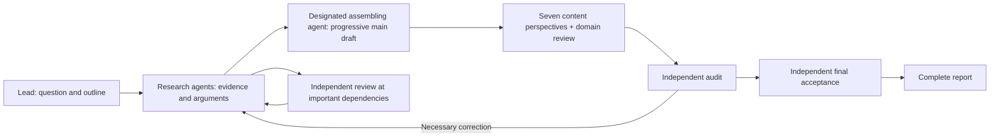

# Research Toolkit

[](./LICENSE) [](https://github.com/rrrrrredy/research-toolkit/actions/workflows/framework-checks.yml)

[English](./README.md) · [简体中文](./README.zh-CN.md)

**Develop long-form research in English or Chinese from a question or existing material, with concrete judgments and traceable sources.**

Use it for long-form research and writing across fields, including industry, companies, technology, policy and science. Start a new study, revise an existing report against its sources, or update conclusions when new material arrives. Agents operate Toolkit to research, write and independently review; the report serves its specified readers and purpose. Toolkit connects methods, evidence and deliverables through one research entry and optional task tools.

[**Choose an entry**](#which-should-i-use) · [Start research](#quick-start) · [See a research case](#research-case) · [Documentation](#documentation)

## How does a study get done?

The lead agent maintains the research question, effective requirements and overall judgment. Research agents investigate, compare, calculate and write substantial parts. A designated assembling agent reads their full work and sources, reconciles the argument and develops the main report progressively. Different independent agents review it, audit the findings and accept the final version.

| Responsibility | How the work connects |
| --- | --- |
| Task and context | Keep the current brief, outline, effective requirements and dependencies together. Satisfied requirements remain visible when they still constrain later work. |
| Evidence and analysis | Give each researcher a bounded question, relevant original material and related findings. Preserve its evidence, reasoning, conditions and unresolved questions in the handoff. |
| Writing and revision | Develop meaningful research units, review premises before dependent work, and integrate their complete analysis into one owned main draft. Changes return to affected units and the outline. |
| Review and delivery | Complete seven separate content-review perspectives, relevant domain review, independent audit and final acceptance against the current report and sources. Resolve necessary corrections before delivery. |

These are four connected responsibilities, not four fixed agents or four independent pipelines. Codex, Claude Code and similar agent tools run the agents and carry messages; Toolkit provides shared inputs, methods, artifact relationships and completion checks. Native collaboration does not require separate API setup. For script-managed execution, the shared [Agent execution adapter](docs/usage-modes.md#agent-host-execution) connects to Claude Code, OpenCode or Codex, according to the current agent tool. [Research steps](docs/quickstart.md#research-from-scratch) · [Handoff and calls](docs/usage-modes.md#research-delegation-and-handoff)



## Which should I use?

**The Skill provides research methods, CLI and MCP expose the same local tools, and the plugin bundles the Skill with MCP.** Choose an entry by your agent environment and need for saved task state; all use the same research and writing methods.

| Your situation | What to use or install | How to start |
| --- | --- | --- |
| You want your existing agent to follow the research methods | **Skill**: read the methods directly, or install them for repeated use. The methods themselves need neither Python nor MCP; default first-use setup is explained below. | Send the request below; the agent reads methods as needed and uses its existing research and writing capabilities. |
| You want methods and task tools together, and your agent tool supports plugins | **Plugin**: installs the Skill and MCP together; local tools need Python 3.10+ and MCP dependencies. | Follow the [plugin instructions](./docs/usage-modes.md#install-the-plugin), reopen the session, select Toolkit and describe the research. |
| You need saved task state, recovery and links between sources and drafts, and your agent tool supports local MCP | **MCP**: configure the local service and use the same Skill for methods. No separate MCP setup is needed if the plugin already supplies it. | Follow the [MCP setup](./docs/usage-modes.md#connect-mcp-separately); the agent calls `research_*` tools. |
| You work in a terminal or script, or your agent tool has no MCP support | **CLI**: download the repository and use Python 3.10+; no MCP dependencies needed. | The agent reads the same Skill and invokes the same task tools through the [command line](./docs/usage-modes.md#skill-only-and-cli-fallback). |

For a first use, start directly with the Skill. Add task tools when persistent state, tool-managed reviews or delivery checks help the work, not because a report reaches a word count. You do not need to install all four or use them in sequence. Skill-only use supports in-depth long reports without requiring the tools' CSV/JSONL registries or delivery receipts.

**Which tasks fit?** Long-form research in English or Chinese across fields, requiring multiple sources, comparison, explanation or supported recommendations. This includes developing summaries and local arguments within a long report, revising existing work and continuing it with new evidence. Simple factual questions, routine translation or minor wording edits usually need only your existing agent. The agent uses its available search and source-access capabilities to obtain and read the material.

[Research from scratch](./docs/quickstart.md#research-from-scratch) · [Revise or update a report](./docs/quickstart.md#revise-or-update-a-report) · [Install for your agent tool](./agents/README.md#choose-your-tool)

**What happens on first use?** You can read the methods directly without installing a Skill or MCP. In Codex, Claude Code and OpenCode, the agent automatically reuses or downloads a complete local copy and uses the bundled Python 3.10+ script as needed to configure basic usage recording for the current project. It reuses unchanged configuration, including active plugin hooks and an existing off setting. Only added or changed configuration needs loading through the agent tool; an already-open Codex session needs a reload or reopening for those changes. The agent uses the tool's available status to check activation rather than inferring it from a saved configuration file. If Python, command access, setup or loading is unavailable or fails, it states the actual status and continues research. Basic operation events are sent by default, excluding conversations, reports and local paths; recording can be turned off. The agent explains this once on first use and handles setup rather than assigning the user a separate installation step. [Setup, collected data and controls](./docs/usage-data.md).

<a id="usage"></a>

## Quick start

Describe your question or requested revision in your own words to an agent that can read the repository and sources. The example below is a starting point; you do not need to fill in undecided details. The agent uses existing context to propose an approach and clarifies only consequential gaps. You can start with the repository link; the agent handles the first-use configuration described above.

```text
Use Research Toolkit: https://github.com/rrrrrredy/research-toolkit
Read SKILL.md and follow the methods needed for this task.

I want to understand or resolve: [The question, or what to change in an existing report.]
Report target readers and intended use: [Who will read the report and why, if known.]
Material and explicit requirements: [Sources, scope, cutoff, format or length, if available.]

Deliver a complete report that answers these questions with usable citations;
include a short change note when revising.
```

[**Start research: one usage guide**](./docs/quickstart.md)

One method set supports long-form and in-depth research, revisions and updates. The request determines scope, length and depth; the agents load methods for their current work and complete independent review, audit and acceptance.

**Only need to review an existing report?** Use the standalone [Research Review](https://github.com/rrrrrredy/research-review) Skill. Toolkit already includes these review capabilities; existing users do not need a second installation.

Have a draft or new material? [Revise or update existing research](./docs/usage-modes.md#continue-existing-research), reusing completed research and its sources.

## Research case

**Test-Time Compute for Reasoning Models and Agents.** Compare sampling, search, revision, verification and tool feedback, then identify which operation should receive additional work. The report connects empirical scaling behavior to a method-and-evidence matrix, a worked allocation example and a design decision tree. Evidence cutoff: **9 November 2026**.

[**Read the full report**](https://rrrrrredy.github.io/research-toolkit/case-study/long-research-2026-11/test-time-compute.en.html) · [Independent Chinese report](https://rrrrrredy.github.io/research-toolkit/case-study/long-research-2026-11/test-time-compute.zh-CN.html) · [First draft, sources and independent reviews](./evals/studies/2026-11-09-long-research/reports/test_time_compute_en/README.md)

The other new case examines **China’s microdrama market**: growth definitions, distribution models, platform competition and value-chain cash flows. It develops platform comparisons and reproducible operating scenarios, showing how traffic, rights, contracts and cash exposure shape participants’ returns.

[**Chinese report**](https://rrrrrredy.github.io/research-toolkit/case-study/long-research-2026-11/microdrama.zh-CN.html) · [English report](https://rrrrrredy.github.io/research-toolkit/case-study/long-research-2026-11/microdrama.en.html)

The two language versions independently use each question’s frozen materials; neither author receives the other-language report. The [current benchmark](./evals/studies/2026-11-09-long-research/README.md) contains 13 independent questions and 15 report assignments, retaining first outputs, located defects and revisions. Earlier office-agent, API/browser and report-update cases remain in the [archive](https://rrrrrredy.github.io/research-toolkit/case-study/index.html).

<a id="use-as-an-mcp-server"></a>
<a id="review-and-acceptance"></a>
<a id="inside-the-toolkit"></a>

## Agent setup

| How you want to use it | Entry |
| --- | --- |
| Read the methods directly | Send the request above; for files or text-only chats, see [agent setup](./agents/README.md#use-without-installation). |
| Install a Skill or plugin | [Choose your agent](./agents/README.md#choose-your-tool) · [Plugin installation](./docs/usage-modes.md#install-the-plugin) |
| Save progress and call workflow tools | [MCP installation and client configuration](./docs/usage-modes.md#connect-mcp-separately) · [CLI](./docs/usage-modes.md#skill-only-and-cli-fallback) |
| Try the local tools | [Runnable MCP example and captured responses](./examples/mcp/README.md); synthetic examples explain the interface, while real execution records retain their actual review scope. |

Nine local tools provide shared task context, on-demand methods, source and analysis saving, registered release-log queries, reviews and delivery checks. CLI and MCP use the same implementation. MCP requires Python 3.10+ and a client that can launch local processes; setup covers Windows, macOS and Linux.

Independent review uses fresh agent contexts. Each required perspective has its own reviewer; authors and assembling agents do not review their own work. Audit and final acceptance have separate assignments. CLI/MCP retains the original agent responses and input versions through the same `research_review` operation. [Review and acceptance](./docs/review-completion.md)

<a id="evaluation-suite"></a>
<a id="evaluation-results"></a>

## Evidence and evaluations

Public records include complete reports, original failures, reviews and repairs. Case studies document report corrections, model comparisons cover their recorded tasks and conditions, and software checks cover tested workflow behavior. Broader quality or efficiency comparisons with native agents require comparable research tasks, inputs, models and execution conditions.

[Current evidence and limits](./docs/evaluation-status.md) · [Complete-report version comparison](./evals/studies/2026-10-13-before-after/README.zh-CN.md) (Chinese) · [Datasets and checks](./evals/README.md) · [Historical data archive](https://github.com/rrrrrredy/agent-trajectory-data/blob/main/docs/PUBLIC-EVALUATIONS.md)

## Documentation

| Need | Entry |
| --- | --- |
| Research and writing methods | [Research guide](./docs/research-guide.md) · [Skill instructions](./SKILL.md) |
| Delegate research and integrate results | [Collaboration and requests](./docs/usage-modes.md#research-delegation-and-handoff) · [Research production and handoff](./references/subagents-and-review-loop.md#research-production-and-handoff) |
| Existing reports and source updates | [Continue existing research](./docs/usage-modes.md#continue-existing-research) |
| Installation and configuration | [Agent setup](./agents/README.md) · [Usage guide](./docs/usage-modes.md) |
| Development and changes | [Contributing](./CONTRIBUTING.md) · [Changelog](./CHANGELOG.md) |

[All documentation](./docs/README.md) · [Website](https://rrrrrredy.github.io/research-toolkit/) · [Submit a failure case](https://github.com/rrrrrredy/research-toolkit/issues/new?template=failure-case.yml)
