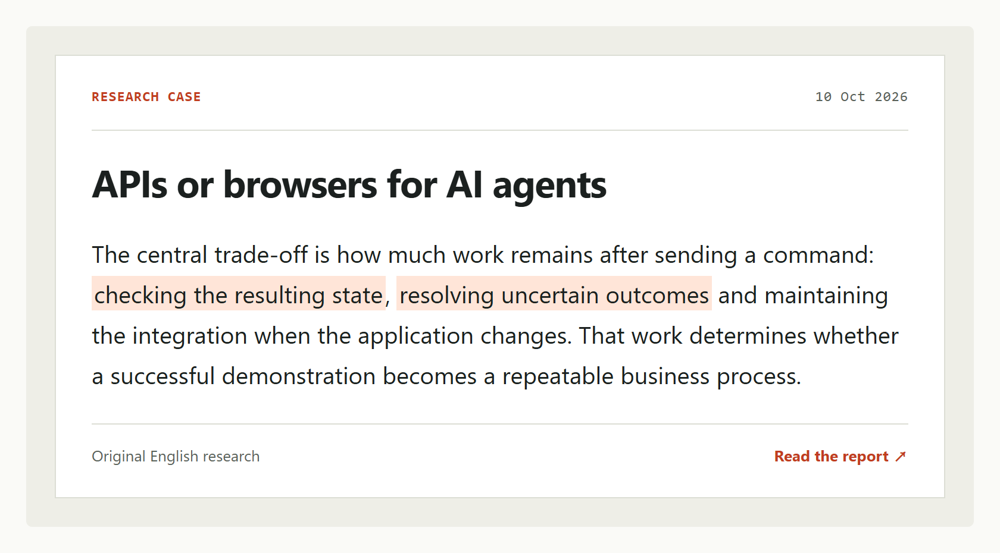
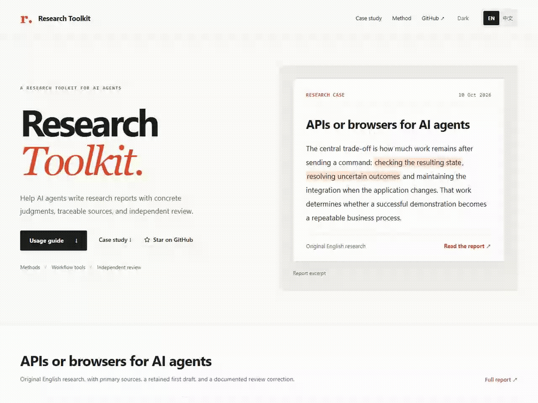

# Research Toolkit

[](./LICENSE) [](https://github.com/rrrrrredy/research-toolkit/actions/workflows/framework-checks.yml)

[English](./README.md) · [简体中文](./README.zh-CN.md)

**Turn a research question or existing material into a report with concrete judgments and traceable sources. Lite and Full share the same research baseline.**

Research methods · Callable workflow tools · Review choices. For industry research, product comparisons, company analysis, and technical research.

[**Choose a workflow and start**](#quick-start) · [Use with your agent](#usage) · [Research case](#research-case) · [Evaluation results](#evaluation-results) · [Lite guide](./docs/quickstart-lite.md) · [Documentation](#documentation)

Read a complete report: [APIs or browsers](./docs/case-study/api-or-browser/report.md) · [Office agents in China (Chinese)](./docs/case-study/report.zh-CN.md). Both retain drafts, sources and revision records; the case section below shows the changes in reasoning.

## Quick start

| Workflow | Fits | Completion work |
| --- | --- | --- |
| [Lightweight workflow (Lite)](./docs/quickstart-lite.md) | Bounded research with manageable consequences where author checks fit the use | Source/claim records and final author checklist |
| [Complete workflow (Full)](./docs/quickstart-full.md) | Complex comparisons, conflicting evidence, formal delivery or explicit review requirements | Selected review tier, revision checks and delivery consistency |

Both answer required questions, read mandatory material, check claims and calculations, address counterevidence and write for the reader. Length is not a profile cap; Full does not automatically mean independent review. Send this request to an agent for a recommendation and brief explanation, or state your choice:

```text
Use Research Toolkit:
https://github.com/rrrrrredy/research-toolkit
Read SKILL.md and load the methods by stage.

Research question: [Include the question, audience, and intended use.]
Scope and length: [Include scope, information cutoff, length and counting unit.]
Existing material: [Attach files or links, including any existing report.]

Recommend Lite or Full from the consequences of error, evidence complexity,
intended use and review needs; briefly explain the choice and respect mine.
Use the context to establish the brief; ask only about consequential gaps.
Read required sources, check important claims and calculations, and develop
comparisons, counterevidence and conclusions for the intended reader.
Reuse existing research and correct affected passages when material changes.
Lite completes the author checklist; Full adds the chosen review, revision
and delivery checks. State the review actually performed.
Deliver the complete report with usable citations and a short change note
when revising. Maintain working records yourself, separately from the report.
Use MCP/CLI for saved progress and checks when connected.
```

Receive the **complete report, important findings and necessary sources**, plus a change note for revisions. The agent maintains accessible source/claim records, author checks and any reviews separately. Apply the methods directly; connect MCP/CLI when you want saved task state and callable checks.

[**Lite guide**](./docs/quickstart-lite.md) · [**Full guide**](./docs/quickstart-full.md) · [Choose your agent](./agents/README.md#choose-your-tool)

Have a draft, need review, or received new material? [Continue existing research](./docs/usage-modes.md#continue-existing-research) without re-entering the brief or restarting completed work. The Lite walkthrough uses a small teaching example, not an analytical limit.

Found a problem? [Submit a failure case](https://github.com/rrrrrredy/research-toolkit/issues/new?template=failure-case.yml) with a report excerpt and sources.

## Research case

<a href="https://github.com/rrrrrredy/research-toolkit/blob/main/docs/case-study/api-or-browser/report.md">
<picture>
  <source media="(prefers-color-scheme: dark) and (max-width: 600px)" srcset="./docs/assets/api-browser-case.en.mobile.dark.png">
  <source media="(max-width: 600px)" srcset="./docs/assets/api-browser-case.en.mobile.png">
  <source media="(prefers-color-scheme: dark)" srcset="./docs/assets/api-browser-case.en.dark.png">
  
</picture>
</a>

[**Full report**](./docs/case-study/api-or-browser/report.md) · [Initial draft](./docs/case-study/api-or-browser/initial.md) · [Sources](./docs/case-study/api-or-browser/sources.md) · [Reviews and revision](./docs/case-study/api-or-browser/reviews.md)

**APIs or browsers: how to choose an execution route for an AI agent.** Written in English from 11 primary English sources, this report compares supported APIs, DOM automation, and visual interaction through completion, retries, permissions, recovery, and cost.

<details open>
<summary><strong>New API coverage does not settle the migration decision</strong></summary>

**Initial draft**

> There is no benefit in preserving this split if the API later covers document generation with adequate permissions and result checking.

**Final report**

> If the API later covers document generation with adequate permissions and result checking, the original coverage gap disappears. Retiring the browser step then depends on whether the expected maintenance and recovery savings justify migration and revalidation costs.

The independent review identified a missing counterexample: an existing browser step can remain worthwhile when replacing and revalidating it costs more than the expected savings. The author accepted the finding and qualified the recommendation.

[Full passages and reasoning](https://rrrrrredy.github.io/research-toolkit/?lang=en&case=migration&detail=reason#case) · [Original review and decision](./docs/case-study/api-or-browser/reviews.md#migration-costs)

</details>

Public-source analysis, 10 October 2026. The workflow is illustrative; no deployment or comparative performance experiment was conducted. This case does not establish a general Toolkit quality advantage. [Evaluation status](./docs/evaluation-status.md)

<details>
<summary>Case walkthrough</summary>

[](./docs/assets/api-browser-walkthrough.en.mp4)

[Video](./docs/assets/api-browser-walkthrough.en.mp4) · [Interactive case](https://rrrrrredy.github.io/research-toolkit/?lang=en&case=migration#case)

</details>

## Usage

[Lite](./docs/quickstart-lite.md) and [Full](./docs/quickstart-full.md) both work by reading the methods directly; choose from use, evidence and review needs.

Start with the shared [research instructions in SKILL.md](./SKILL.md). Your agent reads that entry point and follows its links to the methods needed at each stage. Native Skill installation is optional.

Send this request to an agent that can read GitHub and access the required sources:

```text
Use Research Toolkit:
https://github.com/rrrrrredy/research-toolkit
Read SKILL.md and load the methods by stage.

Research question: [Include the question, audience, and intended use.]
Scope and length: [Include scope, information cutoff, length and counting unit.]
Existing material: [Attach files or links, including any existing report.]

Recommend Lite or Full from the consequences of error, evidence complexity,
intended use and review needs; briefly explain the choice and respect mine.
Use the context to establish the brief; ask only about consequential gaps.
Read required sources, check important claims and calculations, and develop
comparisons, counterevidence and conclusions for the intended reader.
Reuse existing research and correct affected passages when material changes.
Lite completes the author checklist; Full adds the chosen review, revision
and delivery checks. State the review actually performed.
Deliver the complete report with usable citations and a short change note
when revising. Maintain working records yourself, separately from the report.
Use MCP/CLI for saved progress and checks when connected.
```

Replace the bracketed text with your research request. Include any known audience, scope, length, time cutoff, or required sources.

[Setup for your agent](./agents/README.md#choose-your-tool) covers tool-specific installation and file access.

| Your agent's capabilities | How to provide the toolkit |
| --- | --- |
| Can read GitHub | Send the repository link and research request above. |
| Can read local files or attachments | [Download the repository](https://github.com/rrrrrredy/research-toolkit/archive/refs/heads/main.zip), provide `SKILL.md`, and make the reference files available as needed. |
| Accepts text only | Paste the full `SKILL.md` and the reference sections needed for the task. See [chat-only use](./agents/README.md#chat-only-use). |
| Supports native Skills | Install a complete toolkit copy through the host's supported Skill mechanism. See [agent setup](./agents/README.md). |
| Small research task | Use `research_start(profile="lite")` or CLI `start --profile lite`: retain the brief, claims, section drafting and checklist; skip review and full delivery hard gates. |

**Optional workflow tools.** An agent that can start a local MCP server can use the seven tools for task records, stage guidance, review calls, and delivery checks. A compatible plugin bundles the same methods and tools. [Plugin and MCP configuration](./docs/usage-modes.md)

Reading the instructions does not start MCP or execute a review. Full returns a self-review prompt when no backend is configured; configure any supported backend for external or independent opinions. [Backend setup and data destinations](./SKILL.md#reviewer-backends)

## Use as an MCP server

For callable tools, get the repository and install into a virtual environment:

```bash
git clone https://github.com/rrrrrredy/research-toolkit.git
cd research-toolkit
```

Use Python 3.10+ in a dedicated virtual environment. From the cloned repository:

**macOS / Linux**

```bash
python3 -m venv .venv
.venv/bin/python -m pip install -r requirements-mcp.txt
.venv/bin/python -c "import sys, mcp; print(sys.executable)"
```

**Windows PowerShell**

```powershell
py -3 -m venv .venv
.\.venv\Scripts\python.exe -m pip install -r requirements-mcp.txt
.\.venv\Scripts\python.exe -c "import sys, mcp; print(sys.executable)"
```

If Windows has no `py` launcher, use your installed Python 3.10+ executable in the first command. Use the printed absolute interpreter path as the MCP `command`; no environment activation or PowerShell execution-policy change is needed. If Linux reports that `venv`/`ensurepip` is missing, install your distribution's venv package (commonly `python3-venv` on Debian/Ubuntu), then recreate the environment. An `externally-managed-environment` error usually means the install used system Python: rerun pip through `.venv` as above. See the [Python venv documentation](https://docs.python.org/3/library/venv.html).


**Claude Desktop / Cursor:** merge this JSON into Claude Desktop's `claude_desktop_config.json` (Settings → Developer → Edit Config) or Cursor's `.cursor/mcp.json`. Replace all three absolute paths. Keep research tasks outside the checkout.

```json
{
  "mcpServers": {
    "research-toolkit": {
      "type": "stdio",
      "command": "/absolute/path/to/research-toolkit/.venv/bin/python",
      "args": ["/absolute/path/to/research-toolkit/scripts/research_mcp.py"],
      "env": {
        "RESEARCH_TOOLKIT_WORKSPACE": "/absolute/path/to/research-tasks"
      }
    }
  }
}
```

**Codex CLI / IDE:** its native configuration is TOML, not `mcpServers` JSON. Add the equivalent to `~/.codex/config.toml`:

```toml
[mcp_servers.research-toolkit]
command = "/absolute/path/to/research-toolkit/.venv/bin/python"
args = ["/absolute/path/to/research-toolkit/scripts/research_mcp.py"]

[mcp_servers.research-toolkit.env]
RESEARCH_TOOLKIT_WORKSPACE = "/absolute/path/to/research-tasks"
```

Restart the client and confirm the seven `research_*` tools appear. Set `command` to the printed absolute path; on Windows, for example, `C:/tools/research-toolkit/.venv/Scripts/python.exe`. Forward slashes work in JSON paths. [Client documentation and troubleshooting](./docs/usage-modes.md#connect-mcp-separately).

**A captured Full example with self-review.** Lite skips review; this small real Full task using fictional source material demonstrates the review call without an external account. The agent supplies the report and evidence files between guidance and review.

| Call | Input excerpt | Actual response excerpt |
| --- | --- | --- |
| `research_start` | `{"task":"shipment-note","profile":"full","brief":…}` ([complete input](./examples/mcp/start.json)) | `{"ready_for_collection":true,"profile":"full","missing_fields":[],"stage":"collect"}` |
| `research_guide` | `{"stage":"draft","language":"en","profile":"full"}` | `{"stage":"draft","profile":"full"}`; method text omitted |
| `research_review` | `{"task":"shipment-note","evidence_paths":["source.md"],"reviewer":"self"}` | `{"reviews_complete":false,"action_required":"self_review","reviewer":"self","review_strength":"degraded"}` |
| `research_review` again | Submit the [self-review](./examples/mcp/self-review.json) plus the returned `input_version` | `{"reviews_complete":true,"reviewer":"self","review_strength":"degraded"}` |
| `research_check_draft` | Check current draft records and explicit length bounds without model calls or changing task state. |
| `research_finish` | `{"task":"shipment-note","message":"The fictional shipment note is complete, with self-review only and no independent review."}` | `{"completed":true}` |

[Captured inputs/outputs](./examples/mcp/captured.json) · [Run the example](./examples/mcp/README.md). These are local server responses, not efficacy results; the example replays a supplied author review and makes no external model call.

**MCP demo recording:** pending. [GIF/asciinema recording slot and instructions](./docs/assets/mcp-demo.md).

## Review and Acceptance

| Tier | Setup and trade-off |
| --- | --- |
| `self` | Zero configuration; role switch in the author context, recorded as degraded self-review. |
| `external` | One command or endpoint; retain the structured review and original response. |
| `independent` | Separate contexts; preserve existing version binding, recovery and task-required auditing. |

Without a configured backend, review falls back to self; declared independent requirements are never silently downgraded, and Lite skips review. [Configuration checks and backends](./docs/usage-modes.md#reviewer-backends) explain data destinations, account usage and recovery.

## Inside the toolkit

| Component | What it provides |
| --- | --- |
| **Research methods** | Scope, source assessment, judgments, analysis, writing, and revision, loaded by your agent by stage. |
| **Workflow tools** | Task creation, saved progress, method loading, review calls, and delivery checks. |
| **Independent review** | A non-author context examines the whole report and evidence; findings and revision decisions are retained. |

Your agent performs retrieval, reading, analysis, and writing with its own capabilities. The plugin bundles the Skill, methods, and local MCP server. The Skill and MCP can also be used separately.

<details>
<summary>The seven MCP tools</summary>

| Tool | Function |
| --- | --- |
| `research_start` | Create a task and check the brief and review configuration. |
| `research_status` | Read and save progress; check source and claim records for stage transitions. |
| `research_guide` | Load the methods for the current stage. |
| `research_review` | Bind the report and evidence, run reviews, and retain replies or failures. |
| `research_check_draft` | Check current draft records and explicit length bounds without model calls or changing task state. |
| `research_finish` | Check the current report, unresolved requirements, reviews, and delivery text. |
| `research_check_reviewer` | Inspect backend configuration, dependencies and supported local login probes without model calls. |

[Tools and execution boundaries](./docs/usage-modes.md#what-happens-during-a-task)

</details>

## Evaluation Suite

<a id="evaluation-results"></a>

Existing and future user tasks, development tasks, reference tests and cases are real independent tasks; tests actually executed are real tests. Task identity follows the research question, so repeated runs of one task remain repeated runs. Source materials retain their stated provenance, including supplied or constructed data. Astra in a separate context can review independently; no outside person, different model vendor or additional external material is required. Changes to task assignment, reviewer inputs or acceptance criteria require targeted revalidation.

**The public archive includes with/without-toolkit development comparisons and a fixed-source Lite pilot. They expose workflow and report weaknesses; they do not establish a general quality advantage.**

| Experiment groups | Control design | Blind-review scope and limits | Core conclusion |
| --- | --- | --- | --- |
| [2 public development pairs](./evals/diagnostics/2026-09-07/calibration-provenance.json), 4 original reports | With/without toolkit; toolkit first in both tasks | Development diagnostics and later repair reviews; no blinded efficacy result | Useful evidence alongside weaknesses in conclusion priority, reader navigation and evidence use. |
| [11 retained historical families](./docs/evaluation-status.md), 22 review inputs | Historical paired study; author failures retained, supplemental runs separate | Historical study records; see archived inputs and masking limitations | Primary view: both arms had necessary defects in 5 families; 6 were unresolved. Useful for development feedback. |
| [5 shared task families × 4 author models](./evals/studies/2026-10-10-lite-four-models/README.md) | Same-model, same-brief fixed sources; seeded run order and A/B labels | One label-masked LLM judge per usable pair; report clues and execution failures retained | All 20 model–task pairs have judgments; preferences vary. Original failures and supplemental results remain separate. |
| [23 synthetic bad/control pairs](./evals/semantic_diagnostics/) | Short failure-mode excerpts, not complete report comparisons | [Available model diagnoses](./evals/semantic_diagnostics/reviews/2026-09-08/) retain missed defects and disagreements | They locate review weaknesses and support regression work, not toolkit efficacy. |

**Evidence boundary:** public run records do not establish that each pair in the first two collections used the same model and brief, or fully document blinded dimensions and condition masking. Later repair reviews knew the author’s thesis. No toolkit win rate is reported here. The original 7 research tasks are in Chinese; the 23 synthetic diagnostics include 18 Chinese and 5 English pairs. This remains limited coverage, and the English showcase is not an additional controlled pair.

Detailed reports: [public reports and repairs](./evals/diagnostics/2026-09-07/) · [evaluation evidence and version boundaries](./docs/evaluation-status.md) · [evaluation standard](./docs/report-evaluation-standard.md).

Verify the two public development pairs offline (no model calls). Prefer `python3` on Linux (Python 3.10+, standard library only):

```bash
python3 scripts/reproduce_calibration.py
```

The [archive verification script](./scripts/reproduce_calibration.py) checks the frozen public bundle and all four original report hashes, then writes `evals/runs/calibration-reproduction/inventory.json` and `inventory.md`. Use a new `--output` directory to repeat it. This reproduces an archive inventory, not historical model generations or a quality score. [The existing conformance runner](./scripts/run_evals.py) checks task artifacts separately ([command and outputs](./evals/README.md#run-an-eval)).

[The four-model Lite pilot](./evals/studies/2026-10-10-lite-four-models/README.md) now has judgments for all 20 model–task pairs across five shared task families. It publishes all 40 first author attempts plus 20 separately recorded author requests, retaining original failures and every judgment. [Model rerun commands and artifacts](./evals/studies/2026-10-10-lite-four-models/README.md#inspect-and-reproduce) · [Protocol and harness](./docs/eval-protocol.md). This fixed-source, instruction-only pilot does not validate Full or MCP, and does not change the historical n=2, unblinded, toolkit-first limitations.

The historical inventory is dated September 21, 2026: one of the original 12 families was excluded after results were known; 12 of 22 original author attempts failed and supplemental reports did not replace those failures. Additional historical materials are now available in the [public data archive](https://github.com/rrrrrredy/agent-trajectory-data/blob/main/docs/PUBLIC-EVALUATIONS.md). Software checks and historical studies do not validate the current workflow's general research quality.

[Submit a failure case](https://github.com/rrrrrredy/research-toolkit/issues/new?template=failure-case.yml) to help expand the known-bad regression cases.

## Documentation

| Topic | Entry |
| --- | --- |
| Research methods, writing standards, and full instructions | [Research guide](./docs/research-guide.md) · [Stage methods](./references/) |
| Plugin, Skill, MCP, and agent setup | [Usage and configuration](./docs/usage-modes.md) · [Agent setup](./agents/README.md) |
| Reports, sources, and real revisions | [Case archive](./docs/case-study/api-or-browser/README.md) |
| Evaluation materials, defects, and evidence limits | [Evaluation suite](./evals/README.md) · [Evaluation status](./docs/evaluation-status.md) |
| Development, contributions, and releases | [Contributing](./CONTRIBUTING.md) · [Changelog](./CHANGELOG.md) |

[All documentation](./docs/README.md) · [Research instructions](./SKILL.md) · [Website](https://rrrrrredy.github.io/research-toolkit/)

Contribute research questions, usage feedback, or failure cases through [Issues](https://github.com/rrrrrredy/research-toolkit/issues/new), and improve methods and tools through [pull requests](https://github.com/rrrrrredy/research-toolkit/compare).
