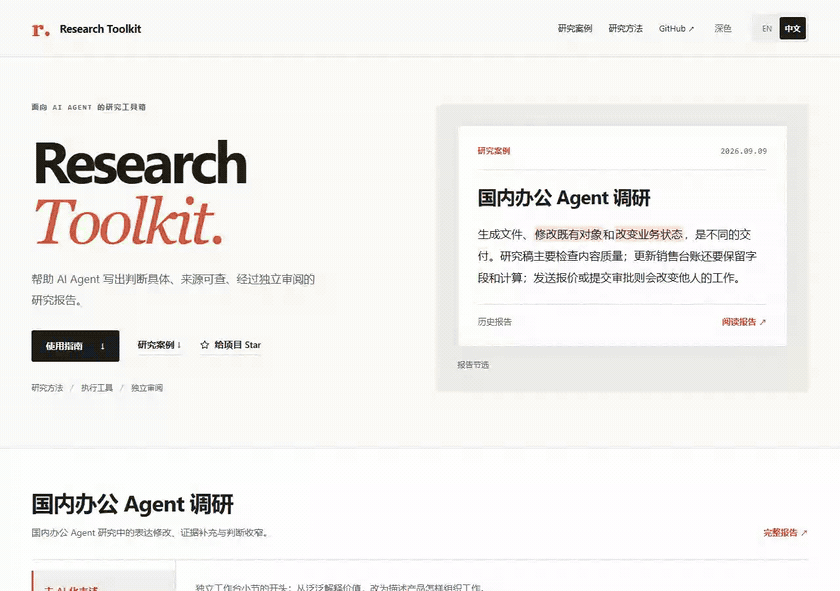

# Research Toolkit

[](./LICENSE) [](https://github.com/rrrrrredy/research-toolkit/actions/workflows/framework-checks.yml)

[English](./README.md) · [简体中文](./README.zh-CN.md)

**从研究问题或已有材料出发，交付判断具体、来源可查的报告。Lite 与 Full 共用研究底线，按任务选择流程。**

研究方法 · 可调用的执行工具 · 可选评审档位。适用于行业研究、产品比较、公司分析和技术调研。

[**选择流程并开始**](#快速开始) · [在你的 Agent 中使用](#使用) · [研究案例](#研究案例) · [评测结果](#evaluation-results) · [Lite 指南](./docs/quickstart-lite.zh-CN.md) · [文档](#文档)

**1.0.0：**[发布说明](./docs/releases/v1.0.0.zh-CN.md) · [1.x 兼容性约定](./docs/compatibility.zh-CN.md)。

先看完整成果：[国内办公 Agent 调研](./docs/case-study/report.zh-CN.md) · [APIs or browsers（英文）](./docs/case-study/api-or-browser/report.md)。两份案例均保留初稿、来源与修订记录，下方可查看关键判断如何修改。

## 快速开始

| 流程 | 适用情况 | 交付时增加什么 |
| --- | --- | --- |
| [轻量流程（Lite）](./docs/quickstart-lite.zh-CN.md) | 边界明确、后果可控，作者自检满足用途 | 来源与判断记录、最终作者自检 |
| [完整流程（Full）](./docs/quickstart-full.zh-CN.md) | 复杂比较、冲突证据、正式交付或明确评审要求 | 所选档位的评审、修订核对、交付一致性检查 |

两种流程都要求完成必答问题和必读材料、核对主张与计算、处理反证，并写出适合读者的报告。篇幅不是档位上限；Full 不自动等于独立评审。将下面请求交给 Agent，由它推荐并解释，或直接指定你的选择：

```text
本次使用 Research Toolkit：
https://github.com/rrrrrredy/research-toolkit
先阅读 SKILL.md，按阶段读取相关方法。

研究问题：[填写问题、读者和用途。]
范围与篇幅：[填写研究范围、信息截止日，以及篇幅和计数口径。]
已有材料：[提供文件或链接，也可附已有报告。]

根据出错后果、证据复杂度、用途和评审要求推荐 Lite 或 Full，
简短解释理由，尊重我的选择。结合上下文明确需求，只追问关键缺项。
读完必需来源，核对重要主张和计算，围绕读者展开比较、反证和结论。
复用已有研究；材料变化时修正受影响的段落。
Lite 完成作者自检；Full 增加所选评审、修订核对和交付检查。
如实说明实际完成的评审。
交付引用可用的完整报告；修订时附简短变化说明。
由你维护工作记录并另行保存，无需我手工整理。
接入 MCP/CLI 时，用现有工具保存进度和执行检查。
```

交付 **完整报告、重要发现及必要来源**，修订时附变化说明。来源／判断记录、作者自检及实际完成的评审由 Agent 另存并提供访问。研究方法可直接使用；需要保存任务进度和自动调用检查时，再接入 MCP/CLI。

[**Lite 指南**](./docs/quickstart-lite.zh-CN.md) · [**Full 指南**](./docs/quickstart-full.zh-CN.md) · [选择你的 Agent](./agents/README.zh-CN.md#选择工具)

已有稿件、需要补评审或来了新材料？直接[接续已有研究](./docs/usage-modes.zh-CN.md#接续已有研究)，无需重填需求或重做已完成的研究。Lite 教学使用小题目，不限制实际分析能力。

遇到问题？[提交失败案例](https://github.com/rrrrrredy/research-toolkit/issues/new?template=failure-case.yml)，附报告片段及来源材料。

## 研究案例

<a href="https://github.com/rrrrrredy/research-toolkit/blob/main/docs/case-study/report.zh-CN.md">
<picture>
  <source media="(prefers-color-scheme: dark) and (max-width: 600px)" srcset="./docs/assets/repository-case.zh-CN.mobile.dark.png">
  <source media="(max-width: 600px)" srcset="./docs/assets/repository-case.zh-CN.mobile.png">
  <source media="(prefers-color-scheme: dark)" srcset="./docs/assets/repository-case.zh-CN.dark.png">
  
</picture>
</a>

[**完整报告（中文原文）**](./docs/case-study/report.zh-CN.md) · [初稿](./docs/case-study/office-agents/original.zh-CN.md) · [定稿](./docs/case-study/office-agents/revised.zh-CN.md) · [来源与审阅记录](./docs/case-study/office-agents/README.md)

这份报告比较 Kimi Work、扣子、飞书／豆包工作、悟空、WPS 和 WorkBuddy。先看两处影响判断的修改：产品关系能否成立，以及执行框架是否等于模型供应方；其后是表达与结构调整：

<details open>
<summary><strong>aily 与豆包工作：收窄版本继承的推断</strong></summary>

**初稿节选**

> 这是当前产品说明与此前功能路线的接续证据

**定稿节选**

> 两个时间点分别展示对象操作和组织上下文协作的产品方向，不足以证明aily与豆包工作的版本继承

两份不同时期的资料可以各自说明产品方向，无法据此认定版本继承或功能迁移。保留各自的能力描述与迁移限制；未证明继承，也不等于证明没有继承。

[来源、差异与审阅取舍](https://rrrrrredy.github.io/research-toolkit/?lang=zh&case=versions&detail=review#case)

</details>

<details>
<summary><strong>扣子用什么模型：区分执行框架与模型供应</strong></summary>

**初稿节选**

> 扣子把原生Agent、托管在云端的第三方Agent和本地接入放在同一协作入口。

**定稿新增**

> 第三方云端模式则在扣子云电脑运行[…]等执行框架，接入扣子提供的模型，不绑定原厂账号与模型。

初稿已区分运行方式与权限；定稿补充原生模型选项和第三方云端的模型供应方式。在这个部署场景中，框架名称不能直接说明底层模型，“扣子提供”也不等于“扣子自研”。

[完整段落、来源与修改理由](https://rrrrrredy.github.io/research-toolkit/?lang=zh&case=analysis&detail=reason#case)

</details>

<details>
<summary><strong>去 AI 化表述：把价值铺垫改成具体动作</strong></summary>

**初稿**

> 独立办公Agent的价值，不在于把聊天框搬到桌面，而在于把资料、执行与修改放进同一段工作。

**定稿**

> 独立办公Agent把资料、执行与修改组织在同一工作空间。

缩短开头，并把段末泛泛的“实现方式不同”展开为谁提供工具、谁保存上下文、谁维持设备在线。可能减少文件搬运的判断和运行限制仍保留。

[完整段落与修改理由](https://rrrrrredy.github.io/research-toolkit/?lang=zh&case=writing&detail=reason#case) · [审阅取舍](./docs/case-study/office-agents/reviews.md#去-ai-化表述中间稿与作者编辑记录)

</details>

<details>
<summary><strong>去过程痕迹：删除章节预告，保留研究边界</strong></summary>

**初稿**

> 以下按工作对象、独立工作台、办公套件、桌面执行与商业化展开。依据是公开产品文档和案例，不含安装实测；单一使用记录不代表行业表现。

**定稿开篇**

> 依据公开文档和案例，不含安装实测；部分动态说明于9月10日核对，不倒推为早期版本的能力。

删除“以下按……展开”和“有三个判断值得先说清楚”。必要的来源、实测和案例代表性说明集中到开篇。这里展示的是删除与重排，两段位于稿件的不同位置。

[段落位置与修改理由](https://rrrrrredy.github.io/research-toolkit/?lang=zh&case=process&detail=reason#case)

</details>

这是一份历史报告：信息截至 2026 年 9 月 9 日，部分动态文档于 9 月 10 日核对；基于公开资料，未安装实测。稿件变化不构成有无工具箱的对照实验。[评测现状](./docs/evaluation-status.zh-CN.md)

<details>
<summary>案例浏览演示</summary>

[](./docs/assets/case-walkthrough.zh-CN.mp4)

[视频](./docs/assets/case-walkthrough.zh-CN.mp4) · [交互案例](https://rrrrrredy.github.io/research-toolkit/?lang=zh&case=versions#case)

</details>

## 使用

[Lite](./docs/quickstart-lite.zh-CN.md) 与 [Full](./docs/quickstart-full.zh-CN.md) 均可直接读取研究方法使用，根据用途、证据复杂度和评审需求选择。

通用入口是 [SKILL.md 中的研究指令](./SKILL.md)，也可阅读[中文版本](./SKILL.zh-CN.md)。Agent 读取入口后，按研究阶段加载它链接的具体方法。原生 Skill 安装是可选方式。

将以下请求发给能够读取 GitHub 并访问所需来源的 Agent：

```text
本次使用 Research Toolkit：
https://github.com/rrrrrredy/research-toolkit
先阅读 SKILL.md，按阶段读取相关方法。

研究问题：[填写问题、读者和用途。]
范围与篇幅：[填写研究范围、信息截止日，以及篇幅和计数口径。]
已有材料：[提供文件或链接，也可附已有报告。]

根据出错后果、证据复杂度、用途和评审要求推荐 Lite 或 Full，
简短解释理由，尊重我的选择。结合上下文明确需求，只追问关键缺项。
读完必需来源，核对重要主张和计算，围绕读者展开比较、反证和结论。
复用已有研究；材料变化时修正受影响的段落。
Lite 完成作者自检；Full 增加所选评审、修订核对和交付检查。
如实说明实际完成的评审。
交付引用可用的完整报告；修订时附简短变化说明。
由你维护工作记录并另行保存，无需我手工整理。
接入 MCP/CLI 时，用现有工具保存进度和执行检查。
```

将方括号内容替换为你的研究需求；已明确的读者、范围、篇幅、信息截止日或必需材料也可一并提供。

[不同 Agent 的接入说明](./agents/README.zh-CN.md#选择工具)介绍各工具的安装与文件读取方式。

| Agent 的能力 | 提供工具箱的方法 |
| --- | --- |
| 能读取 GitHub | 发送上面的仓库链接和研究请求。 |
| 能读取本地文件或附件 | [下载仓库](https://github.com/rrrrrredy/research-toolkit/archive/refs/heads/main.zip)，提供 `SKILL.md`，并按任务需要提供参考文件。 |
| 只能接收文本 | 粘贴完整 `SKILL.md` 及任务需要的参考章节。见[纯聊天使用边界](./agents/README.zh-CN.md#只能在聊天中使用时)。 |
| 支持原生 Skill | 通过该工具支持的技能机制安装完整副本。见[Agent 接入](./agents/README.zh-CN.md)。 |
| 小型研究任务 | `research_start(profile="lite")` 或 CLI `start --profile lite`：保留 brief、claim、分段起草与 checklist，跳过评审和完整交付硬门槛。 |

**可选执行工具。** 能启动本地 MCP 服务的 Agent，可调用七个工具保存任务、加载阶段方法、执行审阅和检查交付。兼容的插件将同一套方法与工具一起安装。[插件与 MCP 配置](./docs/usage-modes.zh-CN.md)

读取指令不会自动启动 MCP 或执行评审。Full 未配置评审后端时返回 self 评审模板；需要外部／独立意见时配置任一受支持后端。[后端配置与材料去向](./SKILL.zh-CN.md#评审后端)

## 作为 MCP 服务使用

需要可调用工具时，先获取仓库，再按下方虚拟环境步骤安装：

```bash
git clone https://github.com/rrrrrredy/research-toolkit.git
cd research-toolkit
```

使用 Python 3.10+，在独立虚拟环境中安装依赖。从已克隆的仓库目录执行：

**macOS / Linux**

```bash
python3 -m venv .venv
.venv/bin/python -m pip install -r requirements-mcp.txt
.venv/bin/python -c "import sys, mcp; print(sys.executable)"
```

**Windows PowerShell**

```powershell
py -3 -m venv .venv
.\.venv\Scripts\python.exe -m pip install -r requirements-mcp.txt
.\.venv\Scripts\python.exe -c "import sys, mcp; print(sys.executable)"
```

Windows 没有 `py` 启动器时，第一条命令改用已安装的 Python 3.10+ 解释器。把打印出的解释器绝对路径填入 MCP 的 `command`；无需激活环境或修改 PowerShell 执行策略。Linux 若提示缺少 `venv`／`ensurepip`，先安装发行版的 venv 包（Debian/Ubuntu 通常为 `python3-venv`），再创建环境。若出现 `externally-managed-environment`，通常是安装时用了系统 Python，改用上面的 `.venv` 解释器运行 pip。见 [Python venv 文档](https://docs.python.org/3/library/venv.html)。


**Claude Desktop / Cursor：**将下面的 JSON 合入 Claude Desktop 的 `claude_desktop_config.json`（Settings → Developer → Edit Config）或 Cursor 的 `.cursor/mcp.json`。替换三处绝对路径，研究任务目录放在仓库之外。

```json
{
  "mcpServers": {
    "research-toolkit": {
      "type": "stdio",
      "command": "/absolute/path/to/research-toolkit/.venv/bin/python",
      "args": ["/absolute/path/to/research-toolkit/scripts/research_mcp.py"],
      "env": {
        "RESEARCH_TOOLKIT_WORKSPACE": "/absolute/path/to/research-tasks"
      }
    }
  }
}
```

**Codex CLI / IDE：**其原生配置采用 TOML，不采用 `mcpServers` JSON。将等效配置加入 `~/.codex/config.toml`：

```toml
[mcp_servers.research-toolkit]
command = "/absolute/path/to/research-toolkit/.venv/bin/python"
args = ["/absolute/path/to/research-toolkit/scripts/research_mcp.py"]

[mcp_servers.research-toolkit.env]
RESEARCH_TOOLKIT_WORKSPACE = "/absolute/path/to/research-tasks"
```

重启客户端，确认能看到七个 `research_*` 工具。`command` 使用上面打印的绝对路径；Windows 例如 `C:/tools/research-toolkit/.venv/Scripts/python.exe`，JSON 路径可用正斜杠。[客户端文档与排查方法](./docs/usage-modes.zh-CN.md#单独接入-mcp)。

**实际采集的 Full 自评示例。** Lite 跳过评审；这个采用虚构来源材料的小型真实 Full 任务展示无需外部账户的评审调用。Agent 在读取方法后、评审前保存报告和证据文件。

| 调用 | 输入节选 | 实际返回节选 |
| --- | --- | --- |
| `research_start` | `{"task":"shipment-note","profile":"full","brief":…}`（[完整输入](./examples/mcp/start.json)） | `{"ready_for_collection":true,"profile":"full","missing_fields":[],"stage":"collect"}` |
| `research_guide` | `{"stage":"draft","language":"en","profile":"full"}` | `{"stage":"draft","profile":"full"}`；省略方法正文 |
| `research_review` | `{"task":"shipment-note","evidence_paths":["source.md"],"reviewer":"self"}` | `{"reviews_complete":false,"action_required":"self_review","reviewer":"self","review_strength":"degraded"}` |
| 再次 `research_review` | 提交[自评内容](./examples/mcp/self-review.json)和返回的 `input_version` | `{"reviews_complete":true,"reviewer":"self","review_strength":"degraded"}` |
| `research_check_draft` | 检查当前稿件记录与显式篇幅，不调用模型、不改变任务状态。 |
| `research_finish` | `{"task":"shipment-note","message":"The fictional shipment note is complete, with self-review only and no independent review."}` | `{"completed":true}` |

[采集的输入与输出](./examples/mcp/captured.json) · [运行示例](./examples/mcp/README.zh-CN.md)。这些是本地服务的真实返回，不是效果评测结果；示例重放已提供的作者自评，不调用外部模型。

**MCP 演示录屏：**待录制。[GIF/asciinema 占位与录制说明](./docs/assets/mcp-demo.zh-CN.md)。

## 评审与验收

| 档位 | 配置与取舍 |
| --- | --- |
| `self` | 零配置，同上下文切换角色；记录标明自评与强度降级。 |
| `external` | 一个外部命令或端点；保留结构化评审及原始响应。 |
| `independent` | 独立上下文；保留既有版本绑定、恢复及任务要求的审计。 |

未配置后端时自动使用 self，已声明的独立评审不能被静默降级；Lite 不运行评审。[配置自查与后端](./docs/usage-modes.zh-CN.md#reviewer-backends)说明材料去向、账户用量和故障处理。

## 工具箱组成

| 组成 | 提供什么 |
| --- | --- |
| **研究方法** | 明确需求、评估来源、形成判断、展开分析、写作和修订；由 Agent 按阶段读取。 |
| **执行工具** | 创建任务、保存进度、加载方法、调用审阅和检查交付条件。 |
| **独立审阅** | 在非作者上下文中检查完整报告及其证据，保留意见与修改取舍。 |

Agent 使用自身的检索、读写和分析能力完成研究。插件将 Skill、方法和本地 MCP 打包在一起；也可以单独使用 Skill 或连接 MCP。

<details>
<summary>七个 MCP 工具</summary>

| 工具 | 功能 |
| --- | --- |
| `research_start` | 建立研究任务，检查需求与审阅配置。 |
| `research_status` | 读取和保存进度，检查阶段所需的来源与主张记录。 |
| `research_guide` | 按阶段加载研究方法。 |
| `research_review` | 绑定稿件与证据，执行审阅并保留回复或失败。 |
| `research_check_draft` | 检查当前稿件记录与显式篇幅，不调用模型、不改变任务状态。 |
| `research_finish` | 检查当前稿件、未解决要求、审阅与交付文本。 |
| `research_check_reviewer` | 本地检查后端配置、依赖与可探测的登录状态，不调用模型。 |

[工具与执行边界](./docs/usage-modes.zh-CN.md#一次研究如何推进)

</details>

## 评测集

<a id="evaluation-results"></a>

现有及以后的用户题、开发题、参考测试和案例均为真实独立任务；实际执行的测试都是真实测试。任务按研究问题区分，同题重复运行仍按重复运行记录。来源材料保留原有出处与性质，包括用户提供或构造的数据。Astra 在单独上下文中即可承担独立评审，无需外部人员、另一家模型或额外外部材料。分工、评审输入或验收标准变化时，应针对受影响部分复验。

**做过对照：公开归档包含用／不用工具箱的开发期比较，以及固定来源 Lite 小型试验。这些材料用于发现流程和报告问题，尚不能证明普遍的质量优势。**

| 实验组数 | 对照设计 | 盲评维度与边界 | 核心结论 |
| --- | --- | --- | --- |
| [2 组公开开发对照](./evals/diagnostics/2026-09-07/calibration-provenance.json)，4 份原始报告 | 使用／不使用工具箱；两题均先运行工具箱组 | 开发诊断与后续修稿评审；未建立盲评效果结论 | 报告提供了可用证据，也暴露出结论排序、读者导航和证据使用问题。 |
| [11 个保留的历史任务族](./docs/evaluation-status.zh-CN.md)，22 份评审输入 | 历史配对研究；保留作者失败，补跑另列 | 历史研究记录；输入及盲评范围见公开归档 | 主视图中 5 族两组都有必要缺陷、6 族未决；适合开发反馈。 |
| [同样 5 个任务族 × 4 个作者模型](./evals/studies/2026-10-10-lite-four-models/README.zh-CN.md) | 同模型、同 brief、固定来源；按种子随机化顺序与 A/B 标签 | 每对可用报告使用一名隐藏标签的 LLM 评审；保留条件线索与执行失败 | 20 对模型—任务均已有评审，偏好不一；原始失败与补充结果分开保留。 |
| [23 组真实任务的反例／对照](./evals/semantic_diagnostics/) | 针对特定缺陷的短片段，不是完整报告对照 | [已有模型诊断](./evals/semantic_diagnostics/reviews/2026-09-08/)保留漏检与分歧 | 可定位评审弱点并做回归，不能据此推断工具箱效力。 |

**证据边界**：公开运行记录尚不足以核实前两类研究中，每一对报告是否使用相同模型与 brief，也未完整记录盲评维度和条件隐藏方式；后续修稿评审知道作者的论点。这里不报告工具箱获胜率。原有 7 个研究任务均为中文；23 组合成诊断包含 18 组中文和 5 组英文，覆盖面仍有限。英文展示案例也不是新增对照实验。

详细报告：[公开原稿与修订稿](./evals/diagnostics/2026-09-07/) · [评测证据与版本边界](./docs/evaluation-status.zh-CN.md) · [评测标准](./docs/report-evaluation-standard.zh-CN.md)。

历史两组开发对照可一条命令离线核验，无需调用模型。Linux 上优先使用 `python3`（Python 3.10+，只需标准库）：

```bash
python3 scripts/reproduce_calibration.py
```

[档案核验脚本](./scripts/reproduce_calibration.py)核对冻结公开包及四份原始报告的哈希，生成 `evals/runs/calibration-reproduction/inventory.json` 和 `inventory.md`。再次运行时通过 `--output` 指定新目录。它复现档案清单，不重新生成历史模型回复或给出质量分。[既有符合性脚本](./scripts/run_evals.py)另行检查任务文件（[命令与输出](./evals/README.zh-CN.md)）。

[四模型 Lite 试验](./evals/studies/2026-10-10-lite-four-models/README.zh-CN.md)已覆盖同样五个任务族的全部 20 对模型—任务，公开 40 次首轮作者尝试、单列的 20 次补跑请求，并保留原始失败和全部评审。[模型重跑命令与产物](./evals/studies/2026-10-10-lite-four-models/README.zh-CN.md#查看与复现) · [协议与脚本](./docs/eval-protocol.zh-CN.md)。固定来源、仅指令试验不验证 Full 或 MCP，也不改变历史 n=2、未盲评及先 Toolkit 后基线的限制。

历史汇总截至 2026 年 9 月 21 日：最初 12 组中有 1 组在结果已知后被排除；22 次原始作者尝试中有 12 次失败，补充报告没有替换这些失败。其余历史材料现已通过[公开数据归档](https://github.com/rrrrrredy/agent-trajectory-data/blob/main/docs/PUBLIC-EVALUATIONS.zh-CN.md)提供。软件检查与历史研究不能证明当前流程具有普遍的研究质量优势。

[提交失败案例](https://github.com/rrrrrredy/research-toolkit/issues/new?template=failure-case.yml)，帮助补充已知失败的回归案例。

## 文档

| 内容 | 入口 |
| --- | --- |
| 研究方法、写作标准与完整说明 | [研究指南](./docs/research-guide.zh-CN.md) · [按阶段的方法](./references/) |
| 插件、Skill、MCP 与 Agent 接入 | [使用与配置](./docs/usage-modes.zh-CN.md) · [Agent 接入](./agents/README.zh-CN.md) |
| 报告、来源与真实改稿 | [案例档案](./docs/case-study/office-agents/README.md) |
| 评测材料、已知缺陷与证据范围 | [评测集](./evals/README.zh-CN.md) · [评测现状](./docs/evaluation-status.zh-CN.md) |
| 开发、贡献与版本变化 | [贡献指南](./CONTRIBUTING.zh-CN.md) · [更新记录](./CHANGELOG.zh-CN.md) |

[全部文档](./docs/README.zh-CN.md) · [研究指令](./SKILL.zh-CN.md) · [网站](https://rrrrrredy.github.io/research-toolkit/?lang=zh)

欢迎通过 [Issues](https://github.com/rrrrrredy/research-toolkit/issues/new) 提交研究需求、使用反馈或失败案例，通过 [Pull requests](https://github.com/rrrrrredy/research-toolkit/compare) 改进方法和工具。
