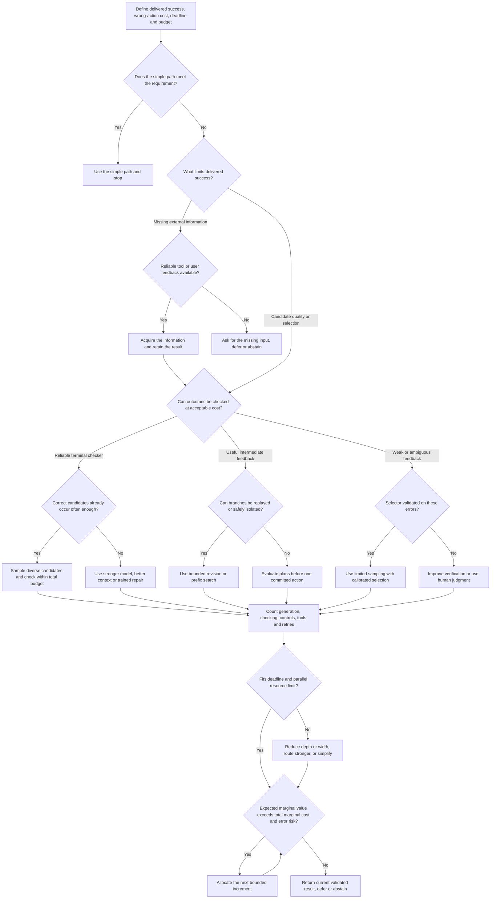

# U7–U8: Resource accounting, worked allocation, and decision policy

Producer: Codex `/root/ttc_research`, 2026-11-09. This contribution supplies original analysis and executable arithmetic for the English report. Proposed policies are explicitly distinguished from reported experimental findings. Calculations were actually executed using `allocation_example.py` and `compute_checks.py`; their outputs are saved as `allocation-results.json` and `calculation-record.json`. They are not model experiments or independent reproductions of papers.

## 1. Count the computation that produces the selected answer

A complete inference ledger is attached to the delivered result, not merely the winning candidate. For policy π and one task, write

`C_total(π) = C_generation + C_verification + C_control + C_tools + C_retries + C_test_time_updates`.

Generation includes every proposed completion and discarded branch. Verification includes prompts, scoring passes, generated critique, answer probes, and any repeated judging. Control includes routing and difficulty estimation if it is done for this request. Tool cost includes execution, retrieval, database calls, environment restoration and any required simulator. Retries include work that failed before it could contribute a candidate. Test-time updates include synthetic data, backward passes and optimizer work when the method adapts weights. A model trained in advance has a separate offline cost, which can be amortized over deployment requests under a stated volume assumption.

When token billing is disclosed, a monetary ledger can be expressed as a sum over calls:

`Cost = sum_j [r_in,j * T_in,j + r_cached,j * T_cached,j + r_reason,j * T_reason,j + r_out,j * T_out,j] + tool charges + infrastructure charges`.

Rates and token categories must not double-count one another: some interfaces include reasoning in output usage, while others expose separate categories. Hidden reasoning tokens belong in cost when billed or measured, even if the model does not reveal their content. If an API only returns a total charge or an opaque reasoning-effort control, report that observable quantity rather than invent a token breakdown. Shared prefill or prefix caching can reduce repeated work, but caching has its own write/read behavior and may not survive all branch layouts.

For a dense transformer, a rough matrix-multiplication estimate often begins with about `2P` FLOPs per token plus attention terms, where P is parameter count. That can support a carefully scoped within-family approximation. It does not turn one token from an 8B dense model, a sparse MoE model, and a different tokenizer into equivalent compute. Active versus total parameters, input context length, attention implementation, precision, batching, cache reuse and memory traffic all matter. FLOPs also do not determine elapsed time: inference can be limited by memory bandwidth or inefficient utilization. TTC010 explicitly uses an approximation including a context-dependent attention term and labels FLOPs a crude resource metric. [Large Language Monkeys, §2.3](https://arxiv.org/html/2407.21787v2).

A cost comparison can therefore be valid at one level and invalid at another. Same-checkpoint generation counts can reveal an algorithmic trend. A complete token and rate ledger can estimate billed money. Measured wall time under a fixed accelerator and concurrency configuration can establish latency. None automatically establishes the other two. TTC008's parameter^γ times token costs are useful sensitivity models; its additive latency-like proxy is explicitly not a parallel service measurement. [Sample, Mix, or Verify?, §4 and limitations](https://arxiv.org/html/2610.23255v1).

## 2. Total work, critical path, and peak resources answer different questions

For a computation graph of generation, checking and tool steps, ideal latency is at least the longest dependency path. Real wall time adds queuing, synchronization, rate limits, environment setup and imperfect scheduling. A sequential revision cannot begin before its preceding answer exists. Independent candidate generation can run concurrently if workers and memory are available. Selection may wait for every candidate, or it may begin as results arrive. Tool calls can be serial because one call supplies an argument for the next.

If N identical candidate-and-check jobs each take t seconds and each worker handles one job at a time, a simplified non-pipelined schedule takes `ceil(N/W)*t` seconds with W workers, versus `N*t` on one worker and t with at least N workers. This is a schedule model, not a universal service law. It makes the distinction concrete: doubling N doubles total work but need not double latency when spare workers exist; conversely, doubling the depth of each trajectory lengthens a dependency path even with unlimited workers.

Peak memory and accelerator demand also matter. A wide search may retain many KV caches and environment snapshots. A deeper single chain can reuse one evolving cache but accumulates longer context. A candidate bank may be cheap to store as text after generation, while keeping many partial branches live is not. A useful report therefore gives at least total cost, maximum or average concurrency, latency distribution, and the hardware configuration when those measurements are available. Missing fields remain missing; they cannot be filled by dividing tokens by an assumed universal decoding rate.

For interactive service, a fixed total budget can be less restrictive than a deadline. A method that is most accurate after thirty seconds of parallel generation may beat one with lower compute usage that requires several sequential rounds. For a batch workload with an overnight deadline, the opposite tradeoff may be reasonable. The objective must reflect that actual use case before choosing a search algorithm.

## 3. Defensible normalization from published records

CodeMonkeys' cost table reports $2,291.90 of LLM inference expense for 500 SWE-bench Verified issues. The arithmetic gives **$4.5838 per issue**. Selection contributes $131.95, or **$0.2639 per issue and 5.76% of the reported total**. Its actual selector improves 45.8% random-selection accuracy to 57.4% against a 69.8% oracle ceiling, recovering `(57.4−45.8)/(69.8−45.8)=48.33%` of that gap. These are calculations from the authors' historic ledger and scores, not new runs. Tool CPU time and full service overhead are not itemized in that ledger. [CodeMonkeys, Tables 1–2](https://arxiv.org/html/2501.14723v1).

This normalization is useful because the selector's cost is included in the reported LLM total. It does not authorize comparison with a current product price or a different benchmark split. It also does not make a one-off benchmark expenditure equal to a production service's marginal cost. Deployment can reuse some fixed work, but may add queuing, cold starts, access control, logging and external API charges. Only components actually required by the task should enter the chosen ledger; the point is complete accounting of the system being compared, not speculative overhead inflation.

TTC005's declared TTSP schedule provides a different kind of normalization. Fifty target-specific GRPO steps, with 16 proposer rollouts and 48×8 solver rollouts per step, imply **20,000 nominal rollout slots per target**. That quantity counts both proposer and solver generations. It does not include test construction, executions, target evaluations, sequence length variation or backward passes. It is therefore useful for checking the scale of the schedule but cannot be divided by another method's sample count to claim an efficiency ratio. The earlier planning estimate of 19,200 corresponds to solver slots only; the complete nominal sum adds 800 proposer slots. [TTSP, Appendix B](https://arxiv.org/html/2611.07367v1).

Similarly, SCoRe's equal-solution-budget comparison can inform how to allocate attempts within its trained policy, but it does not normalize growing revision context into FLOPs. TTC001's fourfold result is a generation-equivalent comparison with difficulty-estimation overhead omitted. TTC007's retained-token frontiers exclude predictor/feature overhead and use labelled probe curves. These findings remain valuable at their declared level; forcing them into a common dollar leaderboard would discard the information needed to interpret them.

## 4. A worked example: generation, verification, consequence, and deadline

Everything in this example is **hypothetical**. The rates are known inputs chosen to illustrate allocation; they are not estimated from a benchmark, current model prices, or a new experiment. A credit is an abstract monetary cost unit, not a FLOP or a token. Each candidate is generated independently conditional on the same task. A verifier accepts correct candidates with true-positive rate τ and incorrect candidates with false-positive rate f. After the budget is spent, the system selects uniformly among accepted candidates; if there are none it abstains, receiving no correctness credit.

| Component | Cost per candidate/call | Duration | Relevant quality input |
|---|---:|---:|---|
| Small generator | 1 credit | 30 seconds | p(correct)=0.20 |
| Strong generator | 4 credits | 45 seconds | p(correct)=0.50 |
| Weak verifier | 0.25 credits | 5 seconds | τ=0.90, f=0.10 |
| Better verifier | 1 credit | 10 seconds | τ=0.90, f=0.02 |

Each candidate is checked once, so a configuration with generator cost g and verifier cost v can afford `N=floor(B/(g+v))` candidates. Let `a=τp` and `s=τp+f(1−p)`. Then

`P(correct submission) = (a/s) * [1−(1−s)^N]`,

`P(wrong submission) = [(s−a)/s] * [1−(1−s)^N]`,

`P(abstain) = (1−s)^N`.

The probabilities sum to one. This is the selector-specific formula analyzed in TTC008 and re-derived in U1; it does not model score-maximizing best-of-N or correlated candidates. The table below was computed by the attached script.

| Budget | Generator + verifier | Candidates | Correct submission | Wrong submission | Four-worker time |
|---:|---|---:|---:|---:|---:|
| 8 | Small + weak | 6 | 57.86% | 25.72% | 70 s |
| 8 | Small + better | 4 | 53.46% | 4.75% | 40 s |
| 8 | Strong + weak | 1 | 45.00% | 5.00% | 50 s |
| 8 | Strong + better | 1 | 45.00% | 1.00% | 55 s |
| 16 | Small + weak | 12 | 67.36% | 29.94% | 105 s |
| 16 | Small + better | 8 | 75.80% | 6.74% | 80 s |
| 16 | Strong + weak | 3 | 78.75% | 8.75% | 50 s |
| 16 | Strong + better | 3 | 82.42% | 1.83% | 55 s |
| 32 | Small + weak | 25 | 69.19% | 30.75% | 245 s |
| 32 | Small + better | 16 | 89.04% | 7.91% | 160 s |
| 32 | Strong + weak | 7 | 89.30% | 9.92% | 100 s |
| 32 | Strong + better | 6 | 95.40% | 2.12% | 110 s |

The scheduler assumes each worker runs generation and verification sequentially for one candidate, then starts the next. There are four identical workers, no setup or queuing cost, and no early stopping or overlapping stages within a worker. These assumptions make the wall-time column auditable. They are not offered as a prediction of a real inference server.

Three decisions follow from the arithmetic.

**First, the best use of money changes with the budget.** At eight credits, cheap sampling with weak checking has the highest correctness probability among the four filtered configurations, despite the better verifier's higher acceptance precision. At sixteen credits, the better-verifier small-model configuration overtakes weak checking, and the stronger-model plus better-verifier configuration is best. Weak checking of small-model candidates has a ceiling of `.18/.26=69.23%`, so increasing the budget from 16 to 32 credits adds only 1.83 percentage points. The same false acceptance floor increasingly dominates the extra candidates.

**Second, consequences can reverse the choice at the same budget.** Suppose a correct submission is worth +1, a wrong submission −4, and abstention 0, with budget enforced as a hard cap. At eight credits, small+weak has utility `0.578626−4*0.257167≈−0.4500`; small+better has about 0.3445; strong+better has `0.45−4*0.01=0.41`. The last configuration is preferable under this loss model, although its raw correctness probability is lower. If a single proposed answer has calibrated correctness probability q, submitting it rather than abstaining requires `q−4(1−q)>0`, or q>0.8. The chosen loss is illustrative, not a universal safety threshold.

There is also a simpler unfiltered baseline. One strong-model answer costs four credits and has 50% correctness, versus 45% after a verifier that rejects 10% of correct answers. With only one candidate, filtering cannot create another correct solution. The filter can still sharply improve risk-weighted utility by converting likely wrong submissions into abstentions. This is why an accuracy-only rule to omit one-candidate verification does not transfer unchanged to costly external actions.

**Third, a deadline changes the feasible allocation before the budget is exhausted.** Impose a 100-second deadline. The full-budget small+weak configuration at 16 credits takes 105 seconds and is infeasible under this schedule; the strong+better configuration takes 55 seconds. At 32 credits, six strong+better candidates require two 55-second waves and miss the deadline. Restricting it to four candidates costs only 20 credits, finishes in 55 seconds, and yields **89.51% correct and 1.99% wrong submissions**. The seven-candidate strong+weak alternative uses 29.75 credits and 100 seconds for 89.30% correct and 9.92% wrong. Under these hypothetical inputs, leaving twelve credits unspent is the better constrained decision.

This last comparison is not an invitation to infer a meaningful empirical 0.21-point advantage from a noisy benchmark. Here the probabilities are exact assumptions. In a real pilot, uncertainty could easily exceed that difference; the lower error risk and shorter latency may still be material, but the ordering of nearly equal accuracies should not be overclaimed.

## 5. An implementable decision tree

The decision tree below is a proposed policy derived from the evidence; its branch conditions must be measured or judged for the actual workload. It is not a learned controller from any cited paper.

“Meets the requirement” is more useful than “the model feels confident.” For an executable coding task it may mean passing relevant tests without breaking required behavior. For a final-state task it may mean achieving the intended database state while respecting the required action procedure. For an open-ended research answer it may mean that the claims needed for the user's decision have adequate source support. Extra computation should address a remaining gap rather than merely prolong the transcript.

Use **more samples** when a pilot shows useful candidate diversity, the acceptance rule is reliable enough, and parallel resources can absorb the work. Use **deeper search** when partial progress has a measurable value signal and pruning saves more work than evaluation consumes. Use **better verification** when correct candidates frequently exist but are not selected, or when false acceptance rises with search. Use **a stronger model** when the weaker generator's useful support is very small, when its failures defeat the available verifier, or when a deadline favors one reliable trajectory over many attempts. Use **a simpler path** when a direct answer already satisfies the requirement, when extra search returns nearly identical candidates, or when the controller has no usable signal for selecting an improvement.

## 6. Estimating the quantities that drive the policy

A representative pilot should separate three observations: how often a useful candidate is generated; how often the deployed selector accepts or prefers a correct versus incorrect candidate; and how much total work the complete procedure requires. The final evaluator should have information not used to overfit the selector where possible, such as held-out tests or a blinded expert rubric. Record failed and discarded work. For agents, record tool errors and whether replay actually restores the relevant state. The request is to measure the real use path, not to add a broad governance framework.

Task-specific estimates matter. A mean success rate from easy and hard tasks does not predict the benefit of another sample on a particular unresolved case. Failure after several attempts is itself evidence that the case is harder or that the generator and verifier share a blind spot. An allocation policy can use that information, but its update rule should be calibrated against representative held-out tasks rather than fitted to the same final outcomes it is credited with predicting.

The key marginal quantity is not merely improvement per generated token. In an accuracy-only objective it is expected additional delivered success per total incremental resource. With consequences, use expected utility: expected gain in correct completion minus the expected loss from wrong external actions, delay and resource consumption. If another unit of work produces no new information and no useful variation, its expected benefit can be near zero even before the nominal budget is exhausted.

Distinguish three reasons a curve flattens. The generator can run out of accessible correct solutions; the selector can become the bottleneck; or the measurement can conceal changes through a weak evaluator or a coarse finite benchmark. These call for different responses. More samples may help only the first case while candidate probability is still nontrivial. Better verification addresses the second. Better measurement addresses the third before any stronger capability claim is made. A fourth reason is self-inflicted regression: optimization begins exploiting a proxy or revision abandons a correct answer. That is a reason to shorten or change the procedure, not to assume the next budget increment will restore the trend.

## 7. Cases where additional inference computation is not the defensible choice

* **The current result already meets the task's completion condition.** Return it. A speculative extra revision can spend latency and introduce mistakes without a concrete unresolved gap.
* **The generator has shown no useful candidate support on the relevant problem class.** Change the model, representation, or information source. Finite zero-success evidence is not a theorem of impossibility, but it can make more of the same sampling a poor allocation.
* **A weak selector cannot distinguish the existing candidates.** Improve the evaluator or ask for judgment. Expanding the pool can make proxy exploitation worse.
* **One candidate is available and the objective is raw accuracy with failed abstention.** A pure rejecting filter cannot raise correctness probability; use it only when its information will enable repair, another candidate, or a different risk objective.
* **The uncertainty is an unavailable fact or unresolved user preference.** Internal continuation cannot observe that fact. Obtain the missing input or state the unresolved choice.
* **Real-world branching would execute costly, irreversible or conflicting actions.** Search in a simulator or evaluate plans before commitment. Without such a facility, broad environmental exploration is not equivalent to harmless candidate generation.
* **The next serial step breaches the deadline.** Reallocate to a parallel or stronger one-pass route when feasible, or return the best supported result within scope.

These endpoints follow from the same objective as the cases favoring more compute. They do not amount to a presumption that shorter outputs are better. Difficult tasks can deserve substantial computation when it buys progress, stronger evidence or reliable completion. The central design task is to identify which operation supplies that value and to account for every operation needed to realize it.
