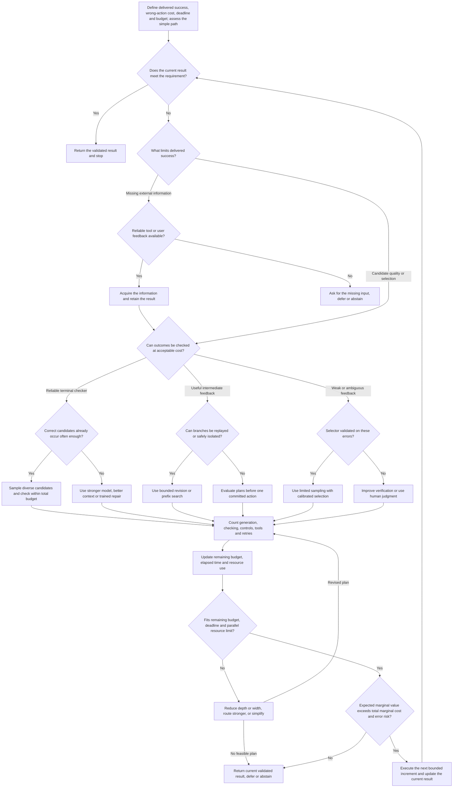

# Test-Time Compute for Reasoning Models and Agents: Methods, Scaling Behavior, and Design Trade-offs

**Evidence cutoff: 9 November 2026.** This report examines selected work published from 2022 through the cutoff, retaining the inspected paper and evaluation versions. Results are author-reported unless labelled as this report's arithmetic or proposed design policy. The original experiments were not independently rerun.

## Research synthesis

Additional inference computation can improve reasoning and agent performance substantially, but the benefit depends on the operation that receives the work. Sampling discovers alternative solutions; revision and prefix search change which solutions are generated; verification determines which candidate reaches the user; tools supply observations unavailable from internal reasoning alone. Training can make these operations productive. A useful allocation policy therefore optimizes the complete inference system, including the cost of selection, feedback and failed work.

The strongest evidence supports conditional choices. Fixed-checkpoint self-consistency can improve mathematical answer accuracy without changing weights. Better process supervision can recover more correct solutions from a common candidate bank. Training specifically for correction can turn a harmful second attempt into a useful one. Coding agents can combine execution feedback with parallel trajectories and explicit selection to improve delivered success. Each result has a different resource and information boundary. A rising probability that a candidate bank contains a solution does not establish rising accuracy of the submitted answer.

Three practical findings recur. First, candidate generation and selection often scale at different rates: oracle coverage can keep growing after practical selectors saturate, and optimizing a weak score can even lower accuracy. Second, the best allocation varies with task difficulty and available feedback; uniform depth or sample counts waste work on already-settled tasks and can underserve promising difficult ones. Third, total work and response latency can move differently. Wide sampling consumes parallel resources, while deep revision and tool dependencies create serial delay.

The design recommendation is to locate the current bottleneck before adding work. Generate more when useful candidates are missing but accessible. Improve verification when those candidates exist but are poorly selected. Use trained repair or partial-state search when intermediate feedback identifies productive changes. Choose a stronger base model when repeated weak attempts share the same blind spot. Stop when the current result meets the requirement or when another increment has less expected value than its resource, delay and error cost. The worked example makes these choices explicit, including a case where the optimal constrained policy leaves budget unspent.

## Scope and comparison discipline

This is a selective technical synthesis rather than an exhaustive literature catalogue or a current-model leaderboard. It connects mathematical reasoning, executable coding and multistep tool interaction through common mechanisms, then preserves their different evaluation conditions. Older studies establish mechanisms; inspected 2026 work tests current questions about selection, termination, imperfect verification and target-specific adaptation. The report does not assume a universal inference scaling law.

Four evidence levels are kept separate: a **shared-bank comparison** isolates reducers over the same candidates; a **fixed-checkpoint end-to-end comparison** changes inference while preserving weights; a **whole-system comparison** can change training, generator and verifier together; and an **oracle diagnostic** uses correctness information unavailable to an online controller. These distinctions follow the explicit evaluation framework in [Test-Time Scaling in Reasoning LLMs, v2](https://arxiv.org/html/2608.04001v2). They determine which findings can support an implementable design choice.

Correctness available to a benchmark author is not automatically available to the deployed system. Final-answer references, hidden tests and oracle prefix probes are identified where used. Sampling costs are not treated as total system costs, and token counts are not treated as a common compute unit across models. The detailed numerical consistency checks are collected in Appendix A so that the main discussion can focus on usable mechanisms and decisions.

## 1. The engineering question: which operation should receive the next unit of work?

Additional inference work improves a system when it changes the distribution of candidate solutions, distinguishes good candidates from bad ones, or acquires information that was missing from the current state. These mechanisms create different scaling curves. Independent sampling explores alternative complete solutions. Revision reuses an existing attempt. Prefix search allocates work before a candidate is complete. Verification changes which generated outputs reach the user. A tool call can change what the system knows about the world. Training determines whether a model can exploit these opportunities, while the inference policy determines when and how often it uses them.

This distinction turns a vague request to “think harder” into an allocation problem. If a correct program already appears frequently but the selector prefers a superficially plausible wrong one, more samples may mainly increase the number of tempting mistakes. If no candidate satisfies an executable specification, improved ranking cannot create a missing solution. If the model's plan is sound but a tool fails, repeating internal reasoning does not repair the tool result. An effective design spends against the observed bottleneck, using a success criterion that matches the actual submitted answer or completed external action.

The useful starting quantity is the gap between **candidate availability** and **delivered success**. A large gap favors better selection or feedback; low availability favors a stronger generator, better information, or a different search policy. A small gap plus low marginal generation gains favors stopping. This is a proposed design interpretation of the evidence, not a universal learned allocation law.

## 2. Method-and-evidence matrix

| Method | Candidate generation and retained state | Selection or rejection; evaluator information | Extra resource and causal interpretation | Informative evidence |
|---|---|---|---|---|
| Independent sampling | Fresh complete trajectories from a fixed prompt/checkpoint; retain a candidate bank | None until a separate reducer is chosen | Multiple generations, repeated or shared prefill; can run concurrently | TTC010 v2 shows broad coverage gains, with task-dependent model-size efficiency |
| Self-consistency | Diverse complete reasoning paths; retain canonical final answers and counts | Plurality of answer strings, without reference answers | Generation dominates; parsing/voting still belongs in accounting; checkpoint fixed | TTC009 v4: PaLM-540B GSM8K 56.5→74.4 using 40 samples |
| Best-of-N / outcome verification | Complete candidates; retain outputs and scores | Learned outcome score, execution tests, or checker; access may range from public tests to an oracle | N generations plus N verifier evaluations and any judge reasoning | TTC012 v1: fixed generator, PRM/ORM/majority comparison; TTC008 distinguishes uniform filtering from argmax |
| Sequential revision | Next candidate conditions on previous answer(s), critique and possibly feedback | Final-turn output or a separately specified best-over-turns selector | Serial dependency, growing context, revision and selection costs | TTC013 v1: trained SCoRe improves second-turn accuracy; generic prompting can regress |
| Extended single-trajectory reasoning | Retain current token prefix; delay or force answer transition | Internal continuation plus stop controller; no external truth required | Serial reasoning tokens, delimiter/probe overhead; capacity depends on post-training | TTC002 v2: same s1-32B extends 50→57% on AIME24, then flattens |
| Prefix/tree search | Partial answers, frontier, action history, optional environment snapshots | Process score or state value; prune and expand promising branches | Generated and discarded nodes, scoring, lookahead, resets/replay | TTC001 v1: benefits depend on difficulty and budget; TTC011 v2: explicit intermediate-state planning |
| Adaptive sample stopping | Running candidate counts or calibrated confidence signals | Stop when further samples are unlikely to change the selected answer | Avoids unfinished future work; count controller overhead and waves of parallel work | SUP-AC: approximate Beta stopping; TTC007: distinguish achievable online policies from oracle prefix choices |
| Test-time weight adaptation | Target-specific proposer/solver adapters and replayed synthetic tasks | Execution reward on generated subtasks, later target evaluation | Forward/backward passes, synthetic data, tests, evaluation; weights change during test time | TTC005 v1: TTSP on a filtered 28-target coding slice |
| Tool/environment loop | Belief/history, repository or browser state; each action adds observations | Tool returns, compiler/tests, user information, policy or state evaluation | LLM calls plus tools, retries, state replay; often serial | SUP-CM, SUP-TREE, SUP-TAU expose selection, reset, and final-state reliability constraints |

The same system can use several rows. Code repair may begin with a shared context pass, run several serial edit/test loops in parallel, and then invoke a final selector. Labeling the whole system “parallel sampling” hides the serial and verification work that produces its result.

## 3. Sampling discovers alternatives; the reducer determines how much discovery becomes useful

Self-consistency is a strong fixed-checkpoint example because it changes decoding and aggregation without retraining the model. In the inspected v4, the authors use the same few-shot prompts, sample 40 outputs per run, and average over ten runs. PaLM-540B uses temperature 0.7 and top-k 40. GSM8K accuracy rises from 56.5% for greedy chain-of-thought to 74.4% for unweighted voting, an absolute 17.9-point improvement. A task-dependent parser extracts a final answer from each path. The decision is a plurality, even though the paper uses “majority” terminology: an answer need not receive more than half the samples to win. [TTC009, §§2–3, Table 1](https://arxiv.org/html/2203.11171v4).

Why it works is more specific than independent thought being inherently reliable. Different sampled paths can make different local errors while still assigning a relatively large share of probability to the same correct final answer. Marginalizing the paths removes sensitivity to one unlucky path. Conversely, if a systematic misconception is the most frequent answer, more samples make the wrong plurality more certain. Sampling diversity is useful only when it changes relevant errors. Diverse wording around the same bad premise does not provide the same benefit as alternative decompositions or genuinely different evidence.

The primitive coverage formula, conditional on one task's success probability p, is `C_N=1-(1-p)^N`. Its marginal gain is `C_(N+1)-C_N=p(1-p)^N`: decreasing with N for a fixed p. Across tasks, `E[1-(1-p_task)^N]` is generally different from `1-(1-E[p_task])^N`. The latter substitutes a homogeneous task model and tends to overstate coverage when success rates vary, because `(1-p)^N` is convex for N≥2. A model that solves half the tasks almost always and the rest almost never can have the same average pass@1 as a model that has moderate success on every task, but much worse high-budget coverage. This is an analytical explanation, not a new empirical estimate.

Large Language Monkeys supplies the broader scale evidence. Its v2 generates 10,000 samples per problem for Llama-3 8B/70B across mathematical, coding and proof tasks, while SWE-bench Lite uses up to 250 independent full Moatless Tools trajectories with DeepSeek-Coder-V2-Instruct. Coverage on the latter rises from 15.9% to 56%. This demonstrates latent candidate availability; the automatic benchmark evaluator identifies successes after the fact. For mathematics, correct final-answer references provide an oracle coverage calculation, not a deployment-time checking mechanism. The paper itself separates coverage from practical precision. [TTC010, §§2 and 4](https://arxiv.org/html/2407.21787v2).

The selection gap is substantial in the same paper: majority voting and reward-based selection saturate before roughly 100 samples in the inspected math experiments while oracle coverage keeps growing. It is therefore possible for the statement “more sampling discovers more correct answers” to remain true while the actual user-facing accuracy has nearly stopped improving. A reported best-of-k result must identify whether “best” means a learned score, a publicly available checker, or knowledge of the correct answer. [TTC010, §4.1, Figure 7](https://arxiv.org/html/2407.21787v2).

The August 2026 revision of *Inference Regimes, Evaluation, and Reproducibility* supplies a recent fixed-bank example. For Qwen3-30B-A3B-Thinking-2507 on 120 competition-mathematics questions, single-response accuracy is 75.56%; at 80 candidates oracle coverage reaches 91.67%, while answer plurality reaches 78.33%. Selecting the highest mean token log probability instead falls to 65.83%. A reference-assisted verifier reaches 89.17%, but it sees the gold answer and is explicitly diagnostic. The same bank therefore supports rising availability, modest usable voting gains, and regression under a different selector. It also shows why a reference-assisted selector cannot be credited as a deployment method. [TTC003v2, §4.2, Figure 5](https://arxiv.org/html/2608.04001v2).

Model strength is also task dependent after normalization. Under the paper's dense-model inference-FLOP approximation, Llama-3-8B-Instruct has higher coverage than 70B at a fixed FLOP budget on MiniF2F, GSM8K and MATH, whereas 70B is almost always more cost-effective on CodeContests. These are coverage comparisons under a stated approximation, rather than a universal preference for smaller models. A code generator may need enough learned syntax, algorithms and long-context competence before sampling gives it a useful probability of success. Pythia's CodeContests coverage remains zero at 10,000 samples in this experiment. That finite negative result supports changing the generator for this workload; it does not prove the true success probability is mathematically zero. [TTC010, §§2.2–2.3](https://arxiv.org/html/2407.21787v2).

Independent evidence on imperfect tests sharpens the distinction. The original November 2024 *Inference Scaling FLaws* compares acceptance under ordinary HumanEval/MBPP tests with correctness under their expanded “+” suites. Repeated sampling can find programs that satisfy weak tests while failing additional cases. Penalizing false positives can make a small sample budget, or abstention, preferable. The expanded suites are stronger checks, not a proof of program semantics. This supports keeping the selector's feedback separate from the final evaluator and pricing wrong submissions explicitly. [SUP-LIMITS, §§2–4 and Appendix A.2](https://arxiv.org/html/2411.17501v1).

The practical policy is to estimate both sides of the selection gap on representative tasks. If reliable checking is available and cheap, sampling is attractive because attempts parallelize and a first success can stop future work. If only a weak model judge is available, measure false acceptance on the errors generated by the actual candidate policy. Its accuracy on an unrelated balanced set is not enough: search preferentially exposes the judge to difficult high-scoring mistakes.

## 4. Revision works when the model or its feedback supports repair

Revision retains information from a previous attempt and can focus computation on a local error. It is attractive when the first attempt has a mostly correct decomposition, when a test failure identifies a location, or when training teaches the model to distinguish a repair from gratuitous changes. It is less attractive when earlier context anchors the model to a globally wrong approach or when no new signal distinguishes the revised answer from the old one.

The relevant negative result concerns generic intrinsic self-correction, rather than all possible revision systems. Huang et al.'s v2 compares oracle-stopped correction with intrinsic feedback prompts. GPT-3.5's GSM8K score changes from 75.9 to 75.1 and 74.7 after one and two correction rounds, requiring three and five calls respectively. GPT-4's corresponding score falls from 95.5 to 89.0 after two rounds on a 200-question sample. Ground-truth-based stopping is a materially different information condition. [SUP-SELF, §§3.1–3.2, Tables 2–3](https://arxiv.org/html/2310.01798v2).

SCoRe provides the positive training counterexample. Its reward uses correct answers or code evaluation during training, but the test-time correction instruction does not reveal whether the first response was correct. The method trains on the policy's own multi-turn rollouts. An initial phase improves second-attempt behavior while constraining first-attempt drift; a later phase rewards useful changes and penalizes changes that turn a correct response into an incorrect one. The reason for this design is concrete: optimizing a two-turn objective can otherwise collapse into a strong first answer followed by a no-op edit, or learn a repair distribution mismatched to the model's own mistakes. [TTC013, §§3–5](https://arxiv.org/html/2409.12917v1).

The numerical distinction matters. In the MATH experiment, the base Gemini 1.5 Flash checkpoint goes from 52.6% on turn one to 41.4% on turn two, a −11.2-point correction delta. After SCoRe training, the same trained checkpoint goes from 60.0 to 64.4%, a **+4.4-point inference-time correction benefit**. The often-quoted 15.6 points is the improvement in correction delta, `4.4−(−11.2)`, across the training change. It is not the gain from adding one turn to an unchanged base model. The trained policy's wrong-to-right transition rate is 5.8% and correct-to-wrong rate 1.4%, explaining the net 4.4 points directly. [TTC013, Table 3](https://arxiv.org/html/2409.12917v1).

The code experiment likewise trains on MBPP and evaluates on HumanEval without exposing test cases during inference. SCoRe's HumanEval first and second attempts are 52.4% and 64.6%, a 12.2-point correction delta. Its 9.1-point headline comparison concerns improvement over the base model's correction delta. Inference scaling on MATH compares 2K parallel solutions with K solutions followed by one revision each: at a 32-solution budget the reported gains are 7.4 and 10.5 points respectively. Equal solution counts are a useful within-study control, but sequential revisions read the first output and may have different token and latency costs. The paper trains one correction round; it does not establish indefinite gains from repeatedly applying the instruction. [TTC013, Table 4 and §6.2–§7](https://arxiv.org/html/2409.12917v1).

s1 shows a related but distinct mechanism: training a checkpoint to generate long reasoning, then intervening on its termination. The inspected v2 distills 1,000 selected question/trace pairs from Gemini Thinking into Qwen2.5-32B-Instruct. Budget forcing either inserts the end-of-thinking delimiter to obtain an answer or suppresses termination and adds “Wait.” Within the resulting s1-32B checkpoint, the reported AIME24 score extends from 50 to 57%; at repeated extension the curve flattens and can enter repetitive loops. The paper's comparison of base-model voting with s1 sequential reasoning changes the checkpoint as well as the inference algorithm, so it cannot isolate a universal serial-over-parallel advantage. [TTC002, §§2–4, Figure 4](https://arxiv.org/html/2501.19393v2).

These studies jointly support an implementable choice: use revision after diagnosing whether the policy can repair the relevant errors. If execution feedback points to a bad boundary condition, revise that candidate. If all candidates repeat the same faulty plan, a fresh trajectory, stronger model, or new information may be more valuable. If the task is already reliably solved and the model's correction behavior is uncalibrated, the simple single pass is an appropriate endpoint.

## 5. Verification changes what search can safely optimize

Outcome verification asks whether a complete result meets the target. Process verification scores intermediate reasoning. The difference is about the semantics and timing of feedback, not simply the number of scores. A process label can mean that a human judges a step reasonable, that a prefix has high predicted probability of eventual success, or that an external transition succeeded. These are different signals and have different failure modes.

*Let's Verify Step by Step* uses human step labels to train a process reward model. At a given scale, the generator is held fixed; the investigation trains reward models rather than improving the generator with RL. Its large-scale process model selects a correct answer on 78.2% of a 500-problem MATH subset from 1,860 candidates, versus 72.4% for the outcome model and 69.6% for majority vote. A single forward scoring pass over a completed solution provides step predictions, whose product defines the full-solution score. This is a concrete demonstration that better verification can recover more of a fixed candidate bank. [TTC012, §§2–3, Figure 3](https://arxiv.org/html/2305.20050v1).

The causal qualification is equally precise. The large-scale ORM and PRM training sets differ, including an active-learning bias toward convincing wrong answers. The paper says that comparison is not an apples-to-apples isolation of supervision type. Its smaller-scale experiment improves control by using identical generated datasets with alternative labels, finding process supervision stronger there too. In both settings, the verification system has an offline training cost and an online scoring cost. The 78.2% is neither pass@1 of the raw generator nor a free benefit from relabeling existing tokens. The split deliberately adds 4,500 MATH test questions to training and evaluates only the remaining 500; reporting it as performance on the original full MATH test set would be incorrect. [TTC012, §§2, 4](https://arxiv.org/html/2305.20050v1).

Snell et al. use a different process signal in TTC001. Their PaLM 2-S* verifier is trained from Monte Carlo continuation rewards, so a prefix score estimates reward-to-go under a sampling policy. It is not the same object as a human judgment of each logical step. The paper uses the final step's score for full-answer scoring and sums scores over candidates with the same final answer for weighted best-of-N selection. This aggregation differs from the product used by the human-supervised PRM above. These design choices determine how a verifier's local errors influence the final decision. [TTC001, §5.1](https://arxiv.org/html/2408.03314v1).

The positive role of prefix search is to avoid spending complete trajectories on already-unpromising branches. A beam preserves several partial hypotheses, uses a value signal to allocate expansion, and can focus the generator on intermediate states it would rarely reach through independent complete samples. Snell et al. find beam search stronger at low generation budgets, and particularly useful on medium-difficulty problems. As budgets increase, best-of-N catches up or overtakes it; lookahead often underperforms at the same accounted generation budget because it spends additional rollouts evaluating prefixes. Their cost convention charges N(k+1) generation-equivalents for k-step lookahead. It is more informative than counting retained beams alone, but it is not a complete hardware-time measurement. [TTC001, §§5.2–5.3](https://arxiv.org/html/2408.03314v1).

Search also changes the distribution presented to the verifier. A score that usually correlates with correctness under ordinary sampling can become unreliable when optimized repeatedly. TTC001 reports easy-problem degradation under stronger search, including repetitive low-information steps and artificially short solutions. The same source finds little progress on the hardest difficulty bin. The combination explains why a search method can help intermediate problems, waste effort on easy ones, and fail to create missing capabilities on the hardest ones. “Deeper” is not an unconditional improvement over “wider”; it is a bet on the value model's ability to distinguish promising partial states. [TTC001, §5.3 and Appendix M examples](https://arxiv.org/html/2408.03314v1).

Tree of Thoughts offers an interpretable small-domain demonstration. On 100 Game-of-24 instances selected from the harder portion of a puzzle list, GPT-4 breadth-first search with five retained thoughts reaches 74%, versus 4% for chain-of-thought and 9% for 100-sample self-consistency. Intermediate states contain remaining numbers; the model proposes operations and evaluates prospects using three sampled judgments. The task has a crisp arithmetic terminal check and a shallow three-step decomposition. The comparison establishes value in planning over intermediate states; visited-node counts do not equal tokens, model calls, or dollars, and the 74% should not be transplanted to unconstrained reasoning. [TTC011, §4.1, Table 2](https://arxiv.org/html/2305.10601v2).

The same paper's creative-writing experiment is a useful boundary case. Planning and selection improve average coherence ratings, and blinded author comparisons favor ToT over CoT in 41 of 100 pairs versus 21 in the other direction, with 38 ties. Yet the evaluator's target is a preference judgment rather than exact correctness, and the model participates in both generation and automatic scoring. This shows how search can improve a specified quality criterion without supplying a correctness guarantee. For ambiguous tasks, designers should define the desired criterion first and check that the selector's preferences align with it before expanding the search. [TTC011, §4.2](https://arxiv.org/html/2305.10601v2).

## 6. Adaptation and stopping should follow observable returns

Adaptive allocation can act at three points: route the task before thinking; adjust the number of independent attempts; or stop a trajectory as it unfolds. These use different information. A router sees the prompt and perhaps a cheap initial probe. A sample controller sees answer counts and check outcomes. A trajectory controller sees the evolving prefix or token statistics. An offline oracle sees eventual correctness at every candidate stopping point. Comparing these as if they had the same observation budget overstates what a practical controller can do.

Adaptive-Consistency implements a lightweight sample controller. The inspected EMNLP 2023 paper uses a Beta approximation comparing the two most frequent answers, with threshold .95; the event being estimated is stability of the leading answer. It reports an average 3.3-fold reduction in samples across its settings, with less than 0.1 percentage point accuracy drop, and up to 7.9-fold on particular settings. Reasoning baselines cap at 40 samples; code budgets differ by benchmark. These are sample-count savings, not universal latency or dollar savings. A confidently wrong plurality can still stop early. [SUP-AC, §§3–5](https://aclanthology.org/2023.emnlp-main.761.pdf).

The benefit is clearest when a few observations settle the same decision that a large fixed sample bank would make. Easy consensus tasks free budget for cases with divided answers. In a latency-constrained service, however, launching all samples at once can finish sooner than several serial stopping rounds; small parallel batches offer a middle ground. That batching recommendation is a design inference from the controller's sequential dependencies, not a measured result from the paper.

TTC001's difficulty-conditioned policy also finds meaningful allocation gains, up to roughly four times fewer generation-equivalents in its comparisons. Its oracle difficulty is estimated with 2,048 samples and ground-truth checking; a predicted version uses PRM outputs. Strategy choice is cross-validated, but the difficulty-estimation overhead is excluded from the main experiments. Thus this evidence demonstrates that heterogeneous tasks favor heterogeneous allocation, while a production controller must separately establish that its cost of identifying difficulty is lower than the work it saves. [TTC001, §3 and Figures 4, 8](https://arxiv.org/html/2408.03314v1).

TTC007's prefix measurements identify another form of headroom. Along a fixed reasoning trajectory, an earlier prefix can yield more accurate answer probes than the final prefix, and different trajectories favor different stopping positions. Its nested oracle frontiers show the value of trajectory-specific decisions within the measurement space. They do not show that a controller can identify the same positions without the probes and labels used to find them. Appendix A documents finite-probe selection and excluded overhead; these findings motivate calibrated online control rather than a claim that an oracle budget cap is a realized saving. [TTC007, §§3–5](https://arxiv.org/html/2610.13570v1).

TTSP addresses a different weak-feedback situation. Instead of repeatedly judging the target, it constructs related executable synthetic tasks and adapts the model on their outcomes. This can move probability toward useful target solutions when a fixed sampler's correct cluster is nonmodal. The mechanism is substantive: it changes the generator, whereas voting only selects among its outputs. Its scope is likewise substantive: synthetic-task reward can be exploited, a target-specific curriculum may not transfer, and the study's very low-coverage subset gains little. Appendix A states the metric and selection conditions for numerical interpretation. It is appropriate to compare TTSP with other adaptation methods as a whole system, and to separate it from inference policies that preserve weights. [TTC005, §§4–6](https://arxiv.org/html/2611.07367v1).

## 7. Agents add observations and external state to the compute problem

An agent loop is useful when an action obtains information that internal continuation cannot manufacture. A compiler exposes a syntax error; a test separates two candidate patches; a database read reveals the actual reservation; a user reply disambiguates intent. Retained state should carry those observations forward. More internal tokens may help plan the next action, but only an external observation can settle an unknown fact about the environment.

CodeMonkeys combines shared repository context, ten independent test/edit trajectories, and a final selection state machine. Up to eight completions per state machine include corrections of malformed responses; tests run before and after edits. Its SWE-bench Verified coverage is 69.8%, random candidate selection 45.8%, and actual selection 57.4%. Reported LLM inference cost is $2,291.90, including $131.95 for selection. This is a positive end-to-end example in which feedback and selection convert part of the coverage gain into delivery. The historic cost table is not a current quote and does not enumerate every tool-execution cost. [SUP-CM, §§2.1–2.3, Tables 1–2](https://arxiv.org/html/2501.14723v1).

The design lesson is to amortize reusable information while preserving diversity where it matters. Repository context can be read once and shared; independent edits can still try distinct fixes. Feedback improves a candidate locally, while fresh trajectories recover from premature acceptance or a bad initial plan. Generated tests themselves can be wrong, so their role is to provide evidence, not to redefine success. Selection consumes a real budget and has its own failure modes. This interpretation is consistent with the candidate-versus-selection separation in TTC003v2 and TTC010, rather than assuming that any multi-agent or multi-trajectory architecture must be better.

Web search illustrates the resource boundary of intermediate-state evaluation. The inspected tree-search agent uses deterministic WebArena/VisualWebArena environments, action-history replay for backtracking, and a GPT-4o value function sampled 20 times per state. With matched five-action limits, WebArena success rises from 15.0% to 19.2%; the VisualWebArena table gives 18.9% to 26.4%. Those results include evaluator work and simulated exploration beyond the committed action count. Real actions that cannot be undone do not offer the same search space. [SUP-TREE, §§3–4](https://arxiv.org/html/2407.01476v1).

The transfer principle is to distinguish **planning branches** from **committed external actions**. In a sandboxed repository, alternative patches can be executed and discarded. In a reservation system, attempting two inconsistent bookings may create two real outcomes. A reversible simulator permits exploration by resetting state; a live service may require read-only inspection, simulation, or authorization before commitment. The benefit of more search then depends on whether those facilities exist, and their setup and replay time belongs in the budget. This is a design implication, not a claim that the web benchmark demonstrates safe deployment of irreversible search.

τ-bench makes the reliability issue measurable. It uses API/database interaction and an LLM-simulated user, scoring final database state plus required output information. Its pass^k is the probability that all k trials succeed, unlike pass@k coverage. GPT-4o function calling reports 61.2% retail and 35.2% airline success, averaging 48.2%; retail pass^8 is below 25%. The paper notes that its reward can miss a policy violation such as omitted user confirmation. Repeated trials expose inconsistency; they do not authorize repeatedly serving the same live user until one outcome happens to pass. [SUP-TAU, §§3 and 5](https://arxiv.org/html/2406.12045v1).

For a long interaction, task success is conditional on a chain of earlier decisions. A useful conceptual factorization is `P(success)=product_t P(required transition succeeds | prior required transitions succeeded)`. It does not assume independent actions; the conditioning matters. Even individually strong steps can yield a weak end-to-end outcome when many must all succeed. Additional tool calls can improve information but also add failure opportunities and latency. Therefore use calls whose expected information or repair value exceeds their execution and error costs, and stop when the task's actual completion condition is met.

## 8. Scaling comparison: what is supported and what remains a different experiment

For OTBench, **Overthinking Ratio (OR)** is the fraction of a trajectory's thinking tokens generated after its earliest measured prefix attaining the highest observed answer-probe accuracy, reported as a percentage. **Accuracy Degradation (AD)** is that maximum observed accuracy minus the accuracy at the full-thinking endpoint, reported in percentage points. These are diagnostics of the finite prefix/probe measurements, not a proportion of failed tasks or realized online cost savings; the oracle and finite-probe limits remain material. [TTC007, §3.1](https://arxiv.org/html/2610.13570v1).

| Study and frozen version | Comparison and statistical target | Reported scaling result | Useful conclusion and boundary |
|---|---|---|---|
| Self-Consistency, TTC009 v4 | Same checkpoint and prompts; 40 sampled paths vs greedy; ten runs | PaLM-540B GSM8K 56.5→74.4% | Voting can turn diversity into answer accuracy; no external checker, 40-generation cost |
| Large Language Monkeys, TTC010 v2 | Fixed candidate banks up to 10k samples; 250 agent attempts on SWE-bench Lite | SWE coverage 15.9→56%; selection curves saturate much earlier on math | Strong sampling headroom can coexist with a selector bottleneck |
| Inference Regimes, TTC003 v2 | 80-response shared banks; Qwen3-30B-A3B-Thinking-2507 over 120 math questions | 75.56% single response; at80: coverage91.67%, plurality78.33%, mean-logprob65.83% | Availability, usable selection and harmful scoring can diverge on the same candidates |
| Let's Verify Step by Step, TTC012 v1 | Same generator, trained selectors over up to 1,860 solutions; 500 MATH tasks | PRM 78.2%, ORM 72.4%, majority 69.6% | Verification quality matters; large-scale training datasets differ and scoring costs must be counted |
| Snell et al., TTC001 v1 | PaLM 2-S*, trained verifier/revision policy, budget/difficulty sweeps | Beam useful at low budget and medium difficulty; stronger search can regress; adaptive policy up to 4x generation reduction | Allocate method by task and budget; difficulty estimation and proxy cost limit deployment translation |
| s1, TTC002 v2 | Post-trained s1-32B under budget forcing | AIME24 50→57%, eventual flattening/repetition | Inference control works within a trained model; base-vs-s1 comparison includes training |
| SCoRe, TTC013 v1 | Trained model, one correction round; MATH 500-question split | 60→64.4%; base correction 52.6→41.4% | Repair behavior can be learned; 15.6-point headline is a change in deltas |
| Adaptive-Consistency, SUP-AC EMNLP2023 | Fixed-weight stopping vs fixed sample budgets | 3.3x fewer samples average, <0.1-point average loss | Stop stable consensus; sample reduction is not a measured system latency reduction |
| TTSP, TTC005 v1 | Target-specific GRPO adaptation on selected HardLCBv6 | Gains under weak target verification; near-zero on very low coverage subset | Change proposals through synthetic execution; cannot equate GRPO steps and sampling cost |
| OTBench, TTC007 v1 | Frozen prefix/probe curves; nested oracle action sets | Mean OR 64.3%, AD 9.03 percentage points; large oracle stopping headroom | Diagnostic upper bounds with finite-probe selection, not realized online savings |
| CodeMonkeys, SUP-CM v1 | Full coding system with retained selection stage | 69.8% coverage, 57.4% submitted success | End-to-end improvement requires feedback and selection; historic cost ledger supports partial normalization |
| Web tree search, SUP-TREE v1 | Fixed agent plus value-guided environment search | WA15.0→19.2% with five committed actions | Environment replay and value calls are essential parts of the method |
| τ-bench, SUP-TAU v1 | Repeated task trials with user stochasticity | GPT-4o mean48.2%; retail pass^8<25% | Reliability cannot be inferred from best-run coverage |

TTC006's numerical thresholds are intentionally absent from this comparison because source checks found unreconciled protocol and arithmetic conflicts (Appendix A). Its general question about harmful reconsideration is addressed by independent revision, search and termination evidence above. No common performance axis is manufactured across the studies: the table preserves the measured outcome, checkpoint, feedback access and budget definition that make each finding interpretable.

## 9. Cross-domain implications

Mathematics benchmarks often permit exact final-answer grading to the researcher while withholding the reference from the deployed solver. That supports oracle coverage and evaluator training, but it does not make every mathematical response cheaply verifiable online. Formal proofs are different when a trusted proof checker can validate the complete object against the intended theorem. Coding occupies an intermediate position: execution supplies rich local feedback, but passing finite tests leaves untested behavior. A bug-fix benchmark's final suite also differs from generated tests available to the agent during its search.

Interactive tasks shift the target again. Correctness may concern final state, compliance with a policy, user consent, and the quality of a conversation. A terminal judge can miss an earlier irreversible violation. The more ambiguous the objective and the later the feedback, the less justified it is to import sample-count gains from exact-answer tasks. Extra computation can still help by collecting evidence, checking a plan against explicit constraints, or generating alternatives for human choice. What changes is the basis of confidence: agreement and judge preference must not be described as a certificate of truth.

This leads to five positive choices, elaborated with the calculation and decision tree below. Use more independent samples when correct candidates exist and can be identified. Use deeper revision or search when intermediate feedback is informative and the state can be safely retained or revisited. Invest in verification when coverage outruns selection. Use a stronger base model when the current generator has little useful support or repeated attempts exploit weak tests. Use a simpler path when the marginal expected benefit is below cost, the existing solution already meets the requirement, or additional computation has no new signal to resolve the remaining uncertainty.

## 10. Count the computation that produces the selected answer

A complete inference ledger is attached to the delivered result, not merely the winning candidate. For policy π and one task, write

`C_total(π) = C_generation + C_verification + C_control + C_tools + C_retries + C_test_time_updates`.

Generation includes every proposed completion and discarded branch. Verification includes prompts, scoring passes, generated critique, answer probes, and any repeated judging. Control includes routing and difficulty estimation if it is done for this request. Tool cost includes execution, retrieval, database calls, environment restoration and any required simulator. Retries include work that failed before it could contribute a candidate. Test-time updates include synthetic data, backward passes and optimizer work when the method adapts weights. A model trained in advance has a separate offline cost, which can be amortized over deployment requests under a stated volume assumption.

When token billing is disclosed, a monetary ledger can be expressed as a sum over calls:

`Cost = sum_j [r_in,j * T_in,j + r_cached,j * T_cached,j + r_reason,j * T_reason,j + r_out,j * T_out,j] + tool charges + infrastructure charges`.

Rates and token categories must not double-count one another: some interfaces include reasoning in output usage, while others expose separate categories. Hidden reasoning tokens belong in cost when billed or measured, even if the model does not reveal their content. If an API only returns a total charge or an opaque reasoning-effort control, report that observable quantity rather than invent a token breakdown. Shared prefill or prefix caching can reduce repeated work, but caching has its own write/read behavior and may not survive all branch layouts.

For a dense transformer, a rough matrix-multiplication estimate often begins with about `2P` FLOPs per token plus attention terms, where P is parameter count. That can support a carefully scoped within-family approximation. It does not turn one token from an 8B dense model, a sparse MoE model, and a different tokenizer into equivalent compute. Active versus total parameters, input context length, attention implementation, precision, batching, cache reuse and memory traffic all matter. FLOPs also do not determine elapsed time: inference can be limited by memory bandwidth or inefficient utilization. TTC010 explicitly uses an approximation including a context-dependent attention term and labels FLOPs a crude resource metric. [Large Language Monkeys, §2.3](https://arxiv.org/html/2407.21787v2).

A cost comparison can therefore be valid at one level and invalid at another. Same-checkpoint generation counts can reveal an algorithmic trend. A complete token and rate ledger can estimate billed money. Measured wall time under a fixed accelerator and concurrency configuration can establish latency. None automatically establishes the other two. TTC008's parameter^γ times token costs are useful sensitivity models; its additive latency-like proxy is explicitly not a parallel service measurement. [Sample, Mix, or Verify?, §4 and limitations](https://arxiv.org/html/2610.23255v1).

## 11. Total work, critical path, and peak resources answer different questions

For a computation graph of generation, checking and tool steps, ideal latency is at least the longest dependency path. Real wall time adds queuing, synchronization, rate limits, environment setup and imperfect scheduling. A sequential revision cannot begin before its preceding answer exists. Independent candidate generation can run concurrently if workers and memory are available. Selection may wait for every candidate, or it may begin as results arrive. Tool calls can be serial because one call supplies an argument for the next.

If N identical candidate-and-check jobs each take t seconds and each worker handles one job at a time, a simplified non-pipelined schedule takes `ceil(N/W)*t` seconds with W workers, versus `N*t` on one worker and t with at least N workers. This is a schedule model, not a universal service law. It makes the distinction concrete: doubling N doubles total work but need not double latency when spare workers exist; conversely, doubling the depth of each trajectory lengthens a dependency path even with unlimited workers.

Peak memory and accelerator demand also matter. A wide search may retain many KV caches and environment snapshots. A deeper single chain can reuse one evolving cache but accumulates longer context. A candidate bank may be cheap to store as text after generation, while keeping many partial branches live is not. A useful report therefore gives at least total cost, maximum or average concurrency, latency distribution, and the hardware configuration when those measurements are available. Missing fields remain missing; they cannot be filled by dividing tokens by an assumed universal decoding rate.

For interactive service, a fixed total budget can be less restrictive than a deadline. A method that is most accurate after thirty seconds of parallel generation may beat one with lower compute usage that requires several sequential rounds. For a batch workload with an overnight deadline, the opposite tradeoff may be reasonable. The objective must reflect that actual use case before choosing a search algorithm.

## 12. Defensible normalization from published records

CodeMonkeys' cost table reports $2,291.90 of LLM inference expense for 500 SWE-bench Verified issues. The arithmetic gives **$4.5838 per issue**. Selection contributes $131.95, or **$0.2639 per issue and 5.76% of the reported total**. Its actual selector improves 45.8% random-selection accuracy to 57.4% against a 69.8% oracle ceiling, recovering `(57.4−45.8)/(69.8−45.8)=48.33%` of that gap. These are calculations from the authors' historic ledger and scores, not new runs. Tool CPU time and full service overhead are not itemized in that ledger. [CodeMonkeys, Tables 1–2](https://arxiv.org/html/2501.14723v1).

This normalization is useful because the selector's cost is included in the reported LLM total. It does not authorize comparison with a current product price or a different benchmark split. It also does not make a one-off benchmark expenditure equal to a production service's marginal cost. Deployment can reuse some fixed work, but may add queuing, cold starts, access control, logging and external API charges. Only components actually required by the task should enter the chosen ledger; the point is complete accounting of the system being compared, not speculative overhead inflation.

TTC005's declared TTSP schedule provides a different kind of normalization. Fifty target-specific GRPO steps, with 16 proposer rollouts and 48×8 solver rollouts per step, imply **20,000 nominal rollout slots per target**. That quantity counts both proposer and solver generations. It does not include test construction, executions, target evaluations, sequence length variation or backward passes. It is therefore useful for checking the scale of the schedule but cannot be divided by another method's sample count to claim an efficiency ratio. The complete nominal sum is 19,200 solver slots plus 800 proposer slots. [TTSP, Appendix B](https://arxiv.org/html/2611.07367v1).

Similarly, SCoRe's equal-solution-budget comparison can inform how to allocate attempts within its trained policy, but it does not normalize growing revision context into FLOPs. TTC001's fourfold result is a generation-equivalent comparison with difficulty-estimation overhead omitted. TTC007's retained-token frontiers exclude predictor/feature overhead and use labelled probe curves. These findings remain valuable at their declared level; forcing them into a common dollar leaderboard would discard the information needed to interpret them.

## 13. A worked example: generation, verification, consequence, and deadline

Everything in this example is **hypothetical**. The rates are known inputs chosen to illustrate allocation; they are not estimated from a benchmark, current model prices, or a new experiment. A credit is an abstract monetary cost unit, not a FLOP or a token. Each candidate is generated independently conditional on the same task. A verifier accepts correct candidates with true-positive rate τ and incorrect candidates with false-positive rate f. After the budget is spent, the system selects uniformly among accepted candidates; if there are none it abstains, receiving no correctness credit.

| Component | Cost per candidate/call | Duration | Relevant quality input |
|---|---:|---:|---|
| Small generator | 1 credit | 30 seconds | p(correct)=0.20 |
| Strong generator | 4 credits | 45 seconds | p(correct)=0.50 |
| Weak verifier | 0.25 credits | 5 seconds | τ=0.90, f=0.10 |
| Better verifier | 1 credit | 10 seconds | τ=0.90, f=0.02 |

Each candidate is checked once, so a configuration with generator cost g and verifier cost v can afford `N=floor(B/(g+v))` candidates. Let `a=τp` and `s=τp+f(1−p)`. Then

`P(correct submission) = (a/s) * [1−(1−s)^N]`,

`P(wrong submission) = [(s−a)/s] * [1−(1−s)^N]`,

`P(abstain) = (1−s)^N`.

The probabilities sum to one. This is the selector-specific formula analyzed in TTC008 and derived from the acceptance event; it does not model score-maximizing best-of-N or correlated candidates. The table below was computed directly from these inputs; the accompanying calculation record retains the arithmetic.

| Budget | Generator + verifier | Candidates | Correct submission | Wrong submission | Four-worker time |
|---:|---|---:|---:|---:|---:|
| 8 | Small + weak | 6 | 57.86% | 25.72% | 70 s |
| 8 | Small + better | 4 | 53.46% | 4.75% | 40 s |
| 8 | Strong + weak | 1 | 45.00% | 5.00% | 50 s |
| 8 | Strong + better | 1 | 45.00% | 1.00% | 55 s |
| 16 | Small + weak | 12 | 67.36% | 29.94% | 105 s |
| 16 | Small + better | 8 | 75.80% | 6.74% | 80 s |
| 16 | Strong + weak | 3 | 78.75% | 8.75% | 50 s |
| 16 | Strong + better | 3 | 82.42% | 1.83% | 55 s |
| 32 | Small + weak | 25 | 69.19% | 30.75% | 245 s |
| 32 | Small + better | 16 | 89.04% | 7.91% | 160 s |
| 32 | Strong + weak | 7 | 89.30% | 9.92% | 100 s |
| 32 | Strong + better | 6 | 95.40% | 2.12% | 110 s |

The scheduler assumes each worker runs generation and verification sequentially for one candidate, then starts the next. There are four identical workers, no setup or queuing cost, and no early stopping or overlapping stages within a worker. These assumptions make the wall-time column auditable. They are not offered as a prediction of a real inference server.

Three decisions follow from the arithmetic.

**First, the best use of money changes with the budget.** At eight credits, cheap sampling with weak checking has the highest correctness probability among the four filtered configurations, despite the better verifier's higher acceptance precision. At sixteen credits, the better-verifier small-model configuration overtakes weak checking, and the stronger-model plus better-verifier configuration is best. Weak checking of small-model candidates has a ceiling of `.18/.26=69.23%`, so increasing the budget from 16 to 32 credits adds only 1.83 percentage points. The same false acceptance floor increasingly dominates the extra candidates.

**Second, consequences can reverse the choice at the same budget.** Suppose a correct submission is worth +1, a wrong submission −4, and abstention 0, with budget enforced as a hard cap. At eight credits, small+weak has utility `0.578626−4*0.257167≈−0.4500`; small+better has about 0.3445; strong+better has `0.45−4*0.01=0.41`. The last configuration is preferable under this loss model, although its raw correctness probability is lower. If a single proposed answer has calibrated correctness probability q, submitting it rather than abstaining requires `q−4(1−q)>0`, or q>0.8. The chosen loss is illustrative, not a universal safety threshold.

There is also a simpler unfiltered baseline. One strong-model answer costs four credits and has 50% correctness, versus 45% after a verifier that rejects 10% of correct answers. With only one candidate, filtering cannot create another correct solution. The filter can still sharply improve risk-weighted utility by converting likely wrong submissions into abstentions. This is why an accuracy-only rule to omit one-candidate verification does not transfer unchanged to costly external actions.

**Third, a deadline changes the feasible allocation before the budget is exhausted.** Impose a 100-second deadline. The full-budget small+weak configuration at 16 credits takes 105 seconds and is infeasible under this schedule; the strong+better configuration takes 55 seconds. At 32 credits, six strong+better candidates require two 55-second waves and miss the deadline. Restricting it to four candidates costs only 20 credits, finishes in 55 seconds, and yields **89.51% correct and 1.99% wrong submissions**. The seven-candidate strong+weak alternative uses 29.75 credits and 100 seconds for 89.30% correct and 9.92% wrong. Under these hypothetical inputs, leaving twelve credits unspent is the better constrained decision.

This last comparison is not an invitation to infer a meaningful empirical 0.21-point advantage from a noisy benchmark. Here the probabilities are exact assumptions. In a real pilot, uncertainty could easily exceed that difference; the lower error risk and shorter latency may still be material, but the ordering of nearly equal accuracies should not be overclaimed.

## 14. An implementable decision tree

The decision tree below is a proposed policy derived from the evidence; its branch conditions must be measured or judged for the actual workload. It is not a learned controller from any cited paper.

“Meets the requirement” is more useful than “the model feels confident.” For an executable coding task it may mean passing relevant tests without breaking required behavior. For a final-state task it may mean achieving the intended database state while respecting the required action procedure. For an open-ended research answer it may mean that the claims needed for the user's decision have adequate source support. Extra computation should address a remaining gap rather than merely prolong the transcript.

Use **more samples** when a pilot shows useful candidate diversity, the acceptance rule is reliable enough, and parallel resources can absorb the work. Use **deeper search** when partial progress has a measurable value signal and pruning saves more work than evaluation consumes. Use **better verification** when correct candidates frequently exist but are not selected, or when false acceptance rises with search. Use **a stronger model** when the weaker generator's useful support is very small, when its failures defeat the available verifier, or when a deadline favors one reliable trajectory over many attempts. Use **a simpler path** when a direct answer already satisfies the requirement, when extra search returns nearly identical candidates, or when the controller has no usable signal for selecting an improvement.

## 15. Estimating the quantities that drive the policy

A representative pilot should separate three observations: how often a useful candidate is generated; how often the deployed selector accepts or prefers a correct versus incorrect candidate; and how much total work the complete procedure requires. The final evaluator should have information not used to overfit the selector where possible, such as held-out tests or a blinded expert rubric. Record failed and discarded work. For agents, record tool errors and whether replay actually restores the relevant state.

Task-specific estimates matter. A mean success rate from easy and hard tasks does not predict the benefit of another sample on a particular unresolved case. Failure after several attempts is itself evidence that the case is harder or that the generator and verifier share a blind spot. An allocation policy can use that information, but its update rule should be calibrated against representative held-out tasks rather than fitted to the same final outcomes it is credited with predicting.

The key marginal quantity is not merely improvement per generated token. In an accuracy-only objective it is expected additional delivered success per total incremental resource. With consequences, use expected utility: expected gain in correct completion minus the expected loss from wrong external actions, delay and resource consumption. If another unit of work produces no new information and no useful variation, its expected benefit can be near zero even before the nominal budget is exhausted.

Distinguish three reasons a curve flattens. The generator can run out of accessible correct solutions; the selector can become the bottleneck; or the measurement can conceal changes through a weak evaluator or a coarse finite benchmark. These call for different responses. More samples may help only the first case while candidate probability is still nontrivial. Better verification addresses the second. Better measurement addresses the third before any stronger capability claim is made. A fourth reason is self-inflicted regression: optimization begins exploiting a proxy or revision abandons a correct answer. That is a reason to shorten or change the procedure, not to assume the next budget increment will restore the trend.

## 16. Cases where additional inference computation is not the defensible choice

* **The current result already meets the task's completion condition.** Return it. A speculative extra revision can spend latency and introduce mistakes without a concrete unresolved gap.
* **The generator has shown no useful candidate support on the relevant problem class.** Change the model, representation, or information source. Finite zero-success evidence is not a theorem of impossibility, but it can make more of the same sampling a poor allocation.
* **A weak selector cannot distinguish the existing candidates.** Improve the evaluator or ask for judgment. Expanding the pool can make proxy exploitation worse.
* **One candidate is available and the objective is raw accuracy with failed abstention.** A pure rejecting filter cannot raise correctness probability; use it only when its information will enable repair, another candidate, or a different risk objective.
* **The uncertainty is an unavailable fact or unresolved user preference.** Internal continuation cannot observe that fact. Obtain the missing input or state the unresolved choice.
* **Real-world branching would execute costly, irreversible or conflicting actions.** Search in a simulator or evaluate plans before commitment. Without such a facility, broad environmental exploration is not equivalent to harmless candidate generation.
* **The next serial step breaches the deadline.** Reallocate to a parallel or stronger one-pass route when feasible, or return the best supported result within scope.

These endpoints follow from the same objective as the cases favoring more compute. They do not amount to a presumption that shorter outputs are better. Difficult tasks can deserve substantial computation when it buys progress, stronger evidence or reliable completion. The central design task is to identify which operation supplies that value and to account for every operation needed to realize it.

## Appendix A. Evidence qualifications that materially affect the conclusions

**Versions and inventory.** The inspected v2 of *Test-Time Scaling in Reasoning LLMs* is dated 31 August 2026. Its 1,948,821 study responses and 1,403,520 declared public attempts reconcile: the difference is 500,661 one-response broad-evaluation records plus 44,640 additional signal-rich mathematics repeats. The earlier v1's conflicting billion/million claims are superseded. This is an internal accounting reconciliation, not an audit of every hosted dataset file. [TTC003v2, Table 1 and Appendix G Table 3](https://arxiv.org/html/2608.04001v2).

**TTSP evaluation.** The study selects 28 HardLCBv6 targets with nonzero but imperfect Qwen3-8B mean@512 from a 131-problem slice. Under v0, mean@8 is ordinary unfiltered candidate correctness; under a nontrivial filter it divides by the accepted-set size. Iterative methods carry forward a previous nonempty score when the current accepted set is empty, whereas one-shot baselines receive zero. The appendix explicitly excludes choosing the best hidden-test checkpoint. Artificial filter calibration nevertheless uses privileged target correctness information, and the strongest filter is also the final evaluator. Consequently, the report uses the weak/no-target-feedback mechanism positively while avoiding an equal-cost, equal-history deployment claim from the complete verifier sweep. [TTC005, §5.2 and Appendices A–C](https://arxiv.org/html/2611.07367v1).

**The TTSP consensus rule.** C.2's sum of pairwise agreements over individual inputs differs from selecting the largest complete-output-vector cluster. For outputs `(0,0),(0,0),(1,1),(1,1),(0,1)`, each size-two-cluster candidate scores 3, while the singleton `(0,1)` scores 4. This counterexample explains why the report names the actual additive rule when precision matters. It does not presume an uninspected software implementation.

**The ACL overthinking paper.** The original rendered pages of *When More Thinking Hurts* confirm inconsistencies, so its numerical stopping thresholds and savings are excluded from the scaling table. A declared 60-question, one-answer-per-budget AIME protocol implies 1.6667-point accuracy increments, unlike several printed one-decimal values. Table 1's 2K→4K endpoint gain is 8.7 points, giving 2.175 points per 500 tokens, rather than the printed 1.8; 8K→12K gives .25 rather than .1. Table 2 labels counts as suffix-cumulative flips through 16K, yet negative counts rise as the suffix shrinks and remain nonzero at 16K. On a common binary cohort, positive minus negative flips equals the endpoint correct-count change, bounded by ±60; printed differences of 111 and −72 violate that identity. Multiple flips per question do not resolve it. [TTC006, Tables 1–2](https://aclanthology.org/2026.findings-acl.1199.pdf).

Using that paper's displayed accuracy and `U=Acc−.5*t/16000`, utility at 4K is .3400 and at 6K .3145, so the displayed points do not support a 6K optimum. Original Figure 3 visually peaks near 6–7K at approximately 52%, whereas Table 1 says 12K at 55.8%; these graphical readings are approximate, not digitized data. Appendix E also gives two p-values for the 7K crossover. Corrected data or a clarified averaging protocol would be needed to use the exact numerical claims. The broader possibility of harmful revision is supported independently elsewhere in this report.

**Termination-oracle scope.** TTC007 selects the earliest empirical maximum among 16-answer-probe estimates at multiple prefixes. Its OR/AD statistics and nested frontiers depend on this finite measurement space. At p=.5, a single 16-probe proportion has binomial standard deviation .125; maximizing across positions adds selection optimism. The authors' own thinning analysis increases OR from64.34% to74.69% and AD from9.03 to11.07 points when reducing probes16→4. Their bootstrap holds probe labels fixed, covering question/trajectory resampling rather than new answer-probe uncertainty. Retained-token cost excludes controller overhead; 70.5B claimed total tokens and 576,688,123 stored thinking tokens are not sufficiently reconciled for this report to use them as a total-cost estimate. [TTC007, §§3–5 and Appendices A–D](https://arxiv.org/html/2610.13570v1).

**Selector theory.** TTC008's uniform-among-accepted formula assumes candidate independence conditional on the task. Its task-level correlation and repeated-judge models do not cover arbitrary dependence between candidates within one task. Argmax selection has a separate high-score-tail formulation. Its cost model assigns tests zero expense and uses parameter/token proxies rather than observed provider billing; its regret is relative to a finite configuration grid. The report uses its formula and allocation logic within those assumptions. [TTC008, §§3–4 and limitations](https://arxiv.org/html/2610.23255v1).

**Benchmark selection, contamination and uncertainty.** The PRM and SCoRe studies explicitly train on 4,500 questions from the original MATH test partition and evaluate the remaining 500; the full 5,000-question test-set interpretation is therefore inappropriate. s1 reports 8-gram decontamination of its additional data, which does not establish that base pretraining was contamination-free. A LiveCodeBench date slice can reduce one route of contamination without proving every teacher, model or prompt free of exposure. TTSP's base-coverage filtering conditions its result on a selected population. AIME24 has only 30 questions, so small absolute differences have limited precision. Cross-paper rankings must retain these splits and avoid treating missing uncertainty estimates as zero uncertainty.

Shared-bank bootstrap intervals, finite-prefix maxima and repeated prompt runs quantify different sources of variation. Most papers do not supply every component required for a matched production comparison: exact software commits, all hidden reasoning usage, tool CPU time, replay overhead, parallel peak resources and wall-time distributions are often absent. The report therefore presents within-study findings and the explicit hypothetical allocation separately. This is the practical limit of the evidence, not a reason to discard the mechanisms that the controlled comparisons do establish.

## Appendix B. Inspected source and evaluation versions

The source list identifies the versions used, rather than implying that older model results describe present-day products. Software commits were not independently pinned when the source did not specify them; no code implementation is claimed to have been reproduced.

| ID and original | Version, model and evaluation boundary |
|---|---|
| [TTC001: Scaling LLM Test-Time Compute Optimally Can Be More Effective than Scaling Model Parameters](https://arxiv.org/html/2408.03314v1) | v1; PaLM 2-S*; MATH 12,000/500 train/evaluation split; implementation commit not pinned |
| [TTC002: s1: Simple Test-Time Scaling](https://arxiv.org/html/2501.19393v2) | v2, 3 February 2025; s1-32B distilled from Gemini Thinking into Qwen2.5-32B-Instruct; AIME24, MATH500, GPQA Diamond |
| [TTC003v2: Test-Time Scaling in Reasoning LLMs: Inference Regimes, Evaluation, and Reproducibility](https://arxiv.org/html/2608.04001v2) | v2, 31 August 2026; repeated-math bank: 20 configurations × 120 questions × 80 responses; separate public-release inventory |
| [TTC005: Test-Time Self-Play: Scaling without a Verifier](https://arxiv.org/html/2611.07367v1) | v1; Qwen3-8B; 28 HardLCBv6 targets selected from 131 February–May 2025 problems; implementation commit not pinned |
| [TTC006: When More Thinking Hurts: Overthinking in LLM Test-Time Compute Scaling](https://aclanthology.org/2026.findings-acl.1199.pdf) | ACL 2026 Findings, pp. 23967–23977; exact R1 checkpoint insufficiently specified; numerical thresholds withheld |
| [TTC007: Constructing Pareto Frontiers of Optimal Reasoning Termination Methods for Overthinking in Reasoning Models](https://arxiv.org/html/2610.13570v1) | v1; six named checkpoints; 963 questions, 16 trajectories per question, 16 answer probes per retained position |
| [TTC008: Sample, Mix, or Verify? Allocating Test-Time Compute under Imperfect Verifiers](https://arxiv.org/html/2610.23255v1) | v1; paper-described public sample releases; exact data/code commits unpinned; selector and cost assumptions retained |
| [TTC009: Self-Consistency Improves Chain of Thought Reasoning in Language Models](https://arxiv.org/html/2203.11171v4) | v4, 7 March 2023; PaLM-540B temperature 0.7, top-k 40; 40 samples per run, ten runs |
| [TTC010: Large Language Monkeys: Scaling Inference Compute with Repeated Sampling](https://arxiv.org/html/2407.21787v2) | v2, 16 September 2024; Llama-3 8B/70B; DeepSeek-Coder-V2 with Moatless Tools on SWE-bench Lite |
| [TTC011: Tree of Thoughts: Deliberate Problem Solving with Large Language Models](https://arxiv.org/html/2305.10601v2) | v2, 3 December 2023; GPT-4 experiments 5–16 May 2023; 100 selected Game-of-24 tasks |
| [TTC012: Let’s Verify Step by Step](https://arxiv.org/html/2305.20050v1) | v1, 31 May 2023; GPT-4-derived generator and reward models; 500-question MATH evaluation; 1,860 candidates |
| [TTC013: Training Language Models to Self-Correct via Reinforcement Learning](https://arxiv.org/html/2409.12917v1) | v1, 19 September 2024; Gemini 1.5 Flash for MATH; Gemini 1.0 Pro trained on MBPP and evaluated on HumanEval |
| [SUP-CM: CodeMonkeys: Scaling Test-Time Compute for Software Engineering](https://arxiv.org/html/2501.14723v1) | v1, 24 January 2025; claude-3-5-sonnet-20241022 and Qwen2.5-Coder-32B-Instruct; SWE-bench Verified |
| [SUP-TAU: τ-bench: A Benchmark for Tool-Agent-User Interaction in Real-World Domains](https://arxiv.org/html/2406.12045v1) | v1, 17 June 2024; 115 retail and 50 airline tasks; agent temperature 0, user temperature 1; historical models |
| [SUP-LIMITS: Inference Scaling FLaws: The Limits of LLM Resampling with Imperfect Verifiers](https://arxiv.org/html/2411.17501v1) | v1, 26 November 2024; HumanEval/MBPP filters versus expanded “+” evaluators |
| [SUP-SELF: Large Language Models Cannot Self-Correct Reasoning Yet](https://arxiv.org/html/2310.01798v2) | v2, 14 March 2024; GPT-3.5-0613 and GPT-4 accessed 29 August 2023; 200-question samples for GPT-4 |
| [SUP-AC: Let’s Sample Step by Step: Adaptive-Consistency for Efficient Reasoning and Coding with LLMs](https://aclanthology.org/2023.emnlp-main.761.pdf) | EMNLP 2023, pp. 12375–12396; Vicuna-13B, code-davinci-002, GPT-3.5; 40-sample reasoning cap |
| [SUP-TREE: Tree Search for Language Model Agents](https://arxiv.org/html/2407.01476v1) | v1, 1 July 2024; gpt-4o-2024-05-13 value model; WebArena/VisualWebArena; matched five-action comparisons |
