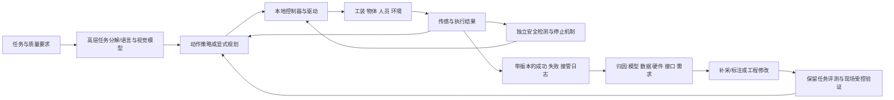

# 具身智能的部署路径：模型、数据与现实任务之间的工程闭环

资料截止：2026年11月9日。研究重点为2022年以来的公开研究和运行记录；经济模型是明确标注的采购情景，金额不冒充企业合同或客户回报。

具身智能进入持续运营，最重要的变化是把一次动作成功转成一个可维护的工作流程。工业上料、物流卸车和家庭整理都需要识别物体并执行动作，但其可接受的环境变化、错误后果和服务组织差异很大。标准料箱和工装可以减少模型需要处理的变化；家庭中物体、位置和任务意图的变化更广，人工指导、隐私和失败后的现场处理又更难统一。因此，模型能力进步与部署范围扩大之间，仍有一段需要传感、工装、控制、数据和人员共同完成的工程工作。

公开证据已经支持若干限定任务进入真实生产或商业运行。BMW确认Figure 02参与生产试点，GXO确认Digit按商业服务协议处理料箱，DHL确认Stretch用于商业卸车并扩展地区。与此同时，家庭研究已经展示未见住宅和部分跨本体迁移，预订产品却尚不能用这些论文结果证明长期客户服务。成熟专用自动化也持续有价值：任务边界稳定时，较简单的夹具、程序和机械臂可能以更低集成风险完成相同工作。

对采购方，判断顺序应是先定义合格任务及可服务需求，再比较系统边界、人工负担和实际产出，最后计算持续成本。对技术提供方，闭环的价值在于把失败分类，决定该补数据、换硬件、改接口还是缩小任务，并用隔离的评测检验修改。运营日志越多，只有在版本、质量与任务覆盖可识别时，才更可能转化成下一轮能力。

## 一、从任务和失败后果开始比较

### 1. 同样的“取放”，工程问题并不相同

| 任务与代表案例 | 物体、环境与动作要求 | 验收、节拍和失败后果 | 系统外部条件及适用对照 |
|---|---|---|---|
| BMW/Figure钣金件上焊接工装 | 从料架或料箱取三件钣金，移动并定位；存在手眼协调、步行和工装对齐 | 厂商列84秒总循环、37秒装载为要求，三件均正确放置为验收；错放可中断焊接节拍 | 工装、焊接机器人、物流供料和生产接口已经存在；对照应为同工序人工或固定机械臂工作站 |
| METEC/ABB CNC上下料 | 车削件取出、上料和吹屑；双三点夹爪、缓存小车、机床门和夹具 | 工件正确夹持、加工顺序和清屑；残屑或夹持偏差会影响加工质量及设备 | 稳定工件族、夹具和I/O接口；专用协作机械臂本身就是成熟比较方案 |
| GXO/Digit料箱交接 | 在既有自动化之间搬取标准料箱并放到输送线 | 合格交接、接口不阻塞、无掉箱；一个工位停顿可影响后段 | 料箱、上游移动设备和输送线限制了对象及位置；可比较人工、固定移载设备或输送线改造 |
| DHL/Stretch纸箱卸车 | 拖车内不同堆叠的纸箱，经吸附抓取放上伸缩输送机；七轴臂及移动底座 | 纸箱完整、成功送出、落箱恢复及吞吐；破损包装、箱堆坍塌会改变任务 | 适用箱型、承重、温度、输送机接口明确；同任务人工卸车或专用拆垛系统是基线 |
| Ocado商品单件拣选 | 在标准货箱和网格物流中处理不同商品；感知抓取、订单匹配及异常分流 | 拣对商品、数量和包装完整性；异常需要人工工位或重试 | 网格搬运、库存软件、容器与订单系统共同工作；不能把拣选臂与整个履约网络合为单机 |
| 家庭餐具入水槽、衣物归拢和折叠 | 未固定的桌面、抽屉、软物和不同家庭布局；双臂、移动、抓持和任务分解 | 餐具无损、物品放对位置、衣物按要求完成；液体、易碎物、儿童宠物提高错误代价 | 对照为同任务人工或适用的专用设备；扫地机、洗碗机的其他工序成绩不能直接替代整理取放 |

工业及物流任务定义依据[BMW/Figure部署说明](https://www.figure.ai/news/production-at-bmw)、[ABB/METEC案例的“application”和“continuous loop”部分](https://new.abb.com/news/detail/112633/cstmr-cobot-colleague-tirelessly-lends-a-hand)、[GXO 2026年10月合作更新](https://investors.gxo.com/news-releases/news-release-details/gxo-and-agility-robotics-expand-partnership-accelerate)、[DHL首次商业部署说明](https://www.dhl.com/us-en/home/press/press-archive/2023/dhl-supply-chain-achieves-first-commercial-deployment-of-boston-dynamics-stretch-robot.html)。家庭任务边界来自[π0.5论文第IV—V节及附录任务评分](https://arxiv.org/html/2504.16054v1)。

这些任务的难度不能由机器人外形排序。人形结构可能利用既有人类工位，轮式底盘可能更适合平坦通道，固定机械臂则能减少定位和能耗问题。末端执行器的接触方式通常直接决定可处理物体：吸盘对纸箱的要求，与平行夹爪夹餐具、双臂整理衣物不同。增加自由度扩大可达动作，也增加标定、碰撞、控制和维护工作。采购时要问的是工作流程需要哪些动作，而非哪个产品自由度更多。

Stretch公开手册把对象限定为封口的长方体纸箱，最大23公斤，最短表面边长15厘米、最长91厘米，工作温度5—45℃，并依靠兼容的伸缩输送机。其600—800箱/小时是产品规格描述。DHL实际部署报道给的是最高约700箱/小时；二者均不足以推导某个客户整班净吞吐。换车、移位、充电、异常和下游等待都需要进入运行记录。[Stretch 2025手册第6—7页](https://bostondynamics.com/wp-content/uploads/2024/01/Stretch-Brochure-2025-compressed.pdf)、[DHL 2025年5月公告](https://group.dhl.com/en/media-relations/press-releases/2025/dhl-group-signs-mou-with-boston-dynamics-and-accelerates-cross-business-automation-strategy.html)

### 2. 任务边界也是经济边界

工业客户通常可以限制来料姿态、整理工装和设置排除区域，以增加稳定性；这部分成本应与模型、机械臂一起计价。物流客户可以标准化料箱和输送接口，但改造后若仅在少量订单上使用，单位成本仍会很高。家庭用户则未必愿意每天整理环境来帮助机器人，其“省事”价值取决于布置、看护和复位后还剩多少净节省。

因此，环境工程并非能力缺陷的同义词。可重复的工装设计可以是最有效的解决方案。需要避免的是把工装减少变化带来的成功全部归给模型泛化，或把客户额外整理物品、清除故障的时间藏到成本之外。报告以下分别记录模型、物理环境和人工的职责。

## 二、模型路线如何分工，数据怎样匹配任务

### 1. 路线—数据—任务匹配

| 路线 | 模型或程序负责什么 | 主要数据与更新方式 | 适配任务与保留的工程职责 |
|---|---|---|---|
| 模块化感知、规划、控制 | 识别物体及姿态，构建场景，搜索运动路径，再由控制器跟踪 | 标定、几何模型、感知标签、轨迹参数、故障日志 | 工装明确、精度和顺序可定义的上下料；地图、夹具、联锁和异常规则清晰，接口错误需逐层诊断 |
| 任务级端到端策略 | 从图像及本体状态直接预测关节或末端动作/动作块 | 遥操作轨迹、纠错数据、针对目标任务的后训练 | 接触复杂、软物和难手写规则的动作；仍依靠低层伺服、限位、末端执行器及安全控制 |
| 视觉语言动作模型（VLA） | 将语言意图、视觉及机器人状态映射到子任务或动作，复用多任务知识 | 跨任务/跨本体示教、语言标注、网络视觉语言数据、目标任务日志 | 变化较多的物体和任务指令；是否可直接迁移须用留出的物体、场地或本体检验 |
| 世界模型辅助 | 生成未来图像、视频、子目标或模拟结果，支持数据、规划或评估 | 视频、动作—观测对、场景与动力学数据，另需可执行动作标签和真实验证 | 扩展视觉/行为覆盖、产生子目标、先筛查策略；预测逼真并不保证接触物理和动作可执行 |
| 混合系统 | 高层语言任务分解，局部学习策略或显式规划，底层控制与安全独立执行 | 上述数据按层组织；失败归因后只修改相关部分 | 现阶段多数可部署路线的合理结构，既利用学习能力，也保留接口、约束和恢复程序 |

模块化系统中的规划场景用于表达几何、机器人状态、碰撞及约束；它并不自行完成整套安全认证。[MoveIt规划场景说明](https://moveit.picknik.ai/main/api/html/planning_scene_overview.html) 动作块模型一次预测一段未来动作，可以减少逐步推理开销并表达复杂动作分布，但执行时仍要决定多久更新一次、怎样接上新动作、何时停止。扩散或流匹配是在生成动作分布，只有额外学习环境演化时才涉及世界模型职责，两者不能按“生成”一词合并。

π0.5提供了一个具体的混合分工：同一模型先预测高层子任务，再以子任务为条件输出动作块；离散动作表示用于高效训练，后训练加入连续动作专家。其移动平台有双六自由度机械臂、平行夹爪、移动底座、升降机构和多路相机，总动作维度为18或19。模型输出这些接口下的动作，电机驱动、机身结构和安全系统仍各有职责。这里的“端到端”描述学习映射范围，不表示工装、控制和人员已消失。[π0.5第III—IV节](https://arxiv.org/html/2504.16054v1#S4)

### 2. 数据数量要与覆盖、质量和获取劳动一起读

| 数据来源 | 能补足的能力 | 获取成本与偏差 | 部署后应怎样使用 |
|---|---|---|---|
| 遥操作和动作示教 | 给出视觉、状态与可执行动作对应，覆盖接触和操作顺序 | 设备、操作者、标定、搬运、重置及监督；操作者常绕开困难情形 | 将成功示教与失败、接管前后状态分开，记录任务和本体版本 |
| 语言指导、子任务标注 | 训练下一步意图、语义选择和长任务分解 | 指导者判断和标注劳动；使用同一模板可能形成语言偏置 | 区分训练时语言示教与运行时每步指导，后者仍是服务人工 |
| 离线部署日志 | 暴露真实物体、照明、磨损、拥堵和失败分布 | 日志不是自动生成的正确标签；隐私、存储和筛选成本存在 | 保留失败、重试与退出，防止只留下已成功项目 |
| 自主执行加人工纠错 | 在策略实际访问的状态上补纠正，改善恢复和吞吐 | 接管时机有选择偏差，恢复与重置占用人员 | 记录接管触发、持续时间和后续结果，重新评测时移除指导 |
| 视频生成与伪动作 | 扩展场景和动作组合，减少部分新增实体示教 | 需要视频模型、逆动力学或动作表示训练，可能出现视觉正确但物理错误 | 验证生成轨迹能否训练出真实可执行策略，按失败类型筛除伪标签 |
| 物理仿真和随机化 | 大量生成接触、噪声、动力学变化，训练低层技能 | 建模、系统辨识、渲染和算力；仿真误差可能系统性遗漏真实困难 | 真实留出条件验证，定期用磨损和新包装等现场分布修正 |

DROID的公开数据集为76,000条示教、350小时交互，分布于564个场景和86类任务，由50名采集者在12个月完成。其统一机器人平台便于跨地点复用，便携安装又扩大了视角和环境覆盖。350小时是机器人交互量，不能视为全体工作人员仅付费350小时；搬运、设备搭建、标定、重置和质量检查均在其外。项目随后更新大量语言标注，并在2025年更新约36,000条episode的相机标定，这说明数据资产需要维护版本，而非下载一次后永久正确。[DROID项目“Abstract”“Updates”和平台说明](https://droid-dataset.github.io/)、[论文方法与校准部分](https://arxiv.org/pdf/2403.12945)

π0.5约400小时移动操作数据来自约100个家庭环境，但其训练还包含其他本体、静态机械臂、实验室任务和网络数据。把最终结果称为“仅400小时学会家务”会遗漏这些来源。其消融显示，移除多环境和跨本体数据会损害表现；网络数据对部分完整任务评分影响不显著，却对未见物体语义和高层指令有作用。数据价值取决于它补哪种缺口，不能用总小时数替代能力解释。[π0.5第IV-C、IV-D、V-B—V-E节及图8—13](https://arxiv.org/html/2504.16054v1)

扩大场景数量时，物体、布局和轨迹也常一起变化。论文的场景扩展实验支持整体训练配方帮助迁移，但不应把所有改善解释成单一的“场景数因果效应”。对企业，最有用的切法是按失败类型补采：反光物体识别差，应增加相应观察及标注；夹爪够不到，应先改物理设计；网络抖动导致动作衔接差，应修执行层，而非继续收集同样成功动作。

### 3. 真实反馈可以训练模型，仍需独立评测

RECAP在π*0.6中组合已有数据、价值评估、自主执行和专家纠正，使模型从自己执行任务的反馈中改进。论文的服装、咖啡和折盒实验同时报告成功率与单位时间完成量，复杂服装和咖啡的吞吐在加入机器人运行数据后超过翻倍；评价时不依赖人工纠正。其成功定义很具体：普通T恤/短裤要在200秒内叠好并堆放，多样衣物实验的量化对象是衬衫、期限500秒，折盒则在600秒内完成组装、贴标和放置。因此，“会折衣物”不能自动扩展为任意家庭衣物、无限时长和零人工重置。[π*0.6论文第VI节、第8—10页](https://www.pi.website/download/pistar06.pdf)

π0.7进一步利用次优示教、旧模型自主评测数据及干预，并通过episode元信息帮助区分数据质量。论文明确把用于泛化评测的自主轨迹排除在训练之外。它在训练中已见任务上的即用表现、未见住宅指令、跨本体迁移和新任务组合，是不同实验问题；不能将训练见过的任务成绩同时当成零样本跨任务证据。由此得到的工程要求是把训练回流和评测保留集隔开，并记录一次模型升级到底改变了什么。[π0.7第VI、IX节，版本v1](https://arxiv.org/html/2604.15483v1)

### 4. 合成视频、模拟评估和仿真迁移是三种证据

DreamGen先适配视频生成模型，再生成轨迹，通过逆动力学等方法取得伪动作，最后训练机器人策略。其真实实验覆盖GR1、Franka和SO-100，共九个任务，在低真实数据条件下加入生成轨迹。第8页新行为表还包含部分进度给分，例如“倒水”抓起瓶子就可得0.5分。表题虽写成功率，跨任务平均仍混有部分评分，故不能直接称为严格整任务完成概率。更广的生成行为提供了有价值的迁移信号，但不直接证明生产可用率。[DreamGen第2—3节、第6—8页、附录任务标准](https://raw.githubusercontent.com/mlresearch/v305/main/assets/jang25a/jang25a.pdf)

SIMPLER研究相反方向：把在真实数据上训练的策略放入模拟场景评估，通过控制和视觉匹配观察模拟排名是否对应真实表现。它支持更低成本的筛查和对照，不能被引用成“策略完全在仿真训练后已迁移现实”的证明。[SIMPLER第I节与评测方法](https://arxiv.org/html/2405.05941v1)

真正的仿真训练到现实迁移，可以用DeXtreme的限定任务说明。研究以Allegro手在仿真中学习立方体手内旋转，用自动域随机化覆盖物理及观察变化，再以真实视觉估计器部署。论文2024年修订版第14页按不同日期、每组10次试验报告连续目标达成次数，自动随机化优于手调随机化；第15页又测试到达目标后保持10帧，成绩随更严格验收下降。这既证明真实迁移可行，也说明指标和硬件边界决定结论：它没有证明拿起任意家庭物品、完成整套装配或长时间无故障运营。[DeXtreme v2，第2节、表7—8](https://arxiv.org/pdf/2210.13702)

## 三、实时执行、安全与恢复是闭环中的独立工作

模型的高层推理、动作块预测、伺服跟踪和安全响应处于不同时间尺度。一次云端推理可给未来动作目标，但本地驱动仍需按控制周期执行，安全停止不能依赖下一次语言模型回应。消息延迟、观测陈旧、动作块衔接、物体在推理期间移动，都会使训练时的状态与执行时不一致。

RTC通过异步动作生成和对已有动作前缀的约束，减少同步等待与动作块切换的不连续。其真实实验采用六个双臂任务，每个任务、方法等组合共480个episode、28小时纯执行，另注入延迟；论文用吞吐与任务进度评价，部分简单时序平均方法因振荡触发保护停止。它提供的是执行方法的对照证据，28小时是汇总执行量，不能变成单台机器人连续无干预28小时。[RTC第4—5节及图6—7](https://arxiv.org/html/2506.07339v1)

2026年10月Pi API beta允许开发者上传数据、微调并经托管网关推理；官方案例也明确遇到网络连接问题。这说明模型服务可以降低训练基础设施负担，但开发者仍承担本地运行、缓存或停机策略、数据上传和恢复流程。云服务的存在不改变机器人的物理责任边界。[Pi API beta，“Enabling independent iteration”部分](https://www.pi.website/blog/api-beta)

| 异常 | 需要识别什么 | 运行处理与恢复边界 | 应进入闭环的数据 |
|---|---|---|---|
| 遮挡、反光、未知物体 | 置信不足、姿态或抓取失败 | 重新观察、换抓取或转人工；限制重试，避免反复损伤 | 观察条件、物体类别、尝试次数与最终质量 |
| 工装/地图偏移、通道拥堵 | 定位误差、可达性、等待超时 | 停在安全状态，重新标定或改派；禁止用旧位置继续动作 | 改造版本、拥堵时段、恢复时间 |
| 断网或陈旧指令 | 指令年龄、连接状态、执行窗口 | 本地按已验证策略停止或完成安全片段，恢复连接后重新观察 | 延迟分布、停止类型、接管和重新启动 |
| 吸附/夹持失效、零件磨损 | 压力、力矩、电流、温度或动作偏差 | 检查物体和设备，按授权维护复位；不能默认自动重试安全 | 部件寿命、故障工况、更换与检验结果 |
| 箱体倒塌、掉落或物品破损 | 当前状态是否超出可恢复范围 | 隔离受影响区域，处理残留物后重新定位 | 事故与近失、现场人员时间、报废及停线 |
| 儿童、宠物或人员进入 | 人员位置及潜在接触风险 | 本地安全机制限制或停止；清障后按条件人工确认 | 触发、误报、停止距离、恢复流程 |

安全评估要覆盖示教、生产、清障、维护及恢复。OSHA技术手册强调，机器人应用包括末端执行器、传感、附属机器和防护，并指出低负载机器人也可能处于危险应用中。UR10e的SW5.20手册进一步给出可核的实现例子：急停与防护停止分别接入安全I/O；门开停止后是否允许自动恢复取决于人员能否进入并关门等条件，光幕接口要求在安全区域外复位。该设备的具体要求不能直接套成Figure或NEO的认证结论，却清楚表明“规划中做了避碰”与“整套应用安全相关控制已验证”属于不同工作。[OSHA技术手册“Integrating”“Operating and Maintaining”部分](https://www.osha.gov/otm/section-4-safety-hazards/chapter-4)、[UR10e SW5.20手册，PDF第73—75页，印刷第74—76页](https://www.universal-robots.com/manuals/EN/PDF/SW5_20/user-manual-UR10e-PDF_online/711-039-00_UR10e_User_Manual_en_Global.pdf)

采购中的恢复测试应保持生产现实：停止后谁有权进入、如何隔离能量、谁判断物体可继续用、如何恢复坐标和任务状态，以及是否需要重新验收。人工接管率很低但每次需要现场工程师长时间赶到，仍可能比接管较多但可快速处理的方案昂贵。远程专家也会受同一故障同时发生的队列限制，平均每台每小时的人工分钟不能证明任何时刻都有人可用。

## 四、真实部署已经出现，但任务边界和证据阶段决定可推广程度

### 1. 按实际达到的阶段比较

以下阶段描述的是对应任务，而非给企业排一个永久名次。同一企业可以同时有商业运行产品、现场试点和研究演示。客户对部署的确认通常比单方视频更有力，但商业合同仍需进一步区分已启动服务、累计作业和客户收益。

| 系统、观察时点与任务 | 已有证据及部署阶段 | 真实计量与尚缺的关键分母 | 截止日不能计入既成运行的部分 |
|---|---|---|---|
| Figure 02，BMW Spartanburg钣金上料；2025年11月厂商、2026年2月客户回顾 | 客户确认生产现场试点，持续参与生产，已超出孤立演示 | 超过9万件、约1250运行小时、支持超过3万辆X3；两方概述使用10个月和11个月等不同起止口径；未给逐班可用率、接管分母及完整缺陷数 | 不能用“99%目标”替代实际质量率，也不能将1250小时写成连续无故障运行 |
| Figure 03，BMW Spartanburg物流排序；2026年6月 | 客户宣布新项目并展示系统，任务转为从大容器分拣至排序小车 | 新任务尚无对应累计产量及持续时间；原F02成绩不属于此任务 | 新闻稿中将启动的后续物流运行不能预先算入规模化 |
| ABB GoFa，METEC CNC上下料；2024年2月 | 客户应用案例，固定机床及连续作业流程；属于成熟专用/模块化自动化应用 | 案例称生产能力翻倍；同时引入无人夜班和周末运行，无同班、同产品质量和劳动时间对照 | 未披露采购价、净节省和完整回收期，不能由翻倍直接算ROI |
| Digit，GXO Flowery Branch；2024年商业协议、2026年10月更新 | 2023年概念验证后签多年RaaS协议，实际商业服务，累计超过10万料箱 | 作业数证明任务实际发生；未给该站点机器人数量、合格率、接管率或客户盈亏 | Statesville和Lebanon部署预计2027年初；“6.5万小时”涵盖Agility各商业及客户项目，不能全分配给GXO此站 |
| Stretch，DHL；2023年首次商业部署，2025年地区扩展 | DHL确认商业卸车，已扩展英国和欧洲；具有多个地区运行证据 | 最高约700箱/小时，适用箱体与输送线边界明确；未披露整班平均、全部站点台数及事故率 | 2025年备忘录中的额外1000余台是未来安排，不能写成已交付 |
| Ocado OGRP；2025年末与2026年中 | 已集成至客户履约中心网络；公司报10个CFC使用，半年更新为14个 | 中心数证明部署范围扩展，未等于每中心所有SKU均可无人拣选；需要可处理商品占比和异常转人工量 | OGRP部署增加与部分整体履约中心关闭可同时发生，不能互相抹去 |
| π0.5、π0.7家庭/跨本体研究；2025—2026论文 | 有留出住宅、任务和本体相关实验；属于有条件的研究验证 | π0.5的三处未见住宅和每任务环境10次试验；π0.7另有指令、多步及跨本体实验；指标包含任务进度 | 研究协议、人工教练和特定硬件不等于可直接向普通家庭提供无人服务 |
| 1X NEO；2026年产品页、4月工厂说明 | 消费预订、制造及内部家庭测试；官方描述初期基本自主加远程专家 | 当前页面有499美元/月、2万美元买断及200美元预订金；尚缺本报告可核的普通客户队列运行数据 | 年产能、预订量、2026发货承诺分别属于供给能力、意向与计划，不合并为交付量 |

来源定位：[BMW 2026年2月正文](https://www.press.bmwgroup.com/global/article/attachment/T0455864EN/644966)、[BMW 2026年6月Figure 03项目正文](https://newsroom.bmwgroup.com/global/bmw-group-advances-the-use-of-physical-ai-in-production-with-figure-03-project-in-spartanburg)、[Figure 02部署“By the numbers”“Reliability”部分](https://www.figure.ai/news/production-at-bmw)、[ABB案例](https://new.abb.com/news/detail/112633/cstmr-cobot-colleague-tirelessly-lends-a-hand)、[GXO 2026年10月26日公告](https://investors.gxo.com/news-releases/news-release-details/gxo-and-agility-robotics-expand-partnership-accelerate)、[DHL 2025年公告](https://group.dhl.com/en/media-relations/press-releases/2025/dhl-group-signs-mou-with-boston-dynamics-and-accelerates-cross-business-automation-strategy.html)、[Ocado 2025年业绩报告](https://www.rns-pdf.londonstockexchange.com/rns/5025U_1-2026-2-26.pdf)、[Ocado 2026年中期业绩正文](https://www.ocadogroup.com/investors/results-and-presentations/half-year-results-2026)、[NEO预订页](https://www.1x.tech/order)、[1X工厂说明](https://www.1x.tech/discover/neo-factory)。

“累计处理10万箱”和“每箱干预率低于某阈值”回答不同问题。前者证明真实用量，但若不知道运行台数和时间，就无法计算每台生产率；后者若只来自挑选后的可处理箱型，也无法推导全仓自动化覆盖率。连续运行小时需要知道中间是否有人工复位、暂停观察和更换部件。事故指标更需暴露工时、严重程度与报告规则。未披露的字段应留空，不能用视频顺畅或客户续约补成零。

### 2. BMW案例：硬件反馈和任务变更比单一成功率更有解释力

F02的价值在于它进入了真实焊接生产接口。工装要求、上游供料、节拍和后段焊接均会约束机器人动作，机器人也必须适应已存在的制造体系。BMW说明其产线已有自动化物流和生产系统，工业人形项目从早期就让生产、IT、安全和物流团队参与；因此，这个案例支持人形系统在既有工厂承担一个限定工序，不能解释为一台通用模型独立完成整条生产线。

Figure把前臂列为现场主要硬件故障来源，涉及腕部通信电路板、动态线缆和热问题，并说明后续设计如何缩短控制链、调整电路和材料。这是公开资料中有用的失败反馈：接触、热、振动和高频重复会把实验室可行的部件推到寿命边界。即使视觉策略不变，电气和机械修改也可能提高可用率。归因时应把硬件版本和模型版本同时列入，而不能把整代产品稳定性改善全部记为训练数据增长。[Figure部署说明“Reliability”与下一代设计部分](https://www.figure.ai/news/production-at-bmw)

2026年的Figure 03项目转向物流排序，BMW描述从非排序大容器取件、放入排序小车，再由既有牵引车或STR运输。这里的灵活抓取与组织物料可能比长时间占用固定焊接工位更适合新硬件。它也是新任务，必须重新验证对象范围、抓取与放置质量、人工异常处理及系统节拍。F02退役回到厂商并不自动说明客户试点失败；同样，F03启动也未证明前一个任务已经可以无条件复制到多厂。两代任务和观察窗口应分别记账。

### 3. 专用自动化与具身策略的实际分工

METEC案例通过双夹爪和缓存小车让机器人在机床加工期间准备下一步，并与机床门、夹紧、吹屑等程序协同。对一组稳定的工件，已知夹持方式和接口能显著减少动作搜索。允许76种零件并不必然需要开放式语言推理；关键是换型、夹具和程序是否能低成本管理。固定任务的专用方案可能以更低的结构复杂度获得较高产能。

GXO的料箱交接则显示另一种分工：在已有自动化设备之间补上一个仍需人工的搬取环节。是否值得使用移动人形，应比较原位部署的改造节省与每箱处理成本。如果永久安装一段输送机就能完成同一流程，专用移载会有竞争力；如果位置频繁变化、需要跨多个工位、租赁场地限制改造，移动机器人的可重部署性才有额外价值。这些价值必须通过实际改线次数、移动距离、安装费用和闲置时段测量。

Stretch的箱体约束同样有商业意义。矩形纸箱、吸附和输送机是有效的环境约束，减少了对任意材质、手内操作和复杂放置的需求。DHL早期公告同时提到落箱识别与恢复仍在持续改进，这表明“正常箱体高速处理”与“异常后恢复”是并行工程任务。产品的高吞吐应在所服务的箱型分布、异常比例和完整换车周期内评估。[DHL 2023年首次商业部署正文](https://www.dhl.com/us-en/home/press/press-archive/2023/dhl-supply-chain-achieves-first-commercial-deployment-of-boston-dynamics-stretch-robot.html)

### 4. Ocado的反证：拣选进展与客户网络收缩可以同时成立

Ocado报告OGRP拣选部署从2025年末10个CFC增加到2026年中的14个；同一时期，部分自动履约中心关闭。2025年报告列出Kroger的Frederick、Pleasant Prairie及Groveland在2026年1月关闭，并说明Sobeys Calgary中心因市场增长与需求不足而关闭，其他中心继续运营。客户Kroger在2025年11月18日8-K中也把关停和整个自动履约网络未达到财务预期列为预计约26亿美元减值及相关费用的原因。[Ocado 2025业绩报告“International partners”部分](https://www.rns-pdf.londonstockexchange.com/rns/5025U_1-2026-2-26.pdf)、[Kroger 8-K Item 2.06](https://www.sec.gov/Archives/edgar/data/56873/000110465925113746/tm2531591d1_8k.htm)

这一对照排除了两个过度推断。中心关停不能直接归因于机械臂抓取失败，因为客户财务包含需求、固定网络、最后一公里和替代门店履约等因素；拣选技术部署扩大也不能证明整体订单经济性改善。需要把合格拣选成本和整个网络每单成本分开，再检查低利用率是否源于模型不能处理商品、上游库存不足，还是用户根本没有产生足够订单。

2026年中期数据又提示一次性收入会改变经营观感：Ocado公布含关闭相关款项的收入约10.37亿英镑，剔除后约6.84亿；调整后EBITDA含相关款项约4.32亿，剔除约0.81亿。技术使用费、客户赔偿和真正持续运维收入不能互相替代。这里使用的是公司明确拆分的指标，用于说明供方收入和客户回报并非同一件事，不据此估算某个机器人的毛利。[Ocado 2026年中期业绩“Financial highlights”](https://www.ocadogroup.com/investors/results-and-presentations/half-year-results-2026)

## 五、家庭任务的进步应沿着泛化证据逐步扩大

家庭环境最难标准化的部分是任务意图与物体分布。盘子放入水槽的目标相对清楚，“整理房间”却包含归属、保留、丢弃、易碎、私人物品和位置偏好。双臂能力扩大了可操作范围，仍需有人定义可碰哪些物体、哪些抽屉可以打开、何时停止以及如何判断完成。

π0.5的留出住宅结果说明跨环境训练可以减少每个新家从零示教的需要；π0.7进一步比较多步指令、跨本体和新任务适应。但需要把三类迁移分开。第一是相同任务在新房间或新物体上完成，第二是已学动作在不同硬件上重组，第三是出现未训练过的任务，通过语言指导或视觉子目标学习。三者需要的人工投入和现场验收成本不同。模型在熟悉任务上开箱运行良好，并不等于第三类任务不需要示教或教练。[π0.5第V节](https://arxiv.org/html/2504.16054v1)、[π0.7第VI及IX节](https://arxiv.org/html/2604.15483v1)

RECAP的π*.6研究把自主尝试与专家纠正反馈用于策略改善，在叠衣、咖啡和装箱等任务上衡量成功与吞吐。它明确设置200秒、500秒或600秒等任务超时，部分失败来自超时；咖啡还要求没有关键步骤错误。因此“成功率提升”需要连同超时和质量规则阅读。一个更慢但最终完成的策略，可能在宽时限测试里得分高，却不适合连续商业工作；一个速度较快的策略若把错误留给用户，真实劳动节省也会下降。研究公开的试验协议是有价值的工程证据，仍需长周期设备磨损、环境变化和普通用户运行来补足。[RECAP论文第8—10页及任务标准](https://www.pi.website/download/pistar06.pdf)

NEO产品页把初期服务描述为基本自主能力加可预约的远程专家，用户也可以通过手机或VR操作。这样一种服务设计可以先扩大可完成任务，再用运行数据改进自主性，但它的经济单位是“机器人加远程服务加家庭配合”。需要分别记录模型自主时间、专家介入时间、等待时间及家庭成员清障或准备时间。把专家执行后的成功全部算成自主成功，会掩盖真正需要改进的部分。[NEO产品页“Autonomy”“Expert”及价格部分](https://www.1x.tech/order)

截至本报告核验到的公开材料，1X工厂说明仍围绕制造启动、内部员工家庭测试和2026年交付安排展开。其产能和预订声明可以支持供应准备的判断，不能替代已经在普通付费客户家庭连续运行的证据。预订页的200美元金额也不是整机售价；法律条款对退款窗口和最终订单成立另有条件，正式采购应以接受的销售合同和服务范围为准。[1X 2026年4月30日工厂说明](https://www.1x.tech/discover/neo-factory)、[1X预订法律条款“Order Invitation”及“Cancellation”部分](https://www.1x.tech/legal)

家庭采用宜从物品清单明确、失败可逆、可暂停的低风险整理开始。危险液体、灶具、锋利工具、儿童照护或需要医学判断的任务，即使能展示几个动作，也需要另一套任务与安全验证。这个边界依据失败后果，而不是产品的营销分类。对家庭用户，远程摄像和操作还要求明确访问授权、可访问区域、录像保存、删除与服务终止安排；本报告未读取到能够替代用户合同的完整产品隐私承诺，因而把这些作为采购条件，而非宣称厂商已满足。

## 六、用合格作业量计算持续成本

### 1. 一套可复核、受需求限制的情景模型

公开客户资料尚不足以复原上述系统的完整内部账目。以下模型因此全部使用明示情景，工业和物流金额为假设人民币，家庭为美元；只有家庭499美元/月取自所读产品页。模型用于检验决定因素，不构成任何品牌报价或收益预测。

先定义同一验收标准下的年度合格作业量。设排班小时为H，可用率为A，可用时间内有任务可做的比例为U，正常动作秒数为t，尝试中需要人工恢复的比例为p，每次恢复分钟为r，最终质量合格比例为g，年度可服务需求为D：

`潜在尝试量 = H × A × U × 3600 / (t + p × r × 60)`

`合格量 Q = min(潜在尝试量 × g, D)`

`协助小时 = (Q / g) × p × r / 60`

A排除计划运行中设备不可用的时段，U排除没有可服务任务的空闲；恢复时间在分母单列，不再从A重复扣除。这种划分需要现场日志一致执行。g把动作执行与最终质量区分开。超过需求的理论产能没有价值，未处理的剩余需求仍需人工或其他设备，不能算作劳动节省。

设备资本及安装用资金回收系数年化，折现率取8%，寿命n年，残值设零：`年化资本 = 设备及安装投入 × 0.08 / [1 − 1.08^(-n)]`。再加维护、软件、耗材、培训等固定费用、现场支持和远程协助人工。使用订阅时以年订阅费代替设备年化资本，不重复加整机折旧。合格单次成本是上述年度成本除以Q。

“劳动价值”按同等合格产出原本需要的人工小时乘工资，再乘能够真正撤掉或转用于有价值工作的比例。比较的是税前年度经济差额，未计供应商利润、融资结构、未建模的事故损失或业务增量收入，不称为会计净利润。安全准入先满足，不能靠给事故一个低概率把危险方案算成便宜。

| 输入 | 工业柔性单元 | 同任务专用单元 | 物流纸箱卸车 | 家庭单项家务 |
|---|---:|---:|---:|---:|
| 设备与安装投入 | 52万元 | 28万元 | 70万元 | 订阅499美元/月 |
| 使用寿命 | 5年 | 7年 | 5年 | 按一年订阅 |
| 年固定运维 | 5万元 | 3万元 | 7万元 | 300美元附加费用 |
| 排班小时H | 4000 | 4000 | 4000 | 730 |
| 可用率A / 有任务比例U | 90% / 65% | 95% / 65% | 90% / 60% | 85% / 40% |
| 正常单次秒数t / 合格率g | 45 / 98% | 30 / 99.5% | 12 / 99% | 600 / 90% |
| 恢复概率p / 每次分钟r | 2% / 3 | 0.5% / 2 | 1% / 2 | 15% / 5 |
| 另计现场支持小时/年 | 200 | 200 | 400 | 24 |
| 人工合格产出/小时 | 55 | 55 | 180 | 6 |
| 人工小时成本或机会价值 | 60元 | 60元 | 60元 | 25美元 |
| 可服务需求D/年 | 170000次 | 170000次 | 600000箱 | 2000次 |

工业固定运维5万元可理解为维护2万、软件1.5万、耗材0.8万、培训0.7万的预算分项，现场支持200小时另计；这里只给出可替换的预算结构。家庭300美元假设是订阅以外的电力或服务支出，若合同已包含相同项目应删除。家庭25美元为时间机会价值，未必是可以减少的实际现金支出。纸箱卸车和料箱交接不是同一任务，物流行不能用于比较Digit与Stretch谁更便宜。

| 年度模型结果 | 工业柔性单元 | 同任务专用单元 | 物流卸车 | 家庭家务 |
|---|---:|---:|---:|---:|
| 合格作业量 | 169867次 | 170000次 | 583200箱 | 1247次 |
| 恢复协助小时 | 173.3 | 28.5 | 196.4 | 17.3 |
| 全年系统经济成本 | 202637元 | 97489元 | 281101元 | 7321美元 |
| 每次合格成本 | 1.193元 | 0.573元 | 0.482元 | 5.872美元 |
| 同产出可替代劳动价值 | 185309元 | 185455元 | 194400元 | 5195美元 |
| 年差额：劳动价值减成本 | −17328元 | +87966元 | −86701元 | −2126美元 |

这组假设支持的判断很具体：在相同固定工序和17万次年需求下，较低资本投入、较长寿命和较少干预使专用方案占优。柔性单元若确实能减少多次换线或处理更多产品，其收益应另加实际节省的工装、安装、停线和人员组织费用；不能仅以“未来能做更多任务”补齐当前亏口。物流场景即使每小时处理很多箱，在人工成本较低或现场支持较重时也未必划算。应优先投向劳动难组织、环境负担较大且持续有货量的工位，同时验证劳务支出是否真的可减少。

### 2. 利用率、寿命和人工负担如何改变结论

| 工业情景，只改变列示参数 | 年合格量 | 单次成本 | 年差额 |
|---|---:|---:|---:|
| 基准：U=65%，恢复2%，寿命5年 | 169867 | 1.193元 | −1.73万元 |
| 有任务比例U=40% | 104533 | 1.900元 | −8.46万元 |
| 有任务比例U=85%，需求仍为17万 | 170000 | 1.192元 | −1.72万元 |
| 恢复率降至0.5% | 170000 | 1.146元 | −0.94万元 |
| 恢复率升至5% | 152880 | 1.411元 | −4.89万元 |
| 寿命仅3年 | 169867 | 1.614元 | −8.89万元 |
| 寿命7年 | 169867 | 1.014元 | +1.30万元 |
| 可实现劳动节省仅50% | 169867 | 1.193元 | −11.00万元 |

利用率从65%提高到85%几乎不再改善结果，因为服务需求已经耗尽。这正是为什么“多排一班”不能自动获得回报。较低干预率也不会无限增加收益：需求已满足后，它主要降低人工成本，未用产能仍闲置。寿命则对昂贵设备影响很大，采购需要备件、保修、软件支持和可替换部件的证据支撑，而不是把最长技术寿命直接填入模型。

家庭场景的U为20%、40%、80%时，单次成本分别约11.40、5.87、3.79美元；最高情景受2000次需求封顶，年差额约+751美元。即使机会价值转正，用户是否愿意支付、家中是否确实存在这些重复任务、是否要提前整理物体和等待专家，仍决定实际价值。对需要在场监督的家务，节省时间还应扣除无法做其他事的注意力占用。

停机损失需要根据工位连接方式另加。串行瓶颈停机可能使整线等待，缓冲区足够的离线工位则可以由人工补位。不能用整个产线产值乘停机分钟直接估损，也不能只计算维修人工而忽略积压、加班和违约。实际合同应将可用率、恢复时限、替代设备、关键备件和客户自身职责相互配合，否则名义服务保障很难兑换成可运行时间。

上述全部输入和结果分别保存在本报告同目录的`economics.py`、`economics-results.json`与`economics-results.csv`。它们是本文情景的计算原件，并未使用企业未公开单机账目。

## 七、采用路径：先验证一个可持续工作单元，再复制系统

### 1. 三类任务的采用条件

| 决策维度 | 工业上下料/操作 | 物流搬运/卸车 | 家庭整理/取放 |
|---|---|---|---|
| 适合优先进入的任务 | 工件族明确、重复工时足、质量可自动检测；改线频率足以支持柔性价值 | 箱型/料箱稳定、货流持续、与现有设备存在清楚接口、人工负担高 | 物品白名单、目标明确、失败可逆、可暂停，普通用户能理解边界 |
| 首先比较的替代 | 固定机械臂、夹具、供料或机床接口改造及人工 | 输送机、移载设备、专用拆垛、人工及既有AMR | 家庭人工、专用家电及任务流程简化 |
| 验收核心 | 同产品族合格节拍、换型、真实可用率、恢复与停线影响 | 完整班次净吞吐、异常箱覆盖、换车等待、下游阻塞及峰时恢复 | 留出家庭和物体的完整任务、用户准备时间、专家等待、隐私及安全 |
| 扩点前必须可复制 | 接口、工装公差、部件寿命、培训、备件和版本管理 | 站点布局、货物分布、网络与现场支持、运维区域覆盖 | 安装、普通用户教学、权限、服务响应和不可处理情形说明 |
| 倾向暂缓的条件 | 稳定任务已有低成本专用方案；人工无法减少；试点依赖驻场研发 | 低货量、高峰极短、商品超出夹持范围或支持距离过大 | 依赖未知专家工时、要求无人处理高后果任务、缺普通客户持续运行证据 |

工业采购可以用一个完整产品周期观察换型、正常生产和维护，按合格件支付或验收。物流采购需要覆盖不同班次与货物分布，用净流量而非抓取峰值计量。家庭产品则宜先采用可退出、服务范围清楚的安排，以实际省下的时间和可接受的协助方式衡量价值。三者都应在扩点前证明当地支持组织可复制，而非让首站工程师长期成为隐形设备的一部分。

### 2. 数据闭环要产出可验证的改进

有效闭环从任务合同开始：定义何为合格、何时算失败、是否允许重试、人工介入如何计量。随后保存任务、机器人与末端执行器版本、模型版本、场景条件、时间戳和结果，避免只采成功视频。失败按感知、策略、执行、设备、接口、环境及需求分类，才知道需要补什么。

如果主要失败是反光物体看不清，增加同类视觉和动作数据可能有效；如果是夹持力不足或线缆失效，应先改硬件；如果是下游没有空位，改善调度接口更直接；如果设备大部分时间没有任务，更多模型训练并不能创造订单。分类可以有多因关联，例如传感漂移使策略抓偏，抓偏又加剧机械磨损，不能强迫每次失败只有一个标签。

修改后的验证应保留同一组基线任务和未参与调整的留出任务，分别比较质量、节拍、接管和成本。现场增加工装或缩小物品清单会改善成功率，但同时改变覆盖率，报告需要把这两项一起展示。一个只处理70%物体、其中99%成功的系统，对全体来货的自主合格覆盖约为69.3%，其余仍需要处理渠道；“覆盖率×条件成功率”在此比单一99%更接近运营实质。

规模化后的数据回流还会受到客户权限、网络、日志质量和站点差异限制。数据量增长不是自动跨场景学习的保证；采购方和供应商需要约定哪些日志可用、异常样本如何标注、版本升级如何验证与回退。安全相关修改和软件策略更新也应分别处理，不能把模型热更新等同于整个应用的重新安全验证。

### 3. 可以形成的产业判断

工业和物流已经有足以支持有限任务采用的真实证据，但采用价值往往来自模型与已有自动化互补。标准化对象、成熟接口和可处理的异常，使机器人先取得稳定的工作份额；灵活性只有在换型、改线或多任务需求实际发生时才形成收益。通用策略能够减少新任务示教和场景定制的潜力值得跟踪，其证明方式应是更低的部署工时、更少的留出场景失败和更好的全周期成本。

家庭研究对跨环境泛化提供了更强证据，消费服务仍需证明普通用户持续使用、远程协助负担和长期维护。对投资与经营决策，最有解释力的指标应逐步从演示次数、预订台数转向合格任务覆盖、恢复总工时、每个客户的可实现价值和复制一个站点所需的总资源。Ocado的中心收缩、Figure的硬件改造以及家用产品保留专家服务分别说明需求、可靠性和自主覆盖都会限制规模，最终结果通常由它们共同决定。

## 来源与计算说明

本报告以2026年11月9日为资料截止。研究论文固定至所引用的版本；公司新闻按发布时间与其描述的运行期分开，未来计划仅按计划处理。客户或厂商未披露的分母不推补，视频链接未被当作本报告已经完成的逐帧运行审计。论文及公司材料用于其能支持的任务范围，情景计算用于解释条件，二者未合并为实际客户ROI。

正文就近给出原始链接及章节、表或页码；`reading-ledger.json`记录实际读到的位置和原文路径，`claims.jsonl`列主要事实、推断与情景对应关系。生产作者为`/root/microdrama_research`，本稿是完整作者稿，完整报告的独立事实、领域和交付审查由协调任务另行执行。
