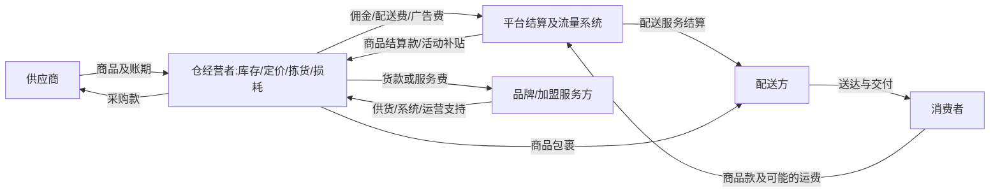

# 国内本地生活前置仓：区域密度、履约网络与单仓经济

资料截止：2026年11月9日。研究重点为2021年以来中国生鲜自营前置仓、即时零售社会化仓及其区域经营变化。全文金额除另有说明均为人民币；模型采用明确标注的假设账目，不冒充企业未公开单仓经营数据。

前置仓能否持续经营，取决于一个具体商圈的可盈利订单是否足以覆盖商品、库存、仓内作业和最后一公里成本。人口多、客单价高或日单量大，都只能解释其中一部分。真正有价值的密度，是在有竞争、正常促销和真实服务时间内，能够以合适毛利、可控损耗和可靠履约获得的订单密度。仓网成熟后形成的采购、补货和配送效率，可以支持某些仓盈利；同一企业在另一个区域的新仓却可能同时亏损。

生鲜自营仓和社会化仓的主要差别在于谁拥有顾客关系、承担库存和补贴、控制采购及取得收入。前者通常把商品销售、加工、仓配和获客放在一个公司体系中；后者由商家持货，在平台上获得流量并向平台和配送体系付费。平台的交易规模与商家的销售收入、商家的利润与平台的贡献利润，必须分别计算。2024—2026年的经营者采访又显示，订单增加、招商回报叙述和实际现金回收之间存在明显差距。

本报告的判断是：成熟城区有机会通过稳定复购、差异品类、合理仓网及峰时履约形成持续利润；新增仓应依据净增需求而非覆盖地图扩张。自营生鲜仓要同时验证仓级贡献和上游供应链负担，社会化仓则要检验平台收费、投流、补贴退坡及库存资金后的真实回报。对需求不够集中的地区，缩小仓网、改变品类或利用门店共享库存，都可能比维持纯仓扩张更合理。

## 一、先确定经营主体，再比较收入和责任

### 1. 四种模式的边界

| 模式 | 库存及商品经营 | 流量与交易 | 履约与固定投入 | 适合采用的利润口径 |
|---|---|---|---|---|
| 自营持货生鲜前置仓 | 零售企业采购并承担大部分库存、损耗、定价与商品质量责任；区域加工及补货为上游环节 | 自有App或其他渠道获客，商品销售通常是主要收入 | 企业自建或租赁仓，组织仓内作业与配送，也可外包部分工作 | 商品净收入减采购、损耗、仓配和获客后，再扣区域供应链与总部费用 |
| 独立社会化仓 | 仓经营者持货、选品和定价；平台约束活动及展示规则 | 依赖即时零售平台及其广告、搜索、推荐；平台不是当然的商品采购方 | 商家承担租金、库存、仓内人工，按合同支付配送及平台费用 | 商家单单贡献、仓利润及资金回收；另列平台端收益 |
| 加盟/合作仓 | 由合同决定库存归属、退换货、采购渠道与滞销风险；加盟商持货是常见但非唯一安排 | 品牌、平台、加盟商分别可能提供流量；合作不保证订单 | 装修、设备、加盟费、运营费、保证金及配送分担依合同列示 | 在独立仓模型上增加真实的供货价差、加盟/运营费，避免把同项费用计两次 |
| 门店拣货配送/仓店一体 | 门店共享线下库存、采购和部分空间；线下与线上可能使用不同价格与促销 | 到店客流和平台订单并存 | 共享固定投入，但高峰线上拣货会占用店员、通道及可售库存 | 先算线上增量贡献，再核实全部共享成本与线下机会损失 |

“前置仓”在报道中可能指独立暗仓、店中仓、门店全仓或区域配送站。比较之前，应知道是否对外营业、库存是否共用、仓库是否只是履约节点。叮咚年报中的前线配送站和社会化经营者口中的闪电仓，都靠近消费者，但品类、作业、上游投入和收入确认并不相同。[叮咚2025年20-F，Business及MD&A](https://www.sec.gov/Archives/edgar/data/1854545/000119312526174971/ddl-20251231.htm)、[《经济观察报》2024年11月社会化仓采访](https://m.eeo.com.cn/2024/1118/698509.shtml)

### 2. 责任和资金流需要落到同一笔订单

社会化仓的通常交易关系可表示为：

平台补贴可以进入消费者优惠、商家奖励或配送方补助，各自影响不同环节。商品降价若由商家承担，会降低其商品收入或采购毛利；平台承担并补给商家的优惠，可能保留商家实收，却消耗平台收益；供应商出资又可能以返利或结算折扣体现。财务模型要选定一个明确账务处理，再避免在销售折扣、毛利和补贴三处重复扣加。

以下用一笔假设的50元商品订单把各主体连起来。消费者付商品款48元，平台补商品券2元，因此商家商品收入为50元；消费者另付2元运费给平台。商家支付佣金2.5元、配送4.5元、广告1.2元，另取得平台运营激励0.5元。配送方实际取得6.5元，平台还承担1元服务及0.2元售后处理成本。

| 同一单的结算 | 仓经营者 | 平台 | 消费者/供应及服务方 |
|---|---:|---:|---|
| 商品收入与商品券 | +50.0 | −2.0 | 消费者商品支出48.0；2.0由平台补足 |
| 消费者运费 | 0 | +2.0 | 消费者另付2.0 |
| 采购及损耗 | −35.5 | 0 | 供应及商品耗损成本35.5 |
| 包装/增量拣选 | −0.8 | 0 | 包材及增量作业0.8 |
| 佣金、商家配送、广告 | −8.2 | +8.2 | 平台内部收入，不重复加作市场消费额 |
| 商家激励 | +0.5 | −0.5 | 假设为额外现金激励，未含于50元商品款 |
| 实际骑手及平台服务 | 0 | −7.7 | 骑手6.5，其他服务及售后1.2 |
| 固定成本前贡献 | **6.0** | **0** | 消费者总支出50，链外成本44，合计贡献6 |

这是解释资金流的情景，不是平台统一费率或合同。它展示了为什么一个商家单单有6元贡献，平台仍可没有当期贡献；撤掉平台0.5元激励会直接降低商家利润，商品券撤除若降低转化或频次，还会通过订单下降再影响一次。商家收到50元、平台处理50元交易，并不产生100元最终商品市场。

平台若同时经营自营零售，须将其持货业务与市场平台业务分别看待。单个平台集团的总收入或经营利润混有餐饮、到店、配送、自营零售及其他业务，不能拿来填某个独立仓的利润。本文以逐笔资金流解决这一边界，不从集团分部利润倒推出未披露的单仓回报。

## 二、2021—2026年的变化：存活、退出和网络重组都提供证据

### 1. 生鲜自营的经验不是单向扩张

每日优鲜提供了重要退出样本。其2022年20-F列示，2021年净收入69.515亿元、销售成本61.310亿元，二者相减毛利约8.205亿元，尚不足以覆盖21.214亿元履约费用；2022年7月关闭按需DMW业务后，收入与履约费用均下降。这说明订单增长若无法产生足够商品毛利，仍会扩大配送和仓内作业缺口。股权激励、组织和其他费用也影响公司亏损，不能把全部亏损归为单仓经营。2023年11月20-F/A解释其修改的是境外审计检查披露及附件，明确未更新财务报表，因此本文采用原年报所列金额，不将这个修订误说成上述数据全部被重述。[每日优鲜2022年20-F，MD&A收入及费用表、F-5](https://www.sec.gov/Archives/edgar/data/1851682/000110465923087268/mf-20221231x20f.htm)、[20-F/A Explanatory Note](https://www.sec.gov/Archives/edgar/data/1851682/000110465923118662/tm2330702d2_20fa.htm)

叮咚的路径则体现区域选择、商品和履约效率的共同作用。2023年5月23日成都报道确认当地和重庆App已发布5月29日18时停止服务通知，公司解释为经营区域调整；报道时成都仍能下单，故这一证据是明确的退出公告及当时状态，不能把报道日写成实际停运日。2026年二季度公司再次披露关闭北京、广州、深圳的低效站点，同时在华东增设站点。扩张和收缩由同一个经营体系同时进行，更接近现实的“挑区域、调仓网”，而非全国范围统一成熟。[《华西都市报》2023年5月23日报道](https://www.wccdaily.com.cn/wapepaper/html/20230523/195727.html)、[叮咚2026年二季度业绩，Operational Highlights](https://www.sec.gov/Archives/edgar/data/1854545/000119312526359862/ddl_2026q2_er.htm)

2025年底叮咚披露覆盖28个城市、40多个区域处理中心及1100多个前线站点。采购、加工和补货网络的成熟可以服务更多末端仓，但这些数量不等于各仓都达到同一盈利水平。全年累计采购SKU超过1.6万个也不是每个前置仓同时存放1.6万个SKU；其自有品牌GMV占比约20%，非生鲜及预制食品范围中的占比更高，支持品类经营已经成为收入结构的一部分，却仍需看毛利、促销和损耗后的贡献。[叮咚2025年20-F，Business“Product offerings”“Fulfillment network”](https://www.sec.gov/Archives/edgar/data/1854545/000119312526174971/ddl-20251231.htm)

### 2. 公司报表怎样约束单仓叙事

| 叮咚公司口径，亿元，年度 | 2023 | 2024 | 2025 |
|---|---:|---:|---:|
| GMV | 219.693 | 255.574 | 264.362 |
| 净收入 | 199.712 | 230.663 | 243.599 |
| 销售成本 | 138.479 | 161.204 | 172.530 |
| 毛利：净收入减销售成本 | 61.233 | 69.459 | 71.069 |
| 履约费用 | 47.009 | 50.765 | 53.349 |
| 销售及营销 | 3.928 | 5.231 | 4.772 |
| 研发 | 8.029 | 8.000 | 8.220 |
| 一般行政 | 3.591 | 4.244 | 4.862 |
| 净收入中的履约费用比率 | 23.5% | 22.0% | 21.9% |

数据来自[叮咚2025年20-F MD&A年度比较及合并经营报表](https://www.sec.gov/Archives/edgar/data/1854545/000119312526174971/ddl-20251231.htm)，表内毛利为相减计算，原始金额为百万元/千元后换算。GMV与净收入分别保留，不以二者差额直接推定退款或平台抽成，因为定义和收入组成不同。

从这张表可以看出，履约费率下降确实改善了商品毛利后的空间，但2025年销售成本占收入比从2024年的69.9%上升至70.8%，抵消了部分改进。2025年营业利润约1.317亿元，低于2024年的2.146亿元；净利润约2.317亿元，也低于前年的3.044亿元。公司层面的研发、管理、营销以及其他经营收入都影响结果，仓级有利润不能直接推到公司净利润。2025年其他经营收入约1.45亿元，其中政府补助增加也是变动因素；不能把含该项目的营业利润全部归为订单自身创造。[同份20-F，“Cost and operating expenses”“Other operating income”“Net income”]

成本分类也决定能否正确套模型。叮咚销售成本包含采购及部分加工相关成本，履约费用包含配送、仓内及区域作业人员、外包、租赁和物流等。把21.9%当作纯骑手配送费，再另加完整仓内人工与租金，会重复计入；反过来，仅从商品毛利扣骑手账单又会遗漏仓库和供应链。本文后面的自建模型按成本发生环节拆分，不与公司综合费用率叠加。

2026年二季度还出现明显会计比较问题。公告总净收入64.873亿元、GMV72.653亿元，国内业务由于拟出售被列为终止经营，同时仍有现实订单及仓站经营。国内资产停止计提折旧摊销，使该季度净利润增加1.991亿元；公司报告净利润2.717亿元。把披露的影响机械扣除后约为0.726亿元，低于上年同期报告净利润1.072亿元，但这只是隔离一项影响的算术对照，不是公司正式发布的可比净利润。报告履约费率降至18.6%同样含停止折旧摊销影响，公告未按费用类别完整分配这1.991亿元，不能把全部下降归为送得更高效。[叮咚2026年二季度业绩，国内业务分类说明、Financial Results及脚注](https://www.sec.gov/Archives/edgar/data/1854545/000119312526359862/ddl_2026q2_er.htm)

美团2026年2月宣布的收购协议与叮咚会计分类互有关联，但协议不等于交割。叮咚8月公告仍写交易待监管审批，美团10月27日发行文件也把相关协议表述为受交割条件约束。本文截至截止日能确认协议与条件状态，不把会计上的终止经营写成业务已经停掉或收购已完成。[美团2026年2月5日公告](https://www1.hkexnews.hk/listedco/listconews/sehk/2026/0205/2026020501302.pdf)、[美团2026年10月27日发行文件，Dingdong交易段落](https://www.hkexnews.hk/listedco/listconews/sehk/2026/1104/2026110400266_c.pdf)

### 3. 社会化仓：平台增量机会与商家利润分化

2024年深圳经营者采访中，一位曾有十余个仓的经营者将大部分仓转让，保留一个；其订单从上一年的日均300—400下降至约150。“20%利润”的表述排除了人工和房租，实际是部分成本后的余额，不能当成净利率。报道中的投流、配送和佣金报价来自特定经营者或客服访谈，城市和品类条件各异；它们证明这些成本实际存在，不足以建立全国统一费率。[《经济观察报》2024年11月18日，陈进案例及成本段落](https://m.eeo.com.cn/2024/1118/698509.shtml)

南方周末2024年12月的广州、佛山采访提供了另一面：经营者从广州番禺到佛山金沙洲寻找适合居民需求的商品和供应链，密集住宅本身并未立即带来好生意。招商方展示的45万元投入、其中35万元铺货及5000—7000个SKU，是特定加盟方案的报价；它能说明初始资金大量沉在库存，而不是证明同样金额可以在任何商圈快速回本。合作方收取供货价差和服务费用，也要求加盟商比较实际到仓采购成本。[南方周末2024年12月11日，广州白云、番禺及佛山案例](https://static.nfnews.com/content/202412/11/c10329134.html)

2026年5月北京采访又记录了补贴高峰后的变化。房山经营者称旺盛补贴期日单800—1000，随后工作日200—300；另一位经营者从400—500降至160—200，在同配送半径内面对五六个仓竞争，并尝试转为仓店一体。海淀一位2025年开业经营者称投入70万元仍有30万元未收回，人员从六七人缩至三人。以上均为采访自述，不是统一样本审计；同一报道中的“15时30分已有286单”尤其不能拿来当全天日均。但多个案例共同指向有经营意义的机制：补贴、竞争和流量获取改变订单，库存和固定投入却不会同比下降。[《经济观察报》2026年5月19日，海淀、房山及仓店转换案例](https://www.eeo.com.cn/2026/0519/882624.shtml)

这些反例不会证明社会化仓整体不可行。它们要求进入者把订单来源拆成自然复购、活动补贴、付费流量和价格吸引，再识别撤掉其中一项后仍能留下多少订单。平台高增长可以与商家分化并存：新增商家分担库存和租赁风险，平台获得更广供给；商家却可能在同一个商圈争夺一组没有同步增长的消费者。

## 三、区域比较的正确单位是可服务商圈

### 1. 不同区域能够说明什么

| 区域与证据 | 人口消费、网络及竞争特征 | 已观察经营变化 | 对选址的含义及可比边界 |
|---|---|---|---|
| 上海及叮咚华东成熟网络 | 上海2025年常住人口2485.41万，人均可支配收入91987元；较高消费基础与既有供应网络 | 叮咚2026年继续在华东增站，同时其他区域调整 | 城市指标用于背景；仍需落实到小区数、道路、复购和现有仓重叠，不能把全市人口均分成仓数 |
| 深圳、广州及佛山住宅商圈 | 都市人口规模大但平台和线下竞争强；食品与百货需求、夜间需求因社区而异 | 深圳2024年经营者转让仓、订单下降；广州/佛山案例经历选品与供货调整；2026年叮咚关部分低效站 | 同城也会分化。不同年份、纯生鲜与百货社会化仓不可直接按日单优劣排名 |
| 北京海淀、房山社会化仓 | 海淀与房山客群、距离及房租不同；2025补贴期与2026常态需求不同 | 部分受访仓缩员、日单回落、提高起送门槛或改仓店一体 | 优先比较同一经营者前后，仍需承认促销、仓龄和竞争同时变化，不能只归因为补贴 |
| 成都、重庆的叮咚退出公告 | 当时已经建立局部仓网，但外地供应链和顾客结构与华东不同 | 2023年公告停止当地服务 | 大城市规模不足以保证某一企业模式适配；退出不代表当地全部即时零售无需求 |
| 成熟城市外围的新住宅区，模型情景 | 人口入住和复购尚在形成，既有上游网络可能可共享 | 本文不虚构已开仓成绩，使用需求爬坡与资金模型 | 最先验证入住家庭和实际下单行为，延后为未来规划人口提前投入完整网络 |

区域背景来源：[上海2025年统计公报“人口”“人民生活”](https://tjj.sh.gov.cn/tjgb/20260330/e0772941e8e041eaaad2df850b44ef98.html)、[深圳2025年统计公报“人口”](https://tjj.sz.gov.cn/zwgk/zfxxgkml/tjsj/tjgb/content/post_12803919.html)。经营来源为上节原始年报和逐城采访。本文没有统一口径的商圈订单数据库，因此不生成看似精确的城市仓密度排行榜。

### 2. 从家庭数推导订单，再从道路和高峰校验

可服务月单量可以拆成：`实际覆盖家庭数 × 活跃购买比例 × 每活跃家庭月频次 × 本仓取得的份额`。这里的份额是商圈各零售渠道和竞争仓共同分配后的结果，不能预设本仓吃下全部即时需求。

例如1万户、45%活跃、每月6次、取得45%份额，给出12150月单，即405日单。这支持后文400单社会化仓的数量级，但四项均为假设，必须由实际住户、平台分区数据及小规模销售验证。生鲜仓若要达到697日单，在1万户、50%活跃、月频次8次条件下，需要约52.3%的份额，竞争要求明显更高。若新社区只有5000户、35%活跃、频次6次、份额40%，则仅140日单；把规划入住户数换成实际家庭数，会直接改变进入决策。

配送半径应用路程和时耗，不应用地图圆面积。河流、快速路、出入口、电梯和写字楼收货规则，可能使两公里直线距离比另一方向四公里更慢。单次履约时间由接单等待、拣货打包、骑手到仓、路途、楼宇交付及异常联系共同构成；扩大半径增加的是这些步骤的组合，而不只是骑行公里数。

密度高通常有利于顺路配送，但峰谷决定组织方式。生鲜晚餐前和社会化仓夜间的订单集中，都会使日平均单量掩盖最忙小时。降雨或高温又可能同时增加需求和降低骑手有效产能。应以准时且无缺损完成的订单计贡献，延迟退款、取消和替代品协商均会侵蚀表面客单价。

### 3. SKU、缺货和损耗应一起管理

更全的SKU能增加一次购齐概率，也会拉长拣选路径、分散库存深度和增加滞销。高频商品断货会损失整篮订单或复购，低频商品过深备货则占资金并临期。正确目标是可盈利的可得性：按商圈购物篮识别引流与连带商品，再以缺货造成的损失、补货频率、保质期和可替代性决定库存。

生鲜仓的短周转减少库存天数，但需要更频繁的上游加工、温控和补货；百货社会化仓可降低部分腐损，却往往持有更长尾、更慢周转的库存。调高高毛利零食或日用品比例可能改善账面毛利，同时削弱消费者把仓当日常买菜入口的理由。换品类应同时观察购物篮、复购、单位拣选时间和缺货投诉，不能只看采购折扣。

采访中“60%的商品不动销”描述的是某经营者的商品组合，并不等于60%的库存金额已经损失。经营上需要区分SKU数、件数、金额、库龄和可回收价值。缺货率也应明确分母：缺货SKU数占比、下单行缺货率、订单无法完整交付率并不相同。模型使用损耗金额率；实际管理还应保留这些服务指标，以免靠少备货压低损耗，却把需求和客单价一起压低。

## 四、两种单仓模型：把收入、贡献与公司利润分开

### 1. 统一单位、公式与补贴处理

以下按30天月度计算，单量N为日均完成订单，A为每单商品净收入。金额按不含增值税、已扣商家承担折扣及退款后的口径。消费者运费如果由平台取得，不进入商家商品收入。模型商品采购毛利率g先不含另列损耗l；真实财报若已在销售成本计提损耗，应从毛利中拆出后再用，不得重复扣。

`月商品收入 = 30 × N × A`

`每单贡献c = A × (g − l − 平台/支付费率 − 加盟服务费率) − 包装及增量拣选 − 商家承担配送 − 投流 + 额外商家激励`

`仓级月利润 = 30 × N × c − 仓级固定费用F(N)`

`分摊后经营结果 = 仓级月利润 − 每单上游及总部分摊 × 30N − 额外总部固定分摊`

最后一项仍不是上市公司净利润，因为税、利息、投资、非经常项目和其他业务未进入。单单贡献用于决定短期增量订单是否有意义，仓级利润用于判断一个仓能否承担自身固定费用，分摊后结果则检查网络是否有足够资源覆盖区域和总部。临时促销订单贡献为正也未必值得永久增加一个仓。

固定费用采用阶梯：超过一定订单量要加人、设备或空间。模型给出月平均产能上限，后续还用最忙小时检查。库存资金按`日商品采购及损耗成本 × 库存天数`计算，先假设现款采购，无供应商账期；有账期时可以减少现金占用，但应保留到期付款义务。

### 2. 输入表与成本范围

| 月模型输入 | 成熟自营生鲜仓 | 独立社会化仓 | 输入性质 |
|---|---:|---:|---|
| 日完成订单N | 900 | 400 | 情景，非企业平均 |
| 每单商品净收入A | 65元 | 50元 | 情景；自营低于叮咚2025披露AOV70.1元，不能视为同一定义 |
| 采购毛利g，另扣损耗前 | 31% | 30% | 情景，采购能力及品类共同决定 |
| 损耗金额/商品收入l | 2% | 1% | 情景，不与采购毛利重复 |
| 支付/平台费率 | 0.2%支付费 | 5%平台费 | 假设，不是平台通用合同 |
| 包装与增量拣选/单 | 2.0元 | 0.8元 | 包材及额外作业；核心仓员工资列固定费用 |
| 商家配送负担/单 | 6.5元 | 4.5元 | 社会化仓另有消费者运费及平台资金，见资金流 |
| 商家投流/单 | 1.0元 | 1.2元 | 以全部完成订单摊销；非点击价 |
| 额外商家激励/单 | 0 | 0.5元 | 社会化基准假设平台出资，未计入商品收入 |
| 固定费用基数/月 | 15.5万元 | 6万元 | 含经营者劳动正常报酬，不把老板免费工作当利润 |
| 固定费用阶梯 | 日单>800加2万；>1000再加4万 | 日单>450加0.9万 | 增员/设备的简化情景 |
| 上游及总部每单分摊 | 1.8元 | 0 | 社会化单仓经营者的常规管理已在6万元内；连锁应另加 |
| 库存天数 | 3天 | 21天 | 情景，百货长尾与生鲜周转差别 |
| 日产能上限 | 1200单 | 600单 | 假设需再过峰时验证 |

生鲜固定基数15.5万元拆为租金2.5万、核心人工8万、能源1.2万、折旧1.8万及其他2万。社会化6万元拆为租金1.2万、人工3.6万、能源0.4万、折旧0.4万及其他0.4万。“其他”包括系统、清洁、基础售后和日常管理预算，实际使用应换成账单。增量拣选项只含固定人工以外的包材或额外作业，配送项也不再包含上述仓内工资。

这些参数选取的作用是呈现成本结构。采访中存在配送5—7元、投流每日数百元等报价，但仓型、城市和时间不一致，本文未把它们拼成某一家企业的内部账目。加盟情景额外收商品收入2%的运营费；如果品牌已把同一服务包含在供货价差里，须依据合同改为对应采购毛利，不能机械再加2%。

### 3. 一张完整仓账如何形成

| 月账项目 | 自营生鲜基准：900单/日 | 社会化基准：400单/日 |
|---|---:|---:|
| 完成订单 | 27000单 | 12000单 |
| 商品净收入 | 1755000 | 600000 |
| 采购成本，不含另列损耗 | −1210950 | −420000 |
| 损耗 | −35100 | −6000 |
| 支付/平台费用 | −3510 | −30000 |
| 包装及增量拣选 | −54000 | −9600 |
| 商家配送负担 | −175500 | −54000 |
| 流量投放 | −27000 | −14400 |
| 额外商家激励 | 0 | +6000 |
| 固定成本前贡献 | **248940** | **72000** |
| 仓级固定费用 | −175000 | −60000 |
| 仓级月利润 | **73940** | **12000** |
| 上游及总部分摊 | −48600 | 0 |
| 分摊后月经营结果 | **25340** | **12000** |
| 单单贡献c | **9.22元** | **6.00元** |
| 存货资金估算 | **124605元** | **298200元** |

两个仓都盈利，但结构完全不同。自营仓需要更高日单来消化固定和上游成本，仓级7.39万元只留下2.53万元分摊后结果。社会化仓少很多订单仍可覆盖较低固定投入，却为长尾商品占用更多库存资金；此外它依赖平台激励，并暴露于流量与收费变动。谁的“日单更多”不能回答谁的投资回报更好。

同样的社会化仓若增加2%加盟运营费，每单贡献从6元降至5元，400日单时月利润恰好为零。如果品牌的选品、采购、供货或流量支持能把客单价、毛利和复购提高，加盟费可以被创造的增量覆盖；若只把原本就能采购的商品和系统再收费，则会耗尽本就有限的余额。判断对象是合同后的整仓现金回报，不是加盟品牌所展示的流水。

| 其他有边界的情景 | 日单/客单价 | 主要变化 | 每单贡献 | 仓级月利润 | 分摊后月结果 | 库存资金 |
|---|---:|---|---:|---:|---:|---:|
| 自营新区域 | 550 / 62元 | 损耗2.5%，配送7元，投流1.5元，上游2.4元/单 | 7.046 | −38741 | −78341 | 73145 |
| 自营弱商圈 | 400 / 60元 | 毛利30%，损耗3.5%，拣选2.2元，配送7.5元 | 4.58 | −100040 | −121640 | 52920 |
| 社会化加2%加盟费 | 400 / 50元 | 其他同基准 | 5.00 | 0 | 0 | 298200 |
| 社会化较强选品情景 | 500 / 55元 | 毛利32%，其他同基准；固定增至6.9万 | 8.30 | 55500 | 55500 | 398475 |

较强社会化情景也伴随更高库存需求，而不是只有收益改善。自营新区域亏损则来自需求、毛利损耗、配送和上游摊销共同作用。单独复制成熟仓的成本率，会同时遗漏这些早期负担。

## 五、盈利边界：订单增长要同时通过毛利、产能和需求检验

### 1. 敏感性显示利润缓冲有多薄

下表每次只改列示项，其他条件不变。生鲜列用分摊后月经营结果，社会化列用已含常规管理的单仓月利润；两列均非公司净利润。正负百分比改变订单量，毛利与损耗的“百分点”改变收入中的比例。

| 情景 | 自营生鲜月结果 | 社会化仓月结果 | 经营含义 |
|---|---:|---:|---|
| 基准 | 25340元 | 12000元 | 有盈利但缓冲有限 |
| 日单下降20% | 5272 | −2400 | 生鲜退回较低固定档；社会化仍承担基数 |
| 日单上升20% | 25408 | 17400 | 两者均触发增员/设备费用，利润未同比增长 |
| 客单价下降10% | −25204 | −2400 | 配送、包材、投流等单单费用不能随收入同比下降 |
| 采购毛利下降2个百分点 | −9760 | 0 | 价格竞争和进价变化直接侵蚀利润 |
| 损耗增加1个百分点 | 7790 | 6000 | 金额损耗控制有实质价值，但还须兼顾缺货 |
| 商家配送每单增加1元 | −1660 | 0 | 半径、天气和履约组织能改变盈亏 |
| 投流每单增加0.8元 | 3740 | 2400 | 获取同样订单的成本升高也会耗尽利润 |
| 社会化激励0.5元撤销 | 生鲜原无激励，仍25340 | 6000 | 仅测直接减少的奖励，尚未改变需求 |
| 社会化激励撤销且日单减少20% | 不适用 | −7200 | 资金退坡与需求回落的叠加结果 |

这张表说明促销的判断单位应该是增量利润。自营基准如果用降价和让利把日单从900提高到1080，同时客单价降至61.75元、采购毛利降至29%、配送升至7元、投流升至1.5元，每单贡献只剩6.049元，仓级月结果约−1.90万元，分摊后约−7.73万元。销量确实上升，仓的经济性却明显恶化。这个联合情景的参数并非历史回归，而是让促销决策把价格和成本联动写出来。

对社会化仓，“提高起送价”也不是免费改善客单价。它可能减少低贡献小单，提升同一配送的商品毛利，但同时排除紧急小额需求，使部分用户转向竞争仓。北京采访所记录的起送门槛调整应理解为经营者尝试重设订单结构，效果仍要用留存、转化和实际商品收入检验，不能把门槛数直接当平均客单价。

### 2. 盈亏平衡必须在每个成本档位内求解

若每单上游分摊为h，某一固定成本档位为F，暂不变价、不增投流时：

`日盈亏平衡订单 = F / [30 × (c − h)]`

求解后还要检查订单是否落在这个F适用的档位、是否低于仓容和峰时产能，以及商圈是否真的给得出订单。模型逐一检查1至产能上限的整数日单，而不是把固定成本最低档无限延长。

| 情景 | 达到分摊后不亏的最小整数日单 | 假设日产能上限 | 判断 |
|---|---:|---:|---|
| 生鲜成熟基准 | 697 | 1200 | 数学可行，仍需有足够家庭需求和高峰人力 |
| 生鲜客单价降10% | 上限内无解 | 1200 | 单靠增单无法覆盖阶梯成本，需改变商品或成本 |
| 生鲜毛利降2个百分点 | 954 | 1200 | 更依赖高利用率，下一档增员继续约束 |
| 生鲜损耗增加1个百分点 | 764 | 1200 | 控损可降低需求门槛 |
| 生鲜配送每单多1元 | 909 | 1200 | 扩半径的新增需求必须补偿配送支出 |
| 生鲜新区域或弱商圈参数 | 上限内无解 | 1200 | 当前单位经济和成本结构不支持单纯冲量 |
| 社会化基准 | 334 | 600 | 连续解约333.3单，取整数334 |
| 社会化增加2%加盟费 | 400 | 600 | 400日单只是盈亏平衡，尚无投资回报 |
| 社会化客单价降10% | 417 | 600 | 近原有400日单的仓会转亏 |
| 社会化损耗增加1个百分点 | 364 | 600 | 利润缓冲下降 |

最低盈亏平衡不是一个永恒目标。租约、配送合同和人员班次变化会移动阶梯；某些参数下，刚达到盈利后又可能因跨过固定成本台阶短暂转亏。因此经营计划应绘出适用档位的利润，而非只展示一个“每天做到X单即可回本”的招商数字。盈亏平衡也只覆盖当期经营费用，尚未回收开业投入和库存资金。

### 3. 高峰能力比日平均更接近服务承诺

生鲜基准假设最忙一个小时承接全天12%的订单，900日单对应108单/小时。每名拣货员每小时名义完成24单，以85%有效作业率计约20.4单，需要至少6名同时在岗；社会化仓400日单、最忙小时占20%，对应80单/小时，每人45单、有效率90%时需2人，能力81单/小时，几乎没有缓冲。这些人数是某个最忙小时的岗位要求，不等于全天总编制。休息、轮班、收货上架和异常处理需要额外覆盖。

按骑手每小时4单、85%有效率的情景，生鲜108单/小时需要约32名并发运力，社会化80单/小时约24名。这是区域共享运力需求，非要求每仓雇用同样数量的专属骑手；但平台共享并不取消高峰竞争。若多个邻仓在同一时段需要运力，平均每单配送费和到仓等待都可能上升。

扩大半径的情景把生鲜日单提高20%至1080，同时配送负担升至8元，骑手名义效率降至每小时3单。结果分摊后月亏约2.32万元，最忙小时所需并发运力由32增加至约51。新增订单是真实假设，但经济与服务仍恶化。扩大配送地图应先证明边缘订单的净贡献和准时率，再决定是否应开更近的节点，不能把超时由消费者承担当作节省。

仓内也存在容量边界。SKU增长会增加货架和补货作业，促销大单会拉长拣货时间，冷藏和冷冻区容积不能随订单无限增加。降低拣选错误与完成率的损失，通常比接入更多平台订单更有价值。实际峰时管理需要记录从支付到开始拣货、出仓、到达和完成的时间分布，以及取消、缺货替换和退款率；日平均送达分钟数会掩盖最差的一批订单。

## 六、库存、现金与仓网：扩张收益如何被分流和爬坡吃掉

### 1. 仓利润不等于已经收回投资

基准社会化仓有约29.82万元存货资金。若设备装修12万元、保证金3万元，再加开仓存货，初始资金约44.82万元。月利润1.2万元中已扣0.4万元折旧，简化为每月1.6万元经营现金且库存不再增加、不缴税、不追加设备、没有账期变化时，静态收回全部初始现金约28个月。这个算式比单纯“投入÷利润”更接近现金，但仍只是一种理想稳定情景。保证金和部分库存可在退出时收回，回收价格、时间及损耗应单列，不应一方面用它们提高投入口径，一方面默认为立即全额退回。

如果激励取消、日单下降、存货积压或补货扩大，28个月会延长，甚至不再存在可实现回收期。以8%年化资金机会成本估算，仅存货平均占用每月约1988元；生鲜基准约831元。该项未在前述经营利润中重复扣除，可在投资比较时另计。供应商账期能缓解流动性，却无法把滞销商品变成可盈利需求，供应款到期仍需要现金。

生鲜新区域还需承受爬坡。以下假设设备及开仓资本60万元、保证金7.5万元，存货按现款采购；初始不提前计同一批存货，随各月存货增加扣现金。月利润已含1.8万元折旧，现金桥加回折旧，再减库存增量；上游分摊在此假定为需要支付的持续费用。未计税费、融资、供应商账期及未来退出回收。

| 开仓月 | 日单 | 当月分摊后经营结果 | 月末存货资金 | 累计现金净流出 |
|---|---:|---:|---:|---:|
| 1 | 300 | −113186 | 39897 | 810083 |
| 2 | 450 | −92279 | 59846 | 904311 |
| 3 | 600 | −71372 | 79794 | 977631 |
| 4 | 750 | −32240 | 99045 | 1011122 |
| 5 | 900 | −27688 | 118854 | 1040619 |
| 6 | 950 | −19504 | 125457 | 1048726 |

该新区域虽然第六月日单已经超过成熟基准900单，仍未盈利，因为客单、配送、上游费用和早期损耗不同。累计需约104.9万元现金，是模拟六个月内已发生的资金缺口，尚不是完整生命周期峰值，更没有产生回本日期。对于进入策略，这比开仓预算60万元更关键：资金承诺应包含合理的爬坡期和停止条件，不以达到某个流水目标代替现金验证。

### 2. 新仓订单要扣掉原有仓的分流

考虑一个已有900日单的生鲜仓，分摊后月利润25340元。新开邻仓取得500日单，其中300单来自旧仓，新区域净增仅200单；旧仓因此降至600日单。按同一基准单价和单位成本、各仓自己的固定成本计算，旧仓月结果降至−21440元，新仓为−43700元，合计−65140元，较开仓前恶化90480元。这尚未另加新增上游资本投入。

| 同一网络前后 | 开仓前 | 开仓后 |
|---|---:|---:|
| 旧仓日单 | 900 | 600 |
| 新仓日单 | 0 | 500 |
| 网络日单 | 900 | 1100 |
| 网络净增日单 | — | 200 |
| 分摊后网络月结果 | +25340 | −65140 |

网络订单增长22.2%与利润恶化可以同时出现。加密仍可能值得做，例如旧仓已持续超过峰时容量、边缘用户超时严重，新仓显著降低配送和取消并带来新增复购。但这些好处要通过更低单单成本、更高留存或取消可避免的旧仓支出明确进入模型。若旧仓租约和人员不能同步缩减，地图覆盖更均匀不会自动形成利润。

合仓则需要反向计算：节省的租金、人工与设备，是否超过半径增大、配送变慢、缺货和丢单的代价。只要保留仓高峰能承接且服务边界仍合格，压缩重叠网络可以改善现金；若合仓造成骑手长距离奔波或冷链暴露，即使账面少了一笔租金也可能毁掉顾客复购。

### 3. 门店履约的优势来自共享资源，也受机会成本限制

永辉2025年报告披露线上销售约100.9亿元，其中自营到家56.6亿元、第三方平台44.3亿元；相关覆盖包括349家门店和不同数量的全仓。这里既有门店也有全仓，不能将线上销售全部称为门店拣货，也不能简单除以349得到“每店线上生产率”。同年集团仍有明显净亏损，线上销售规模本身不证明线上利润。[永辉2025年年报，PDF第8—9页“线上业务”，主要财务数据部分](https://static.cninfo.com.cn/finalpage/2026-04-17/1225113031.PDF)

对已有门店，接入线上可以共享采购、库存、租金和部分人员，适合验证邻近需求。在一个明示情景中，线上200日单、每单贡献5.5元、增量固定支出2万元，带来1.3万元月增量利润；若另做完整成本分摊达到6万元，同样线上业务分摊后为−2.7万元。两个结果回答不同问题：已有门店是否值得增加线上，与为了线上专门建立这一空间是否值得，不应使用同一固定成本口径。

共享也会产生机会损失。线上拣货可能让线下顾客等待，平台爆款会耗尽货架，库存不同步导致线上取消，专门打包区可能占用高价值陈列。增量贡献成立的前提，是剩余资源确实可用、线下销售损失可控，并且没有把门店长期必要的更新投入永久排除。北京经营者尝试从纯仓转为仓店一体，是寻找新的客流和资源利用方式，其成功仍需观察实际线下成交、租金变化和双渠道库存管理。

## 七、持续经营还必须满足食品、用工和服务约束

### 1. 食品安全是供应链和现场能力

2026年5月20日起施行的《网络食品销售经营者落实食品安全主体责任监督管理规定》适用于本报告涉及的网络食品销售。平台应核验经营者实际经营地址、许可或仅销售预包装食品备案等信息，并至少每六个月核验更新；商品、支付和配送等交易信息保存不少于三年。食品经营者应按许可或备案范围经营，按规定配备人员并开展风险管理。对有温湿度要求的食品贮存和运输，委托第三方也需要评估、监督相应能力。[市场监管总局令第124号，第10—12、18、22—25条](https://www.samr.gov.cn/zw/zfxxgk/fdzdgknr/fgs/art/2026/art_9adba18c25a84f24a6334c4c20b61e2f.html)

这些要求直接进入模型中的地址、空间、设备、能源、人员和记录成本。租一个便宜房间不保证它能够按需要分温区存储、验收、清洁和处理退货；平台登记通过也不能代替日常运营责任。生鲜临期、退货和温控中断不能只作为“损耗率变高”处理，还可能要求停止销售、追溯和隔离商品。缩仓或压库存必须保留必要的操作空间和可靠补货，不把食品质量作为利润调节项。

### 2. 人工预算需要支撑真实班次

社会化仓常延长营业时间，但24小时营业不意味着少数员工可以无限延长班次。核心仓员、峰时增援、收货、盘点、休息和请假都需要覆盖。前述每小时产能只计算忙时同时需要的人，不替代排班和雇佣成本。经营者亲自连续工作所省下的工资，在比较投资回报时仍应按正常劳动报酬计入。

人社部门2024年公布的新就业形态劳动者休息和劳动报酬保障指引，区分劳动关系及不完全符合劳动关系但受管理等情形，要求工作时间考虑接受任务、履行任务以及必要等待准备，合理确定最长连续接单与每日工作时间，按适用范围保障报酬。它不是所有人员都可工作固定12小时的许可，也不取代劳动关系下的劳动法律义务。平台配送的规则与仓经营者雇员管理应分别适用实际关系。[相关指引第2—14条](https://chinajob.mohrss.gov.cn/c/2024-02-26/397990.shtml)

经营者采访中的缩员和长班只能说明当事人的应对方式，不成为本报告推荐的人力标准。实际成本节省应来自流程、商品结构、排班和共享资源，不能依靠不计老板劳动或把事故与超时成本推给配送人员。

### 3. 服务质量应进入盈利条件

单仓至少需要同时观察完成订单、完整交付率、缺货替代、超时、投诉退款和复购。为降低损耗而频繁缺货，会降低下次购买；为了扩半径而不断迟送，会提高售后和流失；为做大日单承接大量低价小单，会占用峰时能力并挤出较高贡献订单。质量指标并非另加的评价表，而是对模型中N、A、损耗、配送和投流能否持续成立的验证。

高峰承载需要保留缓冲。基准社会化仓2名拣货员在最忙小时理论能力81单，面对80单需求几乎满载，任何扫码错误、补货或请假都会形成等待队列。经营计划不能把这种临界状态长期当作安全产能；应选择增加峰时人员、降低接单范围、提前备货或调整时效承诺，并把成本和少接的订单真实计入。

## 八、成熟城区经营与新区域进入的条件化选择

### 1. 成熟城区优先改善现有订单质量与网络效率

已有仓的经营者首先应重建同一口径的月账：商品实收、供应商返利、临期及报损、平台结算、投流、配送和正常人工，再逐项对账。若单单贡献稳定为正、固定负担过重，可以通过扩大有效复购、调整班次或合并重叠服务改善；若边际订单本身亏损，优先改价、选品、起送门槛或停止低贡献流量，再考虑冲量。

成熟区域加密适用于旧仓经常达到合格服务的容量上限、存在足够未被服务的边缘需求，而且新节点减少的配送和丢单成本能够支付新增固定投入。新仓覆盖中的原有订单必须标记为转移，不能再次当新增顾客。对已有供应链的自营企业，加密可能强化补货效率；对独立社会化仓，邻近同行加仓还可能反而提高广告竞价，因此“行业仓更多”不是本仓收益的保证。

| 动作 | 合理条件 | 最重要的经济检验 | 应避免的误判 |
|---|---|---|---|
| 扩大现有仓订单 | 单单贡献正、峰时有余量、复购可持续 | 增量毛利减新增投流、配送、人工和售后 | 用低价促销抬日单却损害贡献 |
| 增设仓并加密 | 旧仓容量受限或远端服务成本高，有净增需求 | 全网利润变化，扣原仓分流与新增固定支出 | 新仓流水全部算新增 |
| 合仓/缩仓 | 重叠大、可保留仓有容量、半径仍可达 | 节约可避免成本减新增配送及流失 | 只看租金，忽略冷链、时效和高峰 |
| 改品类/压SKU | 存在明确需求缺口、长尾资金占用高 | 购物篮、复购、缺货与库存回收共同改善 | 高毛利商品替代高频需求后丢掉顾客 |
| 改仓店一体/门店履约 | 线下需求存在、空间与库存能共享 | 线上增量贡献加线下增量，减共享机会损失 | 把共享固定成本永久记为零 |
| 退出区域 | 调整后贡献仍不足、现金消耗超过可支持期限 | 可回收库存/设备与退出费用，对比继续经营 | 用未来人口或平台增长拖延不可逆现金损失 |

### 2. 新区域先证明可获得需求，再承诺固定网络

新区域进入应从实际家庭、品类和配送时耗出发，选择能用现有供应链或门店履约验证的较小服务范围。关键不是一次补贴活动拉来多少订单，而是在正常价格和正常配送费用下，顾客能否形成稳定购物篮和复购。应把活动来源、自然来源以及原仓转移分别标识，避免在同一公司网络内重复计算增长。

对生鲜自营，进入条件应包括足够的可盈利家庭频次、冷链补货可达、区域处理成本能被合理分担及数月爬坡资金。若服务承诺需要一个完整冷链网络，但当地需求只支持少量订单，门店或更有限品类先行可能更合适。对社会化仓，进入条件应包括真实到仓进价、货款与滞销退换条件、实际平台合同、正常投流成本和库存资金。加盟品牌应提供可核的同城仓龄、净收入和完整费用，而非只展示旺季峰值流水。

资金计划需要预先规定何时继续、何时调整。本文的新区域模型在950日单仍亏损，就提示停止条件不能只设为“做到900单”。可以围绕单单贡献、正常价格下的复购、峰时准时完整交付、月现金消耗及可服务需求设置判断，发现不足后选择改品类、改履约、合仓或退出。条件应与具体成本和服务承诺相连，而不是套用统一的三个月回本或固定日单标准。

### 3. 对经营和投资的最终判断

前置仓不是单一盈利模式。自营生鲜的优势可能来自商品和区域供应链一体化，代价是较重的网络和组织投入；社会化仓能利用平台流量与配送网络快速供给，代价是对规则、投流、采购和库存周转更敏感。门店履约可以共享已有资源，但其价值应按线上增量及完整共享成本分别判断。

2021—2026年的公开证据支持区域选择和效率改进能够产生持续经营空间，也显示大城市、补贴高峰、平台扩张或技术系统本身不足以保证单仓回报。成熟城区最值得投入的是可以提高合格复购、降低真实履约负担并改善资金周转的具体变化；新区域最需要验证的是能够取得的净增需求和可承担的爬坡成本。只有订单、商品、仓网和现金在同一范围内对得上，扩张才有经济依据。

## 来源、模型与阅读范围

研究资料截止于2026年11月9日。公司数据采用所引原始年报、季报及交易文件，采访用于具体经营者和区域机制，不将其扩大为全国统计。统计公报仅支持城市背景。协议、开仓目标、拟退出时间与已发生的经营结果分别记录；报告未把平台宣传或加盟招商回报当作审计利润。

正文就近标明原始链接及段落、表或页码。`warehouse-model.py`保存单仓、敏感性、网络分流与六个月现金输入，输出为`warehouse-results.json`及CSV；`financial-bridges.py`及JSON保存公司金额算术、需求、库存资金和门店增量例子。全部情景参数可替换，模型未隐藏填入企业内部数据。

`reading-ledger.json`记录实际读到的原文位置、版本及阅读者，`claims.jsonl`区分来源事实、作者推断与情景结果。生产作者为`/root/microdrama_research`。本文件是完整作者稿，全文独立审查及交付状态由协调任务另行处理。
