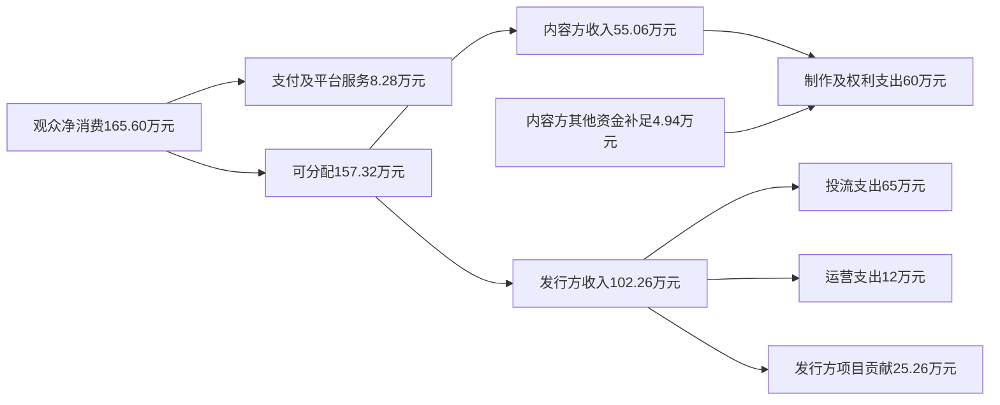

# 中国微短剧市场研究：增长结构、平台竞争与产业链价值分配

**资料截止：2026年11月9日** 
**研究范围：中国境内市场；重点观察2023年至截止日的变化**

中国微短剧已经形成大规模观看需求，当前最清晰的增长来自专门应用承接更多用户、更频繁的使用和更多广告变现机会。QuestMobile最新监测显示，2026年9月短剧视频App月活达到4.87亿；同月短剧视频总使用时长较上年同月增加133.29亿小时。与此同时，CNNIC全国调查中的微短剧使用人口，从2024年末6.62亿变为2025年末6.64亿。应用端增长与全国观看人口在较早观察期内相对平稳并不矛盾。渠道迁移和使用强化是可能的解释，但这组跨期、不同统计口径的汇总数据尚不能分解2026年新增观众、存量迁移及样本或分类变化的贡献；判断其份额需要同期间全国估计与用户迁移或队列数据。[QuestMobile秋季报告，1.4及娱乐休闲2.6原图](https://www.questmobile.com.cn/research/report/2117514373593399298/)；[CNNIC第55次报告，PDF第45页](https://www.cnnic.net.cn/NMediaFile/2025/0428/MAIN17458061595875K4FP1NEUO.pdf#page=45)；[第57次报告，PDF第40页](https://www.cnnic.net.cn/NMediaFile/2026/0304/MAIN1772588317069TUXN3827X8.pdf#page=40)

这使经营竞争从单部剧迅速回收，扩展到持续供给、跨剧复访和长期用户价值。免费广告模式降低观看门槛，拥有流量入口和内容库的平台取得明显优势；付费首发、会员和免广告服务仍可承接愿意为内容与体验付款的需求。真正需要比较的是同一批用户产生的净回款、投入成本和回收时间。相同的“免费”标签下，红果与河马的活跃用户走势已经分化；同一轮供给扩大，也可能同时增加流量平台收入和制作发行方的费用压力。

对决策者，最重要的判断是：**行业观看与交易活动的增长已经得到多方面支持，利润正在按流量、内容权利、合同和现金承担重新分配。**平台应以留存和净变现约束获客及内容预算；制作发行方应根据资金能力选择承制、保底、纯分账或自营；投资者应穿透完整项目组合、集团业务范围和现金回款，而不把最高播放、最高充值或最高分成当作平均收益。以下从统计边界出发，将这些选择放到同一条经济链路中检验。

## 一、先确定增长发生在哪一层

### 1. 内容边界与资金边界

2026年9月1日施行的《微短剧发展管理办法》把微短剧界定为单集少于20分钟、主题主线明确、故事连续完整、人物角色突出的剧集，并覆盖互联网、广播电视等渠道。本报告据此纳入符合叙事条件的真人、动画与AI生成微短剧。横竖屏、AI辅助制作与全生成，是影响成本和场景的不同标签；同一作品不会因为同时拥有这些标签就被重复计入市场。[《办法》第二条](https://www.nrta.gov.cn/art/2026/7/31/art_113_73785.html)

市场核算采用三个层次。第一层是境内观众已经消费、扣除退款的内容支出，以及短剧产业链以外的广告主为国内短剧广告库存或可归属内容服务支付的支出。第二层是企业按合同和会计政策确认的收入。第三层是版权、承制、分销、投流和技术服务等中间交易。第一层观察终端需求，后两层解释需求怎样变成各参与者收入。

| 统一结构 | 纳入对象 | 经营核算单位 | 合并分析时的处理 |
|---|---|---|---|
| 用户付费需求 | 按集解锁、内容包、可归属短剧的会员及免广告服务 | 已履约消费额，扣退款；充值余额另列 | 同一消费不因平台、发行和片方分别确认收入而重复累加 |
| 广告与品牌需求 | 剧内及观看过程中广告、品牌定制和约定传播服务 | 外部广告主支出；平台净广告收入另列 | 平台广告留取与片方分账是同一资金流的分配；商品GMV不整体并入短剧 |
| 内容供给交易 | 剧本、IP改编、承制、采购、授权、联合出品 | 各合同收入、制作成本和回款 | 说明谁获得收入、谁承担成本，产业汇总时抵销内部交易 |
| 获客和分发交易 | 广告购买、达人分销、支付及技术服务 | 实付投流、有效获客成本、佣金和通道费用 | 短剧经营者购买流量，属于内部营销交易；不能与其终端收入简单相加 |
| 资本与扶持 | 股权融资、借款、制作预付、补贴 | 融资现金、合同负债、应收或约定扶持款 | 提高可投入资金，但不是观众或外部广告主消费 |
| 海外业务 | 境内企业面向境外观众的经营 | 境外收入、成本、权益收益与资源投入 | 用于解释企业战略，不并入中国境内终端需求 |

例如，用户充值100元，本期消耗80元，其中退回5元，则可归属消费为75元，另有20元未消费余额。运营者支付40元买量、20元内容分账，这两笔是渠道和内容方收入，终端需求仍为75元。中文在线的会计政策也明确，视频剧收入主要按用户充值后实际消耗的虚拟币折算确认；其2026半年报列有未消费虚拟币形成的递延收入。[中文在线2024年报第187页](https://static.cninfo.com.cn/finalpage/2025-04-29/1223385316.PDF#page=187)；[2026半年报第131页](https://static.cninfo.com.cn/finalpage/2026-08-26/1225504423.PDF#page=131)

免费模式下，汽车品牌支付100元，广告网络、应用、发行和制作方分配这100元。如果广告主本身是一家短剧应用，使用先前收到的观众消费去购买另一平台的流量，产业汇总时还要抵销内部广告购买。企业报表中的“广告收入”因而可能来自两类经济活动：出售观看短剧产生的广告库存，以及向短剧经营者出售获客服务。两者都能产生企业收入，但不能在行业终端需求中不加区分地累计。

### 2. 总量分歧反映什么

不同公开报告都指向行业扩张，却没有形成可直接串联的统一金额序列。主要分歧集中在流水、产值、市场规模的边界，以及预测时点。

| 公开估计 | 时间与性质 | 可以支持的判断 | 比较时需保留的边界 |
|---|---|---|---|
| 2024年505亿元；2025年634.3亿元、2027年856.5亿元 | 中文在线2024年报转引产业报告；后两项为当时预测 | 2024年研究曾预期市场持续扩大 | 634.3亿元不是2025实际值，后续不同口径数字不自动构成同一序列修正 |
| 2023年373.9亿元、2024年504亿元、2025年1000亿元；2026年有望2000亿元 | 北大研究据头部机构流水及第三方数据测算，2026为趋势预测 | 该研究范围内2025交易活动大幅增加 | 报告称未计入出海收入；未消费余额及内部交易的处理缺少可复核明细 |
| 2025年全国产值1000亿元，北京585.7亿元，占58.6%，同比74.2% | 北京市广电局2026年6月发布研究结果 | 企业经营活动和交易组织向北京集聚 | 产值不等于居民消费；地域归属、出海及内部抵销方法未完整公开 |
| 2026年预计超过1210亿元，其中免费真人超过570亿元；上半年AI短剧220亿元、全年预计超过400亿元 | 中文在线2026半年报转引第三方；1210/570均处全年预测语境，220为半年所引估计 | 产业预期已同时考虑真人免费与AI业态 | 半年估计与全年预测分列；AI、真人及整体估计的集合关系未完整说明 |
| 2025年免费微短剧占比约66.3% | 协会白皮书2025年11月版本对全年结构的预估 | 广告支持模式已进入该机构估计的主体 | 免费收入的计价层次未给完整抵销表，不能乘另一来源的1000亿元推算已实现收入 |

来源：[中文在线2024年报第19页](https://static.cninfo.com.cn/finalpage/2025-04-29/1223385316.PDF#page=19)、[北大报告PDF第2—3页](https://www.nsd.pku.edu.cn/docs/2026-02/48accc85b74f4939b8f4c4b612e610ec.pdf#page=3)、[北京研究报告发布稿](https://gdj.beijing.gov.cn/zwxx/gzbg1/202606/t20260625_4720326.html)、[中文在线2026半年报第10—11页](https://static.cninfo.com.cn/finalpage/2026-08-26/1225504423.PDF#page=10)、[白皮书主要发现PDF第14页](https://pdf.dfcfw.com/pdf/H3_AP202511131780698038_1.pdf#page=14)。

这些差异不适合取平均消除。正面的用法是按经营者计算可进入市场：平台估算自己可获得的有效观看和净广告收入；发行商估算可取得版权、可触达队列与净回款；制作方估算有能力签约和交付的采购额。北京企业向海外出售作品，可增加北京企业经营收入，却不增加境内观众消费；这类地理差异同样必须保留。

2023—2026年的变化由此可以分成三条相互连接的线。单剧付费和投流证明了强情节内容的迅速变现能力；免费应用和聚合入口扩大了高频消费及广告承载；进入2026年，连续供给、系列IP、平台合同与内容监管共同提高了组织经营的重要性。这是依据下文产品、财务和规则变化作出的机制归纳，而不是把不兼容的金额估计拼成一条增长曲线。

## 二、需求的增量来自人数、频次还是变现

### 1. 全国人口和应用活跃回答不同问题

CNNIC的两期全国报告分别给出2024年末微短剧用户6.62亿、网民使用率59.7%，2025年末6.64亿、59.0%。按公布的四舍五入值计算，名义人数增加约200万、0.3%，使用率下降0.7个百分点。两期均采用覆盖内地31个省级地区、6岁及以上电话人群的双框抽样和加权估计。这个相对可比的系列没有显示2025年全国观看人口与市场流水估计同步翻倍；增长解释应更多考虑使用强度、渠道迁移和商业化。公开报告未提供短剧指标专属标准误和两期联合方差，200万人不宜进一步解释为统计显著的微弱增长。[第55次报告，PDF第45、61—62页](https://www.cnnic.net.cn/NMediaFile/2025/0428/MAIN17458061595875K4FP1NEUO.pdf#page=45)；[第57次报告，PDF第40、73—74页](https://www.cnnic.net.cn/NMediaFile/2026/0304/MAIN1772588317069TUXN3827X8.pdf#page=40)

QuestMobile则观察应用端使用。2026年2月，其短剧App月活3.35亿、微信小程序4.27亿，二者去重7.18亿。5月报告增加抖音小程序分类，App、微信小程序、抖音小程序分别为4.02亿、5.08亿、0.14亿，三类去重8.51亿；另列抖音、快手主版中浏览短剧相关内容的触达用户4.72亿。原图括号明确，4.72亿不包含在8.51亿的应用端集合内，两者之间也没有可供直接相加的去重结果。[QM2月数据报告PDF第6页](https://pdf.dfcfw.com/pdf/H3_AP202605271822903507_1.pdf#page=6)；[QM授权发布的7月报告，市场概况3原图](https://m.adquan.com/detail/2-362212)

2月图脚还说明了样本门槛：App以2026年2月MAU超过10万的产品回看两期活跃；微信小程序两期各取当月MAU超过100万的产品。前者受到当期存活产品选择影响，后者的产品集合随门槛变化。5月又加入新的容器分类。因此，这些资料很适合识别渠道扩张，但精确的跨期增速应基于统一产品列表、门槛和去重方式。报告中的应用端监测也不直接替代全国人口调查。

| 需求指标 | 已核实的观察 | 对经营选择的含义 |
|---|---|---|
| 全国使用人口 | CNNIC：2024/2025年末6.62亿/6.64亿 | 全国普及面已大，不能仅靠“新增人群翻倍”安排预算 |
| 应用端覆盖 | QM：2026年5月三类应用端去重8.51亿 | 内容可以跨入口流动，需按人去重而非按容器累加 |
| 专门App活跃 | QM：2026年9月4.87亿 | 专用产品持续承接观看，内容库及复访能力的价值上升 |
| App时间与频次 | QM：2026年5月月人均26.9小时、125.6次 | 高频进入比单次使用大幅延长更显著，需建设续看与跨剧承接 |
| 主观偏好 | CSM：2025年末成年网民观看渗透70.2%，77.9%受访者自报过去一年时间增加 | 可用于理解满意度和需求，不能当设备日志或统一全国人口口径 |
| 付费行为和意愿 | CSM：71.8%看过付费微短剧；未来愿意付费84.2% | 付费内容仍有需求，但观看、自己付款与未来意愿须分别记录 |

最新App数来自[QM秋季报告2.6原图](https://www.questmobile.com.cn/research/report/2117514373593399298/)；时间频次来自[QM7月报告，市场概况4原图](https://m.adquan.com/detail/2-362212)；CSM调查于2026年1月开展，核心发现8月11日公开，调查对象为18岁以上网民，其公开摘录未提供完整问卷和抽样细表。[CSM原文](https://www.csm.com.cn/Content/2026/08-11/20260811-01.html)

### 2. 高频复访扩大广告机会，留存决定能否回收获客费用

QM的原图中，短剧App月人均使用从2025年1月13.0小时、62.0次，升至2026年5月26.9小时、125.6次。两端相除，每次使用平均约12.6分钟与12.9分钟，变化相对有限，增量主要表现为一个月内使用更频繁。这是总时长除以总次数的推算，不能直接解释剧集完播，但支持平台把续看、追剧、稳定上新与跨作品推荐作为重要投资方向。[QM7月报告，市场概况4原图](https://m.adquan.com/detail/2-362212)

月人均26.9小时摊到31个自然日约52分钟。掌阅半年报转引CSM全媒体监测的2026上半年“人均单日约2小时”，公开摘录没有给出活跃日或自然日等详细分母。两者不应据表面数值判定谁高估：每日活跃用户均值、每月活跃用户的自然日均值以及有观看当天的均值，描述不同人群和强度。[掌阅2026半年报第8页](https://static.cninfo.com.cn/finalpage/2026-08-27/1225510832.PDF#page=8)

最新QM秋季图提供另一个强度证据：2026年9月短剧视频总使用时长同比净增133.29亿小时，同期短视频增加57.17亿小时，在线视频减少13.80亿小时。图注明确是“当月总时长减去年同期”，并非9月对8月的环比。这些变化说明不同内容产品的时间池正在分化；没有个体迁移和因果识别，不能把短剧全部增量归为长视频流失。[QM秋季报告1.4原图](https://www.questmobile.com.cn/research/report/2117514373593399298/)

广告收入还要经过两道转换。首先，观看必须形成可售广告展示，取决于广告位置、填充、有效流量和用户体验。其次，展示必须获得足够净价格，取决于广告主需求、受众质量和服务留取。增加广告密度可以提高当天收入，也可能降低次周留存；如果后者损失更大，单用户短期收入上升仍会降低整个获客批次的价值。第六部分用联动情景展示这一取舍。

### 3. 将观看、付款和消费连成可用的漏斗

下载表示一次安装或获取行为，可能包含重复安装；注册形成账号，也可能没有观看；MAU只要求观察期内有相应活动；有效观看、完播、复访与支付各有独立定义。经营漏斗应从同一批真实触达或有效激活用户开始，分别记录：进入播放、实际观看、达到约定完播条件、再次观看其他作品、发生净消费或有效广告展示。各节点沿同一观察窗计算，才知道改善来自入口、内容或收费。

CSM所称71.8%“观看过付费微短剧”，公开摘录没有完整区分本人支付、会员观看、家庭共享等情形，因而不能代入买量模型作为支付转化率。其52.3%偏好平台会员、超过四成接受付费去广告，则提示购买方式可能从逐集解锁向内容打包和体验购买扩展。84.2%的未来付费意愿适合用于产品假设，经营预算仍需实际净消费验证。[CSM调查，付费模式部分](https://www.csm.com.cn/Content/2026/08-11/20260811-01.html)

同一用户可以先买首发，后来用广告看老剧，也可以主要免费观看、偶尔购买免广告。混合模式的关键是按时间拆出互斥状态：购买免广告后被替代的广告收入要扣除；转免费后可能流失的原有付费需求也要扣除。一个作品在多个入口发行，创造的是更多消费机会，新增用户和新增净收入仍需分别识别。

### 4. 人群差异决定产品适配，不能直接归因于平台技术

QM2026年2月画像中，短剧App的31—50岁用户占54.9%，51岁以上占13.9%；微信短剧小程序51岁以上占31.2%。同图App男性占60.1%，而掌阅所引CSM全媒体口径女性占52.1%。年龄、内容形态、设备范围和监测方法均会影响结果。对经营者更有价值的是同一来源内的渠道比较，而非宣布全国短剧观众只属于某一性别或年龄。[QM报告PDF第7页](https://pdf.dfcfw.com/pdf/H3_AP202605271822903507_1.pdf#page=7)；[掌阅半年报第8页](https://static.cninfo.com.cn/finalpage/2026-08-27/1225510832.PDF#page=8)

小程序较低的安装门槛和熟悉的分享支付路径，与其较高老年占比相容；App的连续内容库和追剧体验，与高频使用相容。这些机制仍会受采购内容影响。比较同一剧的渠道效果时，应同时控制素材、题材、投放人群、广告密度和观察期，避免把内容适配优势全归给算法，也避免把某一阶段用户构成视为平台永久特征。

## 三、平台竞争发生在发现、复访和内容交易三个环节

### 1. 六类代表性机制

免费和付费描述谁承担内容成本，小程序和App描述播放容器，推荐流和搜索描述发现入口。同一家公司可以同时占据多种位置。以下选择代表对象，是为了比较经营机制，而不是把公司排成互斥阵营。

| 代表对象与机制 | 发现及复访 | 内容供给和用户关系 | 收益与成本的关键位置 | 适合的经营能力 |
|---|---|---|---|---|
| 抖音原生及开放小程序 | 推荐、搜索、关注；视频/直播挂载；侧边栏、feed卡复访 | 平台掌握推荐和交易基础设施，经营者组织内容、推广及客服 | 原生激励、品牌合作、小程序支付与广告并存；发行方承担买量回收 | 素材测试、净回款归因、复访与售后运营 |
| 红果免费短剧App | 集团导流、应用分发、搜索；站内推荐、收藏及跨剧续看 | 连续内容库，IP、版权与制作合作；合同区分独家和非独家 | 广告支持分账，保底和激励分担部分前期投入 | 持续提供有效观看和留存的内容，管理权利与结算 |
| 快手原生、营销入口及喜番 | 原生推荐、账号关系、广告；App追剧 | 内容与账号经营叠加广告技术、独立产品 | 短剧买量构成营销收入；内容分账和App广告另算 | 原生内容、账号、投流及电商协同的组合经营 |
| 微信第三方小程序与绿泡泡 | 视频号切片、分享、搜索；朋友推荐、微信内观看 | 第三方运营与官方聚合并存，聚合进一步集中发现入口 | 支付与广告均可；分销、聚合合作分别核算 | 低摩擦触达、社交传播及多渠道版权发行 |
| 腾讯视频等综合视频平台 | 剧场、站内推荐、IP搜索和会员习惯 | 采购、保底、分账、厂牌及系列开发 | 会员和广告共同形成内容价值，按合同分配 | 较成熟制作、系列IP及较长回收期承受力 |
| 河马等独立应用 | 外部获客、应用分发、站内推荐 | 自建用户关系与内容库，较少集团流量支持时成本约束更强 | 广告、会员、免广告等混合；获客与运维自行承担 | 在特定人群、内容或留存上形成差异化 |

抖音能力依据[官方解决方案](https://partner.open-douyin.com/docs/resource/zh-CN/mini-app/open-capacity/solutions/vertical/micro-drama)；微信产品与协议观察依据[北京日报报道，新华网转载](https://www.xinhuanet.com/ent/20261015/8928500abcd44e8a9e5d69f115fcb2ed/c.html)；内容协作依据[北大报告PDF第6页](https://www.nsd.pku.edu.cn/docs/2026-02/48accc85b74f4939b8f4c4b612e610ec.pdf#page=6)；横屏合作依据[2026产业大会平台发言实录](https://finance.sina.cn/2026-03-17/detail-inhrhxzn2098963.d.html?wm=3049_0015)。表中的适用条件为本文据这些机制作出的判断。

### 2. App把首次获客摊到多次消费，免费优势仍会集中

单剧付费发行把切片吸引力、解锁节点和短期回款紧密连接。一个高转化素材可以迅速带来订单，但换剧或换入口后，经营者可能再次购买同一批人。独立App则试图把首次获客费用摊到多天、多剧和多次展示。内容库越能接住下一部剧，单项目流量波动越容易被组合吸收，采购因此成为持续经营的一部分。

红果的增长显示这种机制可以形成强覆盖优势。QM9月榜单中，红果免费短剧MAU为42969万，同比增长81.8%；河马3080万，同比下降40.3%；喜番834万，同比增长123.9%。红果单App覆盖约为行业去重4.87亿的88.2%，但该比值不是互斥收入份额。相同免费标签下，头部增长和中等应用收缩同时存在，足以否定“免费赛道增长会平均惠及所有应用”的假设。[QM秋季报告2.6—2.7原图](https://www.questmobile.com.cn/research/report/2117514373593399298/)

同报告显示，红果用户中88.5%也用抖音，重合3.80亿；喜番用户中75.8%也用快手。集团能够提供发现入口和商业能力，App则要靠内容体验让人持续回来。重合证明多产品使用普遍，却没有单独识别内部导流的因果贡献。对缺少集团流量的新应用，投资理由应建立在特定内容、受众和净留存上，而不是复制头部产品界面后假设也能获得同样获客成本。

平台内容合作由此具有具体价值：稳定产能减少断档，评级和反馈让资源更快流向有潜力的项目，非独家老剧补充长尾。供给过快也会增加竞争。如果可消费时间增长赶不上上新，新增作品会争夺有限推荐位，压力首先落到片方单部回收和采购报价上。

### 3. 金币调整检验内容需求能否脱离奖励

红果2026年10月公告分阶段取消金币。10月29日报道转述，自11月1日起新激活用户不再获得该功能，旧用户计划在12月31日前下线，已取得金币和现金余额保留兑换提现权益。至11月9日，新用户调整约一周，老用户阶段尚未完成。同期平台否认“年化400亿元”收入传闻，本文不以该传闻估算收入或利润。[报道对公告及平台回应的转述](https://finance.sina.cn/2026-10-29/detail-iniwwpnu6061010.d.html?vt=4)

取消奖励能否改善经营，取决于节省支出与流失广告价值的比较。若用户已形成内容需求，奖励退出后仍会追剧，单位经济性可能改善；若使用强烈依赖现金激励，展示、留存和用户质量变化会抵销节省。合适的判断依据是调整后同批新用户完整观察期的净广告贡献与复访，而不是用9月MAU证明11月政策已经成功。

AI热度同样不能直接推导真人采购必然退出。4月大会宣布5亿元真人短剧扶持，3月平台代表还表示全年内容预算预期增加超过40%。这些安排表明真人供给仍被重视，但预算宣布、项目入选、实际发放各属不同阶段。[中国经营报4月大会报道](https://finance.eastmoney.com/a/202604153706407286.html)；[3月红果发言实录](https://finance.sina.cn/2026-03-17/detail-inhrhxzn2098963.d.html?wm=3049_0015)

### 4. 小程序正在承接复访，微信聚合增强另一种用户关系

抖音方案把自然挂载、商业推广和复访能力分别列出。短视频、直播与搜索可以带来第一次进入，侧边栏、feed卡等可以接住第二次。小程序经营者并非只能完成一次交易，也可以跨剧经营，但入口和触达规则依赖所在平台。官方还提供归因用户eCPM回传能力，用于估算买量LTV，使广告支持模式也能按获客批次评估。[抖音方案第四、五部分](https://partner.open-douyin.com/docs/resource/zh-CN/mini-app/open-capacity/solutions/vertical/micro-drama)

其中，推广计划采用支付分成时，可设1%—29%的达人佣金及0—3天的最长自动发起分账周期；交易系统另列支付T+7结算。前者是推广任务规则，后者是支付链路，均不代表版权方统一份额或所有款项最终到账时间。比较不同发行路径，应把达人费、平台服务费、内容分账和退款逐项归属。

微信聚合则体现社交场景的另一种组织方式。北京日报10月观察显示，绿泡泡在微信内提供免费剧场、推荐流及个人页，以剧间广告支持观看，突出朋友推荐及小窗；协议签约主体为深圳市腾讯计算机系统有限公司，内容由第三方小程序、制作或授权发行方提供。记者还观察到与红果重合的热门剧目。[现场观察和协议核对](https://www.xinhuanet.com/ent/20261015/8928500abcd44e8a9e5d69f115fcb2ed/c.html)

QM9月榜单列绿泡泡MAU15635万，说明聚合入口已具有可观覆盖。新增入口可提高非独家内容的发行选择，却也可能集中原先分散在各小程序的复访关系。版权方的议价能力取决于可保留权利和内容差异；小程序运营者则要判断自己提供的是独特内容、用户关系，还是容易被聚合替代的播放服务。免费内容相近时，竞争会更多落到进入成本、推荐关系、更新和体验。[QM秋季报告2.7原图](https://www.questmobile.com.cn/research/report/2117514373593399298/)

### 5. 营销平台与横屏平台对同一内容有不同定价

快手2026年二季度官方业绩稿披露，短剧线上营销服务总投放消耗同比增长超过100%，6月含真人与AI短剧的供给较1月增长超过5倍。这些数据列在营销服务章节，最直接反映的是短剧经营者购买推广服务的需求。渠道可以先取得营销收入，买量方还需等待观众消费或广告观看回收。供给扩大、营销收入增加与片方利润受压因而能够同时发生。[快手8月19日业绩稿，线上营销服务部分](https://ir.kuaishou.com/zh-hans/news-releases/news-release-details/kuaishoukejifabu2026niandierjidujizhongqiweijingshenhecaiwuyeji)

综合视频平台更多围绕会员价值、IP和较长收益期组织合同。腾讯视频代表在2026产业大会介绍，长、中、短横屏分账政策拉通，纯分账独播项目超过100万元的部分增加15%激励，达到相应门槛可延长分账期，同IP系列开发另有条件奖励。其意义在于把连续开发和长尾价值纳入交易，而不是单纯提高一项名义比例。[产业大会腾讯视频发言](https://finance.sina.cn/2026-03-17/detail-inhrhxzn2098963.d.html?wm=3049_0015)

成熟世界观、角色和主创可在续作中复用开发投入，但更长收益期也可能伴随较长授权、制作义务和资金占用。内容对会员拉新、续订和使用的价值，需要按合同分账基数归属。最高分成、固定时长单价、净收入阶梯、广告金和现金奖励并不具备天然可比性。对同一项目，应固定权利包、窗口、预算和有效观看情景后比较净回款；资金有限的小团队可能更适合确定采购，拥有系列IP的机构则更值得保留长尾参与。

自然流量也应放在这一框架中理解。它可以来自观众搜索和分享、账号积累、推荐匹配，也可以来自平台采购与精品扶持。即便发行方没有按点击付费，内容制作、账号经营和获得推荐资源仍有成本。稳健的预算应区分已获得的资源、可持续的自然复访与尚未兑现的曝光承诺。

## 四、内容生产的效率，怎样变成可分配收入

### 1. 产能与注意力并不同步增长

平台化合作把剧本、人员、场景、拍摄、后期和发行连成连续流程。北大调研描述了定制剧、版权剧和成品剧三类合作，平台参与前期、承担成本及后验评级的程度不同。这能减少寻找生产要素和重复搭建流程的成本，稳定上新，却无法消除观众对故事的反应不确定性。同一平台、题材和演员的项目，也可能一起受到审美疲劳或规则变化影响。[北大报告PDF第6—7页](https://www.nsd.pku.edu.cn/docs/2026-02/48accc85b74f4939b8f4c4b612e610ec.pdf#page=6)

上架数量尤其需要与独立作品分开。协会白皮书列2025年1—8月竖屏剧上架14万余部，并说明其中大量来自重剪和复投，预计全年独立完整制作并上线约4万部。重剪有可能延长资产寿命，但不能据上架增长直接推算拍摄产能或新增制作支出。2026年AI供给加速后，作品、版本、素材和上架记录的区分更加重要。[白皮书主要发现PDF第6页](https://pdf.dfcfw.com/pdf/H3_AP202511131780698038_1.pdf#page=6)

同一白皮书的从业者调研称，2025年普通剧集制作成本普遍升至40万—70万元，百万元以上精品项目增多；公开版没有提供足够样本分布来计算全国均价。本文后续以60万元作演示预算量级，始终保留假设身份。实际项目还需区分制作与发行成本：IP、剧本、演职、场地和后期形成内容，素材、买量、客服、技术及退款则决定能否售出和回收。[白皮书PDF第7页](https://pdf.dfcfw.com/pdf/H3_AP202511131780698038_1.pdf#page=7)

AI改变的是部分工序和可实现题材。减少演员拍摄、场景搭建或复杂视觉制作，可能扩大原本做不起的奇幻、科幻内容；角色一致性、废弃生成、重做、人工审校、算力和素材授权仍需计价。白皮书列常规AI真人剧约每分钟1000元、精品每分钟2万—5万元，跨度本身就说明“AI制作成本”不适合用一个数字概括。[白皮书PDF第21页](https://pdf.dfcfw.com/pdf/H3_AP202511131780698038_1.pdf#page=21)

若降本只使更多相似项目争夺同一流量，节省可能转为更高投流或更低版权报价；若它扩展了差异化内容和有效观看，才会增加行业可分配收益。制作效率因此应与有效观看、净授权价格和项目回款一起观察。

### 2. 合同决定谁承担制作失败与商业化失败

| 合作安排 | 前期资金与交付 | 制作或版权方回报 | 风险落点 | 最关键的计价条件 |
|---|---|---|---|---|
| 固定价承制、采购 | 委托方按里程碑付款，承制方可能先垫支 | 合同价减交付成本；后续版权另约 | 承制方主要承担超支、修改和尾款风险 | 验收标准、修改范围、付款节点、权利交付 |
| 可回收保底加分账 | 平台支付最低保证，后从约定应得分账抵扣 | 通常取保底与累计应得分账较高者，依合同确定 | 平台承担保底下方风险，片方仍承担未覆盖成本 | 抵扣对象、跨项目抵扣、期限和退还义务 |
| 成品纯分账 | 片方先投制作及权利 | 有效结算基数乘约定份额 | 播放、价格、评级、下架和账期主要影响片方 | 分账基数、扣项、数据权限、权利范围 |
| 平台或联合投资先回本后分盈余 | 先承担核定制作及推广 | 成本回款、承制收益及超额收益参与 | 成本超支和回收顺序影响最终分配 | 成本上限、可扣费用、回收优先级、盈余公式 |

这些是对公开调研及平台发言中合作类型的经济拆解，不代表统一合同。北大报告记载部分版权合作先覆盖成本后分成，产业大会也出现平台承担核定成本、再分收益的安排。[北大报告第6页](https://www.nsd.pku.edu.cn/docs/2026-02/48accc85b74f4939b8f4c4b612e610ec.pdf#page=6)；[平台发言实录](https://finance.sina.cn/2026-03-17/detail-inhrhxzn2098963.d.html?wm=3049_0015)

保底的首要价值可能是分担损失，也可能只是提前付款。可从未来收入回收的保底，与在全部分账之外额外支付的不可回收奖励，最终金额不同；若只在验收后支付，制作期的垫资仍由片方承担。保底覆盖70%预算时，还有30%成本暴露；若另有超支，风险继续增加。合同应分别回答最终至少收多少、什么时候先收到钱、付钱之后交出哪些权利。

### 3. IP价值取决于可保留的权利与后续开发

书库规模可以提供选材，但未必每本书都具备同样改编权；爆款播放可以证明受众需求，也未必让承制方获得续作、海外或动画化收益。只有一次承制合同，回报主要来自制作服务；保留续集、改编、再授权和第二窗口权利，才有机会把一次成功变成持续资产。

版权链应覆盖原著到剧本、成片到平台、素材到推广，并明确地域、期限、独家、转授权以及音乐、肖像和声音用途。北大调研记录了部分7天独家首发窗口，说明时间窗口本身可以交易，但不能作为所有平台现行统一期限。多平台发行的选择，是新增净授权或广告收入与原渠道被替代净消费的比较；独家溢价需要补偿放弃的窗口和选择权。[北大报告第6页](https://www.nsd.pku.edu.cn/docs/2026-02/48accc85b74f4939b8f4c4b612e610ec.pdf#page=6)

品牌定制是另一条资金来源。品牌支付的制作或传播合同费可以支持内容预算，降低对充值和插播广告的依赖；品牌最终商品销售额仍属于商品市场。白皮书记录2025年1—8月233部品牌合作短剧和87个首次尝试品牌，证明客户类型扩展。没有对照实验和成本明细，这些数量还不足以判断品牌平均增量销售或项目利润。[白皮书PDF第17页](https://pdf.dfcfw.com/pdf/H3_AP202511131780698038_1.pdf#page=17)

### 4. 爆款是上行空间，组合和合同才是经营结果

中文在线2024年报称，《全家偷听我心声杀疯了，我负责吃奶》上线24小时抖音播放超过3.9亿、充值超过2000万元；2026半年报又称《一品布衣》系列累计播放超过60亿。前者说明付费高潮可以集中形成，后者说明系列内容可以长期吸引观看。但项目退款、投流、制作和各方分账未完整披露，无法由此算出项目净利润，更不能生成行业平均回报。[2024年报第27页](https://static.cninfo.com.cn/finalpage/2025-04-29/1223385316.PDF#page=27)；[2026半年报第14页](https://static.cninfo.com.cn/finalpage/2026-08-26/1225504423.PDF#page=14)

衡量组织能力，需要把未上线、失败、普通和爆款都纳入同批项目。标准化可以减少超支和重复劳动，系列化可以复用资产，分账透明可改善创作激励；这些优势只有在完整组合覆盖开发、人员和获客支出后，才成为可持续利润。下一节的上市公司财务，提供了从“作品成功”走到“组织赚钱”的实际检验。

## 五、上市公司说明了收入机会，也揭示费用与现金的约束

### 1. 同样连接IP和渠道，财务结果仍随经营结构改变

中文在线和掌阅都拥有网文与IP、内容衍生和制作发行能力，也包含海外业务，适合观察从阅读向视频衍生的资源迁移。以下为集团口径，不是两家公司的境内短剧收入。年度截至2025年，2026采用半年和前三季度实际累计，未将任何半年值年化为已实现全年业绩。

**单位：亿元，四舍五入。**

| 公司及期间 | 集团收入 | 归母净利润 | 经营现金净额 | 对比较有实质影响的背景 |
|---|---:|---:|---:|---|
| 中文在线2023 | 14.089 | 0.894 | -0.101 | CMS仅并表至4月底，扣非净利润为-0.383亿元 |
| 中文在线2024 | 11.591 | -2.429 | -0.525 | CMS全年不并表，范围变化影响同比 |
| 中文在线2025 | 16.566 | -6.710 | -2.037 | 收入增42.92%，境外占40.98%，推广投入明显 |
| 中文在线2026上半年 | 5.779 | -0.430 | 1.268 | 减亏和现金改善，包含营运资金释放 |
| 中文在线2026前三季度 | 8.327 | -1.321 | 0.428 | 收入同比下降17.64%，第三季重新净流出现金 |
| 掌阅2023 | 27.784 | 0.348 | 3.384 | 阅读与版权构成既有基础 |
| 掌阅2024 | 25.833 | 0.493 | -0.750 | 净利润仍正，经营现金已转负 |
| 掌阅2025 | 32.427 | -1.765 | -2.325 | 衍生收入扩大，销售费用增长快于收入 |
| 掌阅2026上半年 | 17.838 | -0.501 | -1.165 | 衍生收入增长、减亏，现金尚未转正 |
| 掌阅2026前三季度 | 27.753 | -0.684 | 0.527 | 收入增12.73%，第三季回款改善 |

年度依据[中文在线2025年报第14页](https://static.cninfo.com.cn/finalpage/2026-04-23/1225157276.PDF#page=14)、[掌阅2025年报第6—7页](https://file.finance.sina.com.cn/211.154.219.97:9494/MRGG/CNSESH_STOCK/2026/2026-4/2026-04-25/12187821.PDF#page=6)；中期依据[中文在线半年报第8页](https://static.cninfo.com.cn/finalpage/2026-08-26/1225504423.PDF#page=8)、[掌阅半年报第6页](https://static.cninfo.com.cn/finalpage/2026-08-27/1225510832.PDF#page=6)；最新累计依据[中文在线三季报第2页](https://static.cninfo.com.cn/finalpage/2026-10-26/1225620142.PDF#page=2)、[掌阅三季报第1页](https://dataclouds.cninfo.com.cn/shgonggao/hsomarket/2026/20261030/12ea37e82c304776aa3c019cebbaae96.PDF#page=1)。2026中期与季度报告未经年度审计。

掌阅2025年收入增加6.594亿元，毛利只增加3.450亿元，销售费用却增加5.784亿元，增量毛利不足以覆盖增量销售费用，归母结果由盈转亏。中文在线2026上半年改善较明显，但第三季度收入2.548亿元、同比下降43.95%，归母亏损0.891亿元。两者共同提示，成功内容、增长分部与集团持续盈利之间，还隔着获客费用、业务组合和回收周期。[掌阅年报第16页](https://file.finance.sina.com.cn/211.154.219.97:9494/MRGG/CNSESH_STOCK/2026/2026-4/2026-04-25/12187821.PDF#page=16)；[中文在线三季报第2页](https://static.cninfo.com.cn/finalpage/2026-10-26/1225620142.PDF#page=2)

### 2. 毛利之后仍要支付大量商业化成本

| 指标 | 中文在线2025 | 中文在线2026上半年 | 掌阅2025 | 掌阅2026上半年 |
|---|---:|---:|---:|---:|
| 集团毛利率，自算 | 36.18% | 49.58% | 69.10% | 65.63% |
| 销售费用/收入 | 57.54% | 43.98% | 64.10% | 62.17% |
| 毛利减销售费用，亿元 | -3.539 | 0.324 | 1.622 | 0.619 |
| 已披露短剧相关收入，亿元 | 短剧及IP衍生品8.960 | 同口径4.113 | 短剧等衍生18.549 | 同口径11.851 |
| 相关分部毛利率 | 38.41% | 48.62% | 68.00% | 未单列同等分部成本 |

计算依据：[中文在线年报第31—35页](https://static.cninfo.com.cn/finalpage/2026-04-23/1225157276.PDF#page=31)、[半年报第21—22页](https://static.cninfo.com.cn/finalpage/2026-08-26/1225504423.PDF#page=21)、[掌阅年报第16—18页](https://file.finance.sina.com.cn/211.154.219.97:9494/MRGG/CNSESH_STOCK/2026/2026-4/2026-04-25/12187821.PDF#page=16)、[半年报第9、12页](https://static.cninfo.com.cn/finalpage/2026-08-27/1225510832.PDF#page=9)。

毛利减销售费用用于解释经营桥接，尚未扣管理、研发、财务等，也不是国内短剧利润。掌阅2025年推广费19.856亿元，占销售费用95.53%；2026上半年仍有10.521亿元。其审计报告把推广费用完整性列为关键审计事项，核对合同、后台数据及结算。内容和渠道成本另在营业成本中列报，因此高分部毛利并不意味着已支付所有获客费用。[掌阅年报第18、78—79、212页](https://file.finance.sina.com.cn/211.154.219.97:9494/MRGG/CNSESH_STOCK/2026/2026-4/2026-04-25/12187821.PDF#page=18)；[半年报第149页](https://static.cninfo.com.cn/finalpage/2026-08-27/1225510832.PDF#page=149)

中文在线2025年销售费用9.532亿元、同比增长105.02%，公司主要归因于海外推广；同年境外收入6.789亿元、毛利率16.14%。这些数据解释公司资源投入，不能全部扣在境内短剧上。2026上半年短剧及IP分部毛利约1.9995亿元，集团仍有2.5415亿元销售费用以及管理、研发和其他收支，说明投资需要识别各业务是否覆盖增量费用，而非直接采用分部毛利率作为股东收益率。[中文在线年报第32、35页](https://static.cninfo.com.cn/finalpage/2026-04-23/1225157276.PDF#page=32)；[半年报第21—22、53页](https://static.cninfo.com.cn/finalpage/2026-08-26/1225504423.PDF#page=21)

### 3. 回款可以领先或落后利润

中文在线2026上半年合并净亏损0.431亿元，却有经营现金净流入1.268亿元。现金流补充表中，应收项目减少提供1.9069亿元，应付减少消耗0.5742亿元，存货增加消耗0.0048亿元，三项营运资金净释放约1.3279亿元。回收前期款项是现金改善的重要部分。前三季经营现金减去上半年，第三季度单季净流出0.8401亿元，显示这种释放不能机械延续。[半年报第148页](https://static.cninfo.com.cn/finalpage/2026-08-26/1225504423.PDF#page=148)；[三季报第11页](https://static.cninfo.com.cn/finalpage/2026-10-26/1225620142.PDF#page=11)

掌阅同期方向不同：上半年合并净亏损0.4726亿元，经营性应收增加消耗1.2175亿元，应付增加提供0.5654亿元，存货增加约0.0019亿元，营运资金净消耗约0.6540亿元，最终经营现金流出1.1653亿元。第三季度单季净流入约1.6926亿元，才使前三季转正；半年报还称短剧和推广预付增加，使预付账款达到1.1271亿元。[掌阅半年报第13、156—157页](https://static.cninfo.com.cn/finalpage/2026-08-27/1225510832.PDF#page=156)；[三季报第13页](https://dataclouds.cninfo.com.cn/shgonggao/hsomarket/2026/20261030/12ea37e82c304776aa3c019cebbaae96.PDF#page=13)

因此，收入增长可能同时抬高应收和预付。承制方获得分阶段预付款，可以减少制作垫资；自营发行在获客时支付推广，之后才回收用户或广告收入。相同账面毛利下，两种业务需要的现金准备可能相差很大。

### 4. 公司范围、客户身份和分部重列会改变判断

中文在线2023年4月调整CMS董事会和表决权，持股仍为49.16%，但表决权从50.90%降至47.81%，董事提名为3/7，自5月起不再控制并退出合并、采用权益法。此变更对当年净利润影响约5592.37万元，属非经常损益。ReelShort所在CMS后续收入不能继续全额加到中文在线集团，2023盈利也不能全部解释为日常短剧经营盈利。[中文在线2023年报第23、92页](https://static.cninfo.com.cn/finalpage/2024-04-22/1219703471.PDF#page=92)

2025年公司又调整产品分类，重列2024“短剧及IP衍生品”为3.982亿元；旧2024年报“IP衍生开发产品”为4.549亿元。比较2025年的8.960亿元应使用重列数。2026半年报所列CMS经营资料仅为1—3月，而FlareFlow子公司半年收入和利润又属另一主体、可能包含内部交易。它们都可说明资源配置，但不能跨主体、跨期间拼成国内行业利润。[2025年报第31—32页](https://static.cninfo.com.cn/finalpage/2026-04-23/1225157276.PDF#page=31)；[2024年报第30页](https://static.cninfo.com.cn/finalpage/2025-04-29/1223385316.PDF#page=30)；[2026半年报第25—26、159页](https://static.cninfo.com.cn/finalpage/2026-08-26/1225504423.PDF#page=25)

平台还可能是内容公司的客户。掌阅2026半年报关联交易表中，广告营销8937.86万元列在“出售商品/提供劳务”项下，属于销售侧；同表还列向北京字跳提供衍生业务3.9983亿元、向北京巧幕提供衍生业务1.0826亿元。仅看到“广告”或“巨量引擎”名称就认定为买量采购，会反转资金方向。[掌阅半年报第186—188页](https://static.cninfo.com.cn/finalpage/2026-08-27/1225510832.PDF#page=187)

这使平台采购与自营应用之间的选择更具体：前者可以获得内容或服务回款，减少部分直面消费者的成本，同时依赖客户结算和分发；后者保留更多用户经营空间，也承担获客和持续供给。2026上半年两家公司均有减亏和经营改善证据，不能只讲失败；最新季度和现金变化又提醒，扩大投入必须以完整回收持续覆盖成本为条件。

## 六、用可复算的经营账比较利润与垫资

公开资料不足以估计行业统一利润率，但可以构造透明情景，检验预算、转化、完播、留存和合同怎样作用于不同参与者。本节全部商业参数均为假设，不是行业均值、平台报价或回报承诺。金额为人民币，项目贡献仅扣列示成本，未计所得税、融资和总部费用。两种模式的用户规模不同，用于解释各自机制，不作为免费与付费的同条件胜负实验。

### 1. 付费发行：整体赚钱，片方仍可能亏损

设10万名有效获客用户，15%在观察窗内发生实际内容消费，消费用户人均消耗120元；对消费金额按8%退款，支付及平台服务合计留取退款后金额的5%，余额35%给内容方。发行获客成本6.5元/人，运营12万元，制作及权利预算60万元。这里的120元是实际消耗，未履约充值余额不计收入。

令N为有效获客用户，p为发生消费的比例，S为消费用户人均消耗，r为金额退款率，f为渠道留取，s为内容份额，B为制作及权利预算，c为每用户获客成本，O为运营成本：

\[
D=NpS(1-r),\quad R=D(1-f)
\]
\[
\Pi_{内容}=sR-B,\qquad \Pi_{发行}=(1-s)R-Nc-O
\]

D为外部净消费，R为可分配收入。用户实际消耗180万元，退款14.40万元，终端净消费165.60万元。扣渠道8.28万元，可分配157.32万元；内容方取得55.06万元，扣60万元预算后贡献-4.94万元；发行方取得102.26万元，扣65万元买量和12万元运营后贡献25.26万元；两者合计贡献20.32万元。

这条资金流只形成165.60万元外部消费；内容收入、发行收入和投流不能再相加为新增终端市场。图中的4.94万元是片方亏损需要补足的资金。相同合同下，发行方仍可能愿意继续投放，制作方却已无力靠当部回款完成下一部，这正是合同谈判和可持续供给需要解决的问题。

### 2. 广告支持：累计有效观看替代支付转化

另设100万名初始有效用户，观察第0—90日共91个自然日。第0日全部活跃，D1留存40%、D7为20%、D30为8%、D90为2%；锚点间按指数曲线插值。每活跃日有12次广告机会，填充率85%，广告主侧每千次有效展示45元，广告网络留取15%，其后35%给内容方。获客1.8元/人，运营30万元，制作及权利预算60万元。

广告主在本情景中来自短剧产业链以外；收入全部可归属于设定内容包，不挪用其他作品收入。令每日活跃概率为q，累计活跃天数L，广告机会a、填充率h、广告主侧eCPM为e：

\[
L=\sum_{t=0}^{90}q_t,\quad I=NLah,\quad D=Ie/1000,\quad R=D(1-f)
\]

基准每名初始用户累计活跃8.553天，形成8723.72万次有效展示。广告主支出392.57万元，网络取得58.89万元，余333.68万元分配。内容方收入116.79万元，贡献56.79万元；经营者收入216.89万元，扣180万元买量和30万元运营，贡献6.89万元。双方合计63.68万元。

| 资金位置 | 付费情景，万元 | 免费广告情景，万元 |
|---|---:|---:|
| 外部净消费或广告主支出 | 165.60 | 392.57 |
| 支付/平台服务或广告网络留取 | 8.28 | 58.89 |
| 可分配收入 | 157.32 | 333.68 |
| 内容方收入 | 55.06 | 116.79 |
| 发行/应用经营者收入 | 102.26 | 216.89 |
| 制作及权利成本 | 60.00 | 60.00 |
| 获客成本 | 65.00 | 180.00 |
| 运营成本 | 12.00 | 30.00 |
| 内容方贡献 | -4.94 | 56.79 |
| 发行/经营者贡献 | 25.26 | 6.89 |
| 双方合计贡献 | 20.32 | 63.68 |

免费基准中，经营者的最高可承受获客成本约1.869元/人，实际假设1.8元已经接近边界；其保本广告主侧eCPM约43.57元，距离假设45元也不远。高观看规模与片方分账良好，可以和应用经营者微利并存。扩大规模若抬高获客报价，可能先使经营者转亏。

### 3. 预算、转化与留存的敏感性

以下只变动注明参数，其余保持对应基准。D7变化同时把D30、D90保持为D7的40%、10%，表示后续留存曲线整体变化，D1不变。金额单位均为万元。

| 情景 | 内容方贡献 | 发行/经营者贡献 | 合计 | 对决策的意义 |
|---|---:|---:|---:|---|
| 付费基准 | -4.94 | 25.26 | 20.32 | 合计与各方盈亏不同 |
| 制作预算降30%至42万元 | 13.06 | 25.26 | 38.32 | 真实效率提升增加总盈余 |
| 制作预算增30%至78万元 | -22.94 | 25.26 | 2.32 | 固定份额下，升级成本由片方承担 |
| 获客增20%至7.8元 | -4.94 | 12.26 | 7.32 | 加价抢量空间缩小 |
| 消费用户比例15%降至12% | -15.95 | 4.81 | -11.14 | 合计转负，片方受损更早 |
| 消费比例升至18% | 6.07 | 45.71 | 51.78 | 转化改善可让双方受益 |
| 退款率8%升至15% | -9.13 | 17.48 | 8.35 | 流水之外需看真实回款 |
| 内容份额35%升至40% | 2.93 | 17.39 | 20.32 | 改变分配，不创造新盈余 |
| 免费基准 | 56.79 | 6.89 | 63.68 | 内容方较好，经营者余量薄 |
| eCPM降20%至36元 | 33.43 | -36.48 | -3.05 | 广告需求变化影响合计回报 |
| eCPM升20%至54元 | 80.15 | 50.27 | 130.42 | 广告变现改善具明显杠杆 |
| 获客增20%至2.16元 | 56.79 | -29.11 | 27.68 | 收入规模未变，经营者已亏损 |
| D7降至15%，后续同比例降 | 34.87 | -33.82 | 1.05 | 留存损失吃掉大部分盈余 |
| D7升至25%，后续同比例升 | 78.47 | 47.15 | 125.62 | 跨日复访支撑更高获客报价 |
| 内容份额35%升至40% | 73.47 | -9.79 | 63.68 | 过度让利可能影响持续采购 |

付费基准下，发行方最高可承受获客成本约9.03元；内容方若保持60万元预算和35%分成，则消费用户比例需约16.35%才能保本。合同双方看到的盈亏阈值不同，单用发行ROI决定投放强度，会忽视内容供给方的可持续性。

预算变化在表中被视作不影响收入的纯成本变化。实际削减演员、后期或剧本投入若损伤转化，就应联动调整收入；增加预算也需要有效观看、留存或授权溢价的依据。精品化值得投入的经济条件，是新增回款和长期价值足以覆盖新增资源。

### 4. 完播影响一次使用，留存影响重复次数

完播率不能直接代入留存，也不能对所有广告形式套用同一关系。为单独展示机制，假设免费基准每个活跃日开始20集，只有完成一集才形成一个剧后广告机会，其他参数和跨日留存固定。完播60%对应原基准12次机会；45%对应9次；75%对应15次。这是明确的产品假设，不是对任何实际应用广告密度的描述。

| 完播情景 | 每活跃日机会 | 内容方贡献，万元 | 经营者贡献，万元 | 合计，万元 |
|---|---:|---:|---:|---:|
| 完播45% | 9 | 27.59 | -47.33 | -19.74 |
| 完播60% | 12 | 56.79 | 6.89 | 63.68 |
| 完播75% | 15 | 85.99 | 61.12 | 147.10 |

对剧前广告或固定时间插播，完播与展示关系会不同；对付费剧，完成免费集后才到达解锁节点，也可能影响支付转化。故应先确定产品链路，再把完播变化映射到广告机会、消费人数或后续留存。质量提升若同时改善这些指标，收益更大；但它们不能被当作彼此独立的乐观增量重复相乘。

两个联动情景尤其有用。其一，把每日广告机会从12次提高到15次，却使D7从20%降到14%、后续同幅调整，广告主总支出降至380.02万元，经营者贡献约-0.04万元，原有6.89万元贡献基本消失。其二，广告价格下降20%、获客上涨20%、D7降至15%，经营者亏105.05万元，内容方仍贡献15.89万元，合计亏89.16万元。版权方可能暂时感觉收入尚可，承担获客的一方已难持续，随后会通过减采购或压价传导。

### 5. 三种“保底加分账”不能混算

沿用免费基准，设最低保证G为60万元，内容份额s为35%。

| 条款定义 | 制作方最终收入 | 基准：内容方/经营者贡献，万元 | eCPM降至20元：内容方/经营者贡献，万元 |
|---|---|---:|---:|
| 纯分账 | sR | 56.79 / 6.89 | -8.09 / -113.60 |
| 保底可抵该项目分账，低收益时无退还义务 | max(G,sR) | 56.79 / 6.89 | 0 / -121.70 |
| 不可抵扣额外补贴，加全部分账 | G+sR | 116.79 / -53.11 | 51.91 / -173.60 |

基准中应得分账已超过保底，提前支付60万元改善的是现金时间，而非最终总收入；收入不足时，保底才将部分损失移给经营者。额外不可抵扣补贴则始终额外转移60万元。若合同存在退还、跨项目回收或验收不达标条款，最低保证的风险保护还会变化。

另一种安排是平台先支付核定制作费用，再在扣获客、运营和制作成本后的正盈余中各分50%。基准63.68万元盈余会各分31.84万元；制作方总收91.84万元，其中60万元是成本回款。这个安排与按广告收入先分35%的合同，分配基数和风险顺序均不同。谈判时先核对基数和回收优先级，比比较最高比例更有价值。

### 6. 混合模式必须扣除被替代的广告

假设免费基准中5万用户购买覆盖同一第0—90日窗口的一次性免广告权益，价格15元，扣5%服务费用后净收71.25万元，新增服务成本5万元，观看量不变。免广告用户占初始人数5%，但他们原来的广告价值可能显著高于平均。

若其广告价值为平均的1倍，净增项目贡献约49.57万元；3倍时净增16.20万元；6倍时反而减少33.85万元。对应保本权益价格约4.57元、11.59元、22.13元。这些是调整内容分账之前的增量，已扣被替代广告。高频用户更可能买免广告时，平均用户估值会系统性低估损失。若免广告还改善留存，则需另外加入长期价值与成本，不能既保留完整广告收入又加完整权益收入。

付费首发再转免费也采用同样原则。增加的长尾广告或授权回款，要减去提前免费替代的净消费、额外推广和版本管理成本。独家窗口的长度应服务于这项比较。

### 7. 最终有盈余，也必须准备足够现金

现金演示约定：制作成本在上线前60天、前30天和上线日支付30%、50%、20%；获客在上线日支付；运营在第0—90日均匀发生。免费收入按留存曲线产生，付费收入按前期较集中的指数曲线分布，退款已从相应收入净额扣除；内容分账与经营者留取在7、30或60日后同步收款。

| 情景 | 延迟7日的最大合计垫资 | 延迟30日 | 延迟60日 | 最终合计贡献 |
|---|---:|---:|---:|---:|
| 付费基准 | 125.92万元 | 128.96万元 | 132.91万元 | 20.32万元 |
| 免费基准 | 242.31万元 | 249.89万元 | 259.78万元 | 63.68万元 |

延迟不改变未计融资成本的最终贡献，却增加资金缺口。免费30日情景中，内容方最大垫60万元，经营者最大垫189.89万元；若平台按制作里程碑预付保底，部分垫资转移给平台，若只承诺播后保底，拍摄期缺口仍在。

7日与抖音小程序公开支付T+7有现实参照，但版权回款还取决于分账、审核、开票和合同；30、60日为情景参数。实际支付、广告和版权结算往往不同步，应分别录入。[抖音运营规范2.1](https://partner.open-douyin.com/docs/resource/zh-CN/mini-app/operation/industry-norm/1/short-drama-app-operation)

此例一次性支付获客费用，适合说明首轮资金准备。持续买量、收入再投和多项目并行，需要按排期叠加现金；停止投放后仍有退款和尾款义务时，也不能立刻把所有余额视为可分配利润。财报中的应收、预付和经营现金变化，正是这种时间差在组织层面的体现。

### 8. 用完整项目分布判断爆款组合

再设纯示例组合：失败、普通、爆款的可分配收入分别30万、100万、500万元，概率60%、30%、10%；片方得35%，每部成本60万元。平均可分配收入98万元，片方期望贡献却为-25.7万元。一个500万元爆款能给片方175万元收入，仍不足以证明同批所有项目赚钱。

保持失败与普通项目的相对比例2:1，只提高爆款比例时，保本需要约26.44%的项目达到500万元这一档；也可以通过降低真实成本、增加可持续保底或提高适当份额改善。此处不估计行业爆款率，而是给出组合判断需要的完整分布。多个项目共同押注同一题材或推荐规则时，收益相关，增加数量也未必分散风险。

本节公式、输入和结果均可复算：基础模型23组情景另保留逐项参数，完播扩展保留3组结果，6份每日现金表对应两种模式的三种延迟。读者可以替换自身合同与获客数据，保留同一资金边界，比较具体经营选择。

## 七、审核、授权和消费者规则怎样改变经营账

### 1. 审核路径影响可交付时间与垫资

前述模型中的“内容成本”需要形成可合法播出、可按合同结算的内容。拍摄完成之后，审核修改、推广素材审查、权利核验及版本管理仍会占用资金和人员。对承制方，这决定何时达到验收节点；对发行方，这决定何时可以启动投流；对平台，这决定采购的内容能否持续服务用户。

2026年9月1日施行的《微短剧发展管理办法》将一、二、三类的管理路径纳入规章。一、二类播前向相应广电主管部门申请内容审核和许可或批准文件，三类由符合条件的播出单位履行内容管理责任并标注节目编号。具体投资标准依配套规定执行，不能只看规章名称推定所有作品适用同一流程。[办法第5、17—24条](https://www.nrta.gov.cn/art/2026/7/31/art_113_73785.html)

| 适用阶段 | 已公开并核实的分类或要求 | 对项目安排的影响 |
|---|---|---|
| 2024年6月1日起 | 未经审核且备案不得上线；旧投资分档为重点100万元及以上、普通30万元及以上且不足100万元、其他不足30万元，另有特殊题材等条件 | 评价历史项目时保留当时的准入路径，不能用新标准解释旧项目全部成本 |
| 2026年1月1日起 | 真人剧重点门槛调整为300万元，普通100万元及以上且不足300万元，其他一般题材不足100万元 | 同一预算在不同年度可能走不同路径；预算比较需要包含申报和交付差异 |
| 2026年7月1日起 | AI剧重点80万元及以上，普通30万元及以上且不足80万元，其他一般题材不足30万元；特殊题材另有上档要求 | 制作方式影响分类，AI制作的低名义预算不自动消除审核工作 |
| 2026年9月1日起 | 规章采用一、二、三类名称；地方官方执行说明列真人300/100万元、AI80/30万元及特殊题材一类条件 | 按制作方式、题材、总投资共同判断，对边界金额采用相应上档规定 |
| 2026年11月1日至12月底 | 专项治理低俗化、同质化，涉及AI盗脸偷声、改名重复播出及推荐问题 | 截止日正处执行期；片库复用、素材再投和推荐运营都需随之调整 |

表中依据为：[广电办发〔2024〕35号通知第三部分](https://www.nrta.gov.cn/art/2025/2/5/art_113_70148.html)、[2026年调整通知官方转载](https://www.baoji.gov.cn/bmpd/bjswhhlyj/ztzl/whly/202601/t20260115_1240723.html)、[新华社6月25日AI分类报道](https://www1.xinhuanet.com/politics/20260625/7264a728b3a54314a5e1aff934c6f585/c.html)、[南京文旅局9月执行说明](https://wlj.nanjing.gov.cn/whyw/202609/t20260902_5904082.html)、[总局11月6日治理公告](https://www.nrta.gov.cn/art/2026/11/6/art_114_74410.html)。35号通知网页的2025年公开日期与正文2024年实施节点分开处理；AI分类采用新华社直接报道及后续官方执行说明，未取得的配套签发原件不冒充已读原件。

一类申请的决定期限为自受理起20日，其中专家评审时间10日，修改后须重新送审。这为排期提供了基准；补充材料、修改重送和制作交付仍应另排时间。第33条要求非独播三类剧在不同平台使用各自审核版本的节目编号，第35条要求三类重播依当期标准重新审核。因此，多平台发行能够增加覆盖，同时需要维护版本、素材、编号和结算记录。对资金有限的小团队，能够承担这些工作并按节点付款的合作方，具有可直接计价的经营价值。[办法第20、33、35条](https://www.nrta.gov.cn/art/2026/7/31/art_113_73785.html)

### 2. 推荐与扶持会改变获客成本，也有履约条件

推荐制度既决定流量效率，也影响内容选择。《办法》第37条要求定期审核算法，优先推荐优质作品，禁止诱导沉迷、过度消费；第28条将推广信息纳入内容标准。11月治理进一步涉及片名、宣推、引流片段以及首页、榜单同质化。依靠同一剧反复改名、换主角姓名继续投流的收益，应从可持续片库估值中扣除；稳定提供新内容、清楚管理版本和权利，能降低平台审核及下架的经营成本。[办法第28、37条](https://www.nrta.gov.cn/art/2026/7/31/art_113_73785.html)、[11月专项治理公告](https://www.nrta.gov.cn/art/2026/11/6/art_114_74410.html)

总局11月6日披露，今年以来此前治理累计下架违规剧7.5万部、处置违规账号1500余个。这是已发生的处置，说明下架确实会中断回收；其作品去重方式、全市场分母和收入损失没有完整公布，不能据此给每个项目填入同一个下架概率，也不能把该累计结果归入刚于11月开始的新一轮行动。

扶持政策提供另一方向的资源。5月《微短剧精品创作传播计划》要求平台为精品设置首页固定入口、置顶推荐及算法正向推送。对有机会入选的作品，这可能降低买量依赖、延长发现期；对平台，这是以推荐资源参与内容投资。总局扶持项目要求已规划备案、尚未上线的原创项目，经遴选签署三方协议，并有完成、审核验收等条件；已获其他中央财政项目资助的，不重复发放资金。制作方应将具体协议中的金额、到账节点和传播支持纳入预算。计划中的年底体系建设、全年优秀作品目标以及平台4月公布的5亿元真人内容基金，均属于计划或承诺，尚不能直接填作行业已实现收入。[实施方案第五、六部分](https://www.nrta.gov.cn/art/2026/5/26/art_113_73378.html?xxgkhide=1)、[4月平台大会报道](https://finance.eastmoney.com/a/202604153706407286.html)

这也说明“自然流量”有不同来源：用户主动续看和搜索、平台配置推荐、政策扶持曝光、已有账号传播各有成本与稳定性。项目测算应分别记录免费曝光和买量形成的有效用户，再追踪其后续消费。把所有非付费点击归入一个低成本人群，会掩盖扶持到期或入口调整后的变化。

### 3. 权利链与收费规则决定最终可收取的金额

第四节所列的IP、成片和宣传授权，具有直接的执法后果。法院官方案例介绍显示，有经营者把未经许可的微短剧更名，通过短视频账号引流到微信小程序，对第18—99集收费；法院认定侵犯修改权和信息网络传播权，判赔经济损失及合理开支4.6万元。该公开页面是案件介绍，未附判决全文和案号，本文只采用其行为和裁判结果。经营者拥有账号、支付能力或平台审核编号，仍需核实向其提供内容的一方是否拥有相应授权。[法院案例介绍](https://www.sdcourt.gov.cn/wfzy/442541/442474/34153945/index.html)

AI进一步增加肖像、声音及生成素材使用的权利核验。《办法》第34条要求每集明显位置标识AI生成、制作，11月治理明确涉及盗脸、偷声。比较真人与AI成本时，应采用完成授权、通过审核和实际交付后的成本；后期重制、下架及争议处理会消耗原先的拍摄节省。授权还应覆盖宣传剪辑、后续改编和拟销售的地域语言，否则只能按合同已取得的范围估计资产价值。[办法第34条](https://www.nrta.gov.cn/art/2026/7/31/art_113_73785.html)、[11月公告](https://www.nrta.gov.cn/art/2026/11/6/art_114_74410.html)

收费方面，《办法》第40条要求明确告知收费信息；《消费者权益保护法实施条例》第10条规定价格、计价方式的显著展示，以及接受自动续费服务前、续费日期前的显著提醒。第17条限制不合理免除经营者责任的格式条款，第22条要求预付款合同明确服务、价款、退款等事项。对按集消费、代币充值、会员和免广告权益，需分别计算已履约收入、未消费余额与退款义务。[办法第40条](https://www.nrta.gov.cn/art/2026/7/31/art_113_73785.html)、[实施条例第10、17、22条](https://www.samr.gov.cn/zw/zfxxgk/fdzdgknr/bgt/art/2024/art_0aea188276a44f0baf940ab95ee00e0a.html)

未成年人交易的效力还涉及年龄、与其年龄智力相适应的程度，以及监护人同意或追认。《民法典》第19、20、144、145条提供共同法律基础，平台可进一步规定操作要求。已核实的抖音短剧小程序规范禁止未成年人购买，出现未成年人退款申请时要求全部退款、不区分是否消费；同时要求明确全剧价格、固定代币兑换关系，不得默认勾选自动解锁，并规定客服服务、响应和投诉处理要求。这些条款使退款、客服和余额处理成为发行能力的一部分，影响净回收和现金尾部。[民法典相关条款](https://fjca.miit.gov.cn/zwgk/zcwj/wjfb/art/2020/art_9f0ef44677164c5eb3a5585bf82a07cb.html)、[抖音运营规范收费、客服与退款条款](https://partner.open-douyin.com/docs/resource/zh-CN/mini-app/operation/industry-norm/1/short-drama-app-operation)

同一份抖音规范还规定交易类短剧保证金1万元和支付T+7，并保留对违规结算冻结等处理。保证金占用现金，通常不作为当期内容费用；T+7解决支付环节，仍需接续版权分账、开票和合同付款安排。平台之间的费率、退款责任和结算方式各异，经营者应把具体条款填入第六节各方现金表，再判断一次项目收入能支持多少并行制作与投放。

## 八、不同参与者怎样选择进入位置与扩张节奏

### 1. 平台：先验证能持续回收的用户关系，再决定内容采购规模

对已有短视频或综合视频流量的平台，短剧的价值可以同时出现在用户时长、会员体验、广告收入和第三方投流收入中。各项收益应按对应业务核算，再扣推荐资源机会成本和内容投入。快手的短剧营销消耗增长说明内容经营者愿意购买触达；中文在线、掌阅的费用和现金表现则表明，购买者能否长期承受报价需要另外判断。若买量方持续亏损，渠道收入的增长也可能通过预算削减受到影响。

平台扩张有三种实际选择。第一，向第三方提供分发、交易和广告能力，让发行方承担更多选片和资金风险，平台重点改善搜索、复访、归因及消费者处理。第二，运营专用应用，通过版权库、跨剧推荐和留存把首次获客费用摊到多个观看周期，承担更多内容采购与获客资金。第三，采用采购、保底或联合开发争取独家与系列IP，用较确定的内容供给支持会员或差异化用户关系。三个位置可以并存，但每个位置都应有独立贡献与现金账，避免用营销业务盈利掩盖专用应用亏损，或反向忽视内容给集团其他业务带来的可验证贡献。

对新进入者，先用有限片库和可追踪渠道验证目标人群，是比直接扩大全品类买量更可承受的路径。需要回答的具体问题是：一个已获客用户在同一观察窗口内带来多少退款后消费或净广告回款，观看是否跨越单部剧，留存是否主要依赖奖励，以及达到成熟回款前需要垫多少钱。第六节免费情景中可承受获客仅约1.87元，预算只增加20%就足以使经营者转亏；这个数值只属于该组假设，但“先算可承受获客，再决定出价”的顺序可以直接采用。

| 平台已有条件 | 较匹配的选择 | 扩张前的证据 | 应收缩或调整的信号 |
|---|---|---|---|
| 已有广泛流量、交易及广告基础设施 | 分发和营销服务，同时完善短剧复访 | 第三方退款后回收、复访增长、投诉与结算情况 | 收入主要由亏损发行方持续加价支撑，退款或客户流失恶化 |
| 有明确人群、可持续版权库和跨剧留存 | 免费或混合专用应用 | 成熟获客批次的净广告/付费回款覆盖获客、内容和运营，现金缺口可承担 | 去奖励后留存下降、广告价格走弱，或获客增长快于净回款 |
| 有会员基础、成熟制作协作与系列IP | 采购、保底及系列开发 | 内容对会员消费或广告的可归属贡献，续作与第二窗口回款 | 单剧采购提价但可归属回款停滞，独家占用现金过长 |
| 只有一次性爆款或低价买量机会 | 限定人群、限定预算的项目运营 | 爆款外其他内容仍能承接用户，回款可重复 | 用户随单剧结束流失，放量后边际获客迅速失效 |

红果的规模证明免费专用应用能够形成大体量，河马的下降说明采用免费模式本身不保证份额；微信聚合说明留存关系也可能形成于超级应用内部。平台选择应跟随自己能够控制的内容、入口与用户行为。取消金币后的观察尤为有用：应在可比获客来源和用户年龄批次中比较留存、广告回款、奖励节省及投诉，而非仅比较总MAU。新用户政策11月1日才开始，截止日尚不足以据此宣布长期成效。

### 2. 制作与发行：把专业能力对应到自己能够承担的风险

制作能力、IP权利与投放能力可以由不同组织持有。擅长剧本、拍摄和交付的团队，可优先选择有清楚验收与付款节点的承制或成本覆盖合作，把主要风险放在自己能控制的预算与质量上。有资金、有选片和素材测试能力的发行方，可以承担成品采购、买量和回款风险；拥有可保留IP权利的团队，则有机会通过不同窗口、续作和多渠道授权提高单位内容价值。

对纯分账项目，应在拍摄前同时做内容方账与经营者账。第六节付费基准的整体贡献为正，内容方仍亏4.94万元；把份额提高到40%能改善片方，却只是转移已有盈余。更稳妥的谈判是同时确认可分配基数、费用扣项、有效消费或观看定义、数据查看权、结算时间、权利保留和下架责任，再决定预算。可回收保底特别适合缓解可预见的最低收入风险，但是否覆盖拍摄期资金，要看何时支付；跨项目抵扣又会把单部项目风险连到整个片单。

多平台发行适合权利完整、内容较通用且有版本管理能力的团队。它能扩展触达并减少单个平台采购变化的影响，同时需要计算非独家单价、独家窗口牺牲、各版本交付与结算成本。独家适合平台提供的额外保底、流量或数据服务足以补偿放弃其他渠道的收益时。可采用逐窗口比较：独家期确定性净回款，加期后剩余授权价值，是否高于非独家多平台净回款；所有金额按各自到账时间和履约成本比较。具体合同若限制后续续作、改编或海外使用，还需将这些权利从剩余资产中剔除。

发行预算应随真实消费和退款成熟而调整。付费项目跟踪到达解锁节点、付款、实际消费和退款；免费项目跟踪有效观看、广告填充、变现价格、跨日留存和跨剧观看；品牌定制则以交付、验收及品牌合同回款为主。比较这些模式时，统一的是净贡献和现金承受力，前端指标仍保留差异。推广素材若只提高点击，却吸引不匹配用户，可能同时损害付费转化、广告留存及退款表现。

| 团队条件 | 优先承接的工作 | 必须锁定的条款或数据 | 不宜用来证明可扩张的指标 |
|---|---|---|---|
| 制作交付强、现金有限 | 承制、核定成本合作、按里程碑付款的保底 | 交付范围、修改次数或范围、付款与验收、权利归属 | 同类题材曾有高播放或高充值 |
| 拥有完整IP与持续开发能力 | 分窗口授权、系列开发、联合出品 | 改编及续作权、独家期限、转授权范围、剩余收益 | 一次性授权单价高但交出长期全部权利 |
| 素材、渠道和归因能力强 | 发行、买量、小程序运营 | 退款后贡献、分账基数、客户服务、成熟回款与现金余额 | 当日充值ROI或尚未发生退款的流水 |
| 有片库但缺稳定用户关系 | 多渠道授权，选择性验证自营 | 片库有效权利、各渠道净回款、审核与版本成本 | 累计上架次数、重复剪辑数量 |
| 具备AI制作能力 | 在同等交付条件下控制成本、试验特定题材 | 肖像声音与素材授权、返工率、有效消费及审核结果 | 生成分钟成本或生成数量 |

精品化的可执行含义，是把新增成本投入能改善完成观看、后续留存、采购价格或长期IP回款的环节。对无法证明收入改善的预算升级，应保持谨慎；对已经表现出持续需求的角色、题材或制作团队，固定低预算也可能错失可回收的质量提升。公开爆款报道可以帮助发现上行空间，最终片单规模仍须由包括失败作品的回款分布及资金容量决定。

### 3. 投资者：分别估值渠道收入、内容资产和承担风险的资本

投资者应先识别持有的是什么资产。分发和营销平台提供触达与交易服务，其收益受广告购买者预算、用户时长和平台规则影响；自营短剧应用持有用户关系，但需要持续支付获客和内容；制作发行企业持有项目、权利与交付能力，收入更多依赖片单、合同及回款。三者处于同一产业链，利润并不按同一比例随行业总量增长。

上市公司的收入增长应拆为同范围的产品或分部增长、并表变化、境内外变化和确认时点。中文在线2023年CMS出表、2025年短剧及IP分部重列，均会改变可比基数；掌阅衍生收入的扩大，需要接着看推广费用、预付和应收。企业向平台销售内容、广告或服务形成收入，与企业向平台购买流量形成费用，方向相反。关联客户和采购依赖值得研究，但需要先准确识别交易类别。

可以按下列顺序判断一家公司是否获得了可持续价值。先看可归属业务的收入及权利范围，再看内容成本、推广费用和运营投入后的贡献；接着核对退款、合同负债、应收与预付，解释利润怎样转成现金；最后判断海外扩张、AI投入或新应用投入需要多少增量资本，以及何时可能形成成熟回款。集团公开资料未单列的短剧净利润，应保留为需要补充披露的变量，不能由毛利率或子公司收入替代。

这会改变对近期改善的解释。中文在线2026上半年经营现金转正有明显应收释放贡献，第三季再次净流出；掌阅上半年仍净流出，第三季改善并使前三季累计转正。两者都提示逐季观察营运资金，而非根据一个半年度方向外推稳定现金创造。同时，账面亏损也不自动否定所有新业务：若投入对应可验证的成熟用户回款与未来权益，投资仍可能有价值。需要看到的是投入队列和回款的联系，而非只接受“行业高增长”作为解释。

对未上市项目或基金组合，应索取包含未上线、失败和下架项目的完整样本，按实际合同和支付时间列示收入分布；再按同题材、同平台或同买量渠道估计相关性。第六节的组合例子说明，少数高分账作品与组合亏损可以同时成立。拥有多个项目并不自动分散风险，提前支付保底也可能只是把风险转给出资人。投资条款应对应可确认的版权、收入查看权、回款账户和成本扣项，估值依据是这些权益能带来的现金，而非累计播放或产业产值份额。

### 4. 哪些新证据会改变本报告的选择

目前证据支持“用户关系和交易活动持续扩张，收益向能够控制入口、留存、版权与资金的人分化”。这一判断容纳付费、免费与混合模式，也容纳同模式下的增长与收缩。具体经营选择应随以下证据更新。

| 当前判断与建议 | 主要依据及相反证据 | 足以改变选择的条件 |
|---|---|---|
| 专用App增长值得重视，但进入需要可重复的留存与回收 | QM专用App活跃与频次上升；河马下降，说明行业扩张没有普惠所有产品 | 新产品在可比人群中持续获得较高净回款和跨剧留存，且放量后获客价格仍低于可承受值，可增加自营投入；若只靠奖励和一次性热点，则缩减 |
| 免费有扩展观看的优势，付费仍有适用空间 | 免费应用规模增长；付费内容观看与免广告意愿仍在，但公开调查不能给实际付款转化 | 某内容/人群的退款后付费贡献稳定高于广告及运营替代价值，可优先付费；广告回款和留存更好则增加免费；免广告净增回款为正才加大混合销售 |
| 内容方宜按权利和现金能力选择合作方式 | 保底、纯分账、先回本合同并存，模型中各方盈亏阈值不同 | 长期实际分账足以补偿自投与波动时可增加纯分账；采购压价或结算拉长、资金不足时转向里程碑付款、联合投资或缩小片单 |
| 精品与AI投入应由最终交付及回款解释 | 精品扶持与内容基金提供机会；AI增加供给，也带来差异化和授权问题 | 成本节省在计入返工授权后仍成立，或新增质量可提升留存、有效消费、采购价及后续IP回款，才扩大投入 |
| 上市公司短剧收入增长不能直接推定股东收益改善 | 2025收入与费用同增、两公司亏损；2026有减亏和不同现金变化 | 在可比范围内，贡献、成熟回款和营运资金连续改善，且新增投入的回报可归属，才支持上调经营质量判断 |
| 尚不采用单一全国市场金额安排资本预算 | 同年产值、流水、外部支出及预测口径不同；用户与应用使用却有可定位证据 | 若取得按境内、实际消费与外部广告、内部交易抵销的可复核统计，可建立统一规模序列；此前按自身可进入的人群、权利和渠道估算 |

经营者能够立即采取的行动，是用现有合同和已经成熟的用户批次替换第六节参数，明确每一笔钱的归属、成本和到账日，再选择下一批内容或获客预算。平台由此判断是否提高内容保证和流量投入，制作发行方判断是否承担自投、独家或买量，投资者判断利润与现金改善属于可持续经营还是一次性范围和回款变化。这些选择比对行业总额下注更接近各自能够控制的结果。

## 资料与计算说明

资料截止2026年11月9日；未结束年度数据保留累计期间，预测和投入计划保留其原有性质。正文优先采用监管机关、公司披露、平台规则及研究机构原图；对媒体转述，已明确其提供的是大会发言、产品观察或公告报道。PDF引用页码为文件物理页，正文印刷页不同时另作说明；网页以条款、章节或图表名定位。

公司财务计算采用报告原币金额再换算亿元。经营情景的全部商业输入均为显式假设，付费与免费使用不同示例规模，不能据绝对贡献对模式排名。模型中的“贡献”是已列明收入减成本的项目结果，未替代企业净利润，融资成本及未列示税费、集团公共费用需由使用者按实际情况补入。原创算术和由资料推导的经营判断与来源事实在正文分别说明。

配套文件保留完整复算路径：`financial-calculations.py`与`financial-results.json/csv`为财报重算；`2026-11-12-portfolio-correction/scenario-model.py`与同目录的`scenario-results.json/csv`为更正后的基础及联动情景；`completion-sensitivity.py`与`completion-results.json`为完播扩展；六份`cashflow-*.csv`为逐日现金。`source-locations.csv`与`reading-log.md`记录原始URL、档案目录和真实阅读范围，供引用核对与后续更新。
