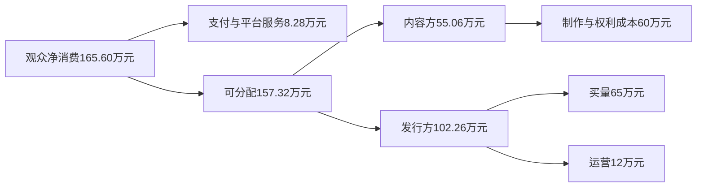

# 一组可复算的经营账：收入增长为何未必传到所有参与者

执行身份：原生协作 Agent `/root/microdrama_research`。本单元全部商业参数均为情景假设，不是行业均值、真实平台报价或收益承诺。计算脚本`scenario-model.py`，逐项结果`scenario-results.json`及`scenario-results.csv`，每日资金路径为`cashflow-*.csv`。人民币口径；利润均指扣除本模型列示成本后的项目贡献，未计所得税、融资成本和总部费用。

## 用同一笔外部支出追踪每一方收入

先看付费发行的一组假设。10万名有效获客用户，15%在观察期内消费，付费用户人均实际消耗120元；已消费金额按8%退款，支付与平台服务合计留取退款后消费的5%；余额的35%给内容方。发行方每名有效获客成本6.5元，另有12万元运营成本；制作及权利成本60万元。120元在此是已使用内容对应金额，未消费充值余额不计入收入。

公式为：

\[
D=N\times p\times S\times(1-r),\qquad R=D(1-f)
\]
\[
\Pi_{内容}=sR-B,\qquad \Pi_{发行}=(1-s)R-Nc-O
\]

其中D为退款后终端消费，R为扣渠道留取后的可分配款，B为制作及权利成本，c为每名有效获客成本，O为发行运营成本。N、p、S必须来自同一获客批次、同一观察期。

| 付费基准资金路径 | 金额（万元） | 收入或费用归属 |
|---|---:|---|
| 付费用户实际消耗 | 180.00 | 1.5万人×120元，非充值余额 |
| 退款 | -14.40 | 返还用户 |
| 外部净消费D | 165.60 | 行业终端需求只计这一次 |
| 支付及平台服务留取 | 8.28 | 渠道收入 |
| 内容方收入 | 55.06 | 35%×157.32万元 |
| 发行方可留取收入 | 102.26 | 65%×157.32万元 |
| 内容方制作及权利成本/项目贡献 | 60.00 / **-4.94** | 项目有人观看、发行方赚钱，片方仍可能亏损 |
| 发行方买量/运营/项目贡献 | 65.00 / 12.00 / **25.26** | 买量支付给流量渠道，是内部转移收入 |
| 内容加发行合计贡献 | **20.32** | 157.32−60−65−12 |

这个例子中，165.60万元、渠道8.28万元、片方55.06万元与买量65万元不能相加为市场规模。后面三项来自第一项的分配。计算内容与发行的合并贡献时，内部内容分账被抵销；买量和实际生产服务仍是项目支出。若进一步合并整个产业链，则需按研究边界继续抵销流量和生产环节内部收入。

## 免费模式把付费转化换成累计有效观看和广告价格

另设一组广告支持内容包的假设：100万名入组用户，在第0天全部有效激活；D1留存40%、D7为20%、D30为8%、D90为2%。各锚点间按指数曲线插值，观察第0—90日共91个自然日。每个有效活跃日提供12次广告机会，填充率85%，广告主侧每千次有效展示价格45元，广告网络留取15%；剩余收入的35%给内容方。获客成本1.8元/人，运营成本30万元，制作及权利成本60万元。

以上广告收入只归属本模型的内容包，广告主假设来自短剧产业链以外；未把其他内容产生的广告收入计给同一作品。两个基准的用户数和成本结构不同，其用途是解释机制，不构成对付费、免费的同条件优劣实验。

\[
L=\sum_{t=0}^{90}q_t,\quad I=N\times L\times a\times h,
\quad D=I\times e/1000,\quad R=D(1-f)
\]

q为该日活跃概率，L为每名初始用户累计活跃天数，a为每活跃日广告机会，h为填充率，e为广告主侧eCPM。后续利润分配公式与付费情景相同。基准L=8.553天，形成8723.72万次有效广告展示；广告主支出392.57万元，网络留取58.89万元，可分配333.68万元。内容方取得116.79万元，扣60万元成本后贡献56.79万元；经营者留216.89万元，扣180万元买量和30万元运营后贡献6.89万元；双方合计63.68万元。

广告支持模式的优势很清楚：不愿直接付费的人也能形成收入，跨日、跨剧使用可让一次获客产生多次展示。但经营者的利润对获客和广告价格很敏感。基准下其可承受的最高获客成本为1.869元/人，实际假设1.8元只有很薄余量；其他参数不变时，广告主侧eCPM需约43.57元才能让经营者达到盈亏平衡。规模扩大若同时抬高获客成本，仍可能使平台亏损，即使版权方按分成取得不错收入。

## 敏感性告诉各方该改什么

以下金额均为万元。除指定参数外，保持对应基准其他条件不变；“D7±5个百分点”同时将D30、D90按D7的40%、10%调整，表示整条后续留存曲线随之变化，D1保持40%。这不是把单个第7天当成全部价值。

| 情景 | 内容方贡献 | 发行/应用经营者贡献 | 双方合计 | 经营含义 |
|---|---:|---:|---:|---|
| 付费基准 | -4.94 | 25.26 | 20.32 | 整体赚钱，不代表各环节都赚钱 |
| 制作预算下降30%至42万元 | 13.06 | 25.26 | 38.32 | 真正节约制作资源，直接增加总盈余 |
| 制作预算增加30%至78万元 | -22.94 | 25.26 | 2.32 | 固定收入分成下，片方独自承担预算升级 |
| 获客成本增加20%至7.8元 | -4.94 | 12.26 | 7.32 | 发行利润被压缩，继续加价抢量空间变小 |
| 净消费转化从15%降至12% | -15.95 | 4.81 | -11.14 | 片方先受损，项目合计转负 |
| 转化升至18% | 6.07 | 45.71 | 51.78 | 内容、素材和支付链路改善可以同时受益 |
| 退款率升至15% | -9.13 | 17.48 | 8.35 | 充值或流水保持热闹，真实回款却减少 |
| 内容分成从35%升至40% | 2.93 | 17.39 | 20.32 | 重新分配同一盈余，并未创造新收入 |
| 免费基准 | 56.79 | 6.89 | 63.68 | 内容方较好，经营者利润薄 |
| 广告价格下降20%至36元 | 33.43 | -36.48 | -3.05 | 广告景气和填充质量直接影响项目总盈余 |
| 广告价格上升20%至54元 | 80.15 | 50.27 | 130.42 | 广告需求改善带来明显经营杠杆 |
| 获客成本增加20%至2.16元 | 56.79 | -29.11 | 27.68 | 收入增长仍可能伴随应用亏损 |
| D7降至15%，后续同比例下降 | 34.87 | -33.82 | 1.05 | 留存损失吃掉几乎全部合计盈余 |
| D7升至25%，后续同比例上升 | 78.47 | 47.15 | 125.62 | 复访和跨剧承接可以支撑更高买量报价 |
| 内容份额升至40% | 73.47 | -9.79 | 63.68 | 平台过度让利也会失去持续采购能力 |

付费基准中，发行方的最高可承受获客成本约9.03元，但内容方要在既定预算与分账下保本，净消费转化需要约16.35%。由此可见，发行商看到“投放仍有利润”时，制作方可能已无法用分账覆盖下一部作品。双方需要调整最低保证、预算或份额，单纯继续扩大播放不能自动解决分配失衡。

预算敏感性也有一个现实约束：这里把降本视作不损伤观看和转化的纯效率改善。若削减预算同时减少观众认可，必须联动重估收入。相反，增加制作投入应有可检验的转化、留存或授权溢价提升理由，不能只因作品被称为精品就默认收入同步增加。

## 两组联动情景防止只看单变量乐观结果

在免费情景里，把每天广告机会从12次提高到15次，表面库存增加25%；若D7从20%降至14%，D30和D90同比例下调，总广告主支出反降到380.02万元，经营者贡献约-0.04万元，基本盈亏平衡。相较基准，增加广告已失去原有6.89万元经营贡献。这个例子说明，广告密度的决策应依据整个批次的净回收，不能只依据首日单用户收入。

更不利但相容的联动是广告价格下降20%、获客成本上涨20%、D7降至15%。经营者亏105.05万元，内容方仍贡献15.89万元，双方合计亏89.16万元。版权分账方可能暂时感觉业务尚可，实际承担买量和运营的一方已经不可持续；未来可能通过减少采购、压价、缩短扶持或降低投放传导给内容方。经营者需要以这类组合检查现金承受力，而不是只为每个变量选择最好值。

## 保底、预付款和额外补贴会产生三种不同账

在免费基准的可分配收入333.68万元上，假设最低保证G=60万元，制作方份额s=35%，比较如下：

| 合作条款的经济定义 | 制作方总收入公式 | 基准：片方/经营者贡献（万元） | 广告eCPM降至20元时：片方/经营者贡献（万元） |
|---|---|---:|---:|
| 纯分账 | sR | 56.79 / 6.89 | -8.09 / -113.60 |
| 保底可从该项目应得分账回收，且不要求低收益时退还 | max(G,sR) | 56.79 / 6.89 | 0 / -121.70 |
| 不可抵扣的额外补贴加全部分账 | G+sR | 116.79 / -53.11 | 51.91 / -173.60 |

基准中分账已经高于保底，提前付60万元只改善制作方现金时点，不额外增加其最终收入。在收入不足的情景，最低保证将8.09万元损失转给经营者，前提是制作方确实满足交付条件、没有退还义务。不可抵扣补贴则在两种情景都把60万元从经营者转给制作方，不能写成行业新增消费。

若改为平台支付核定制作成本，再在扣获客、运营和制作成本后的正盈余中各分50%，基准63.68万元盈余会分为各31.84万元。制作方收到的总额91.84万元包括60万元成本回款，不可把91.84万元全称为利润。收入较差时平台承担约定风险；超支是否由平台承担仍取决于成本核定条款。这类合同与“保底加分账”的最大区别在于分配的基数和回收顺序。

## 混合模式要减去被会员替代的广告

在免费基准中，假设5万用户购买覆盖同一第0—90日窗口的免广告权益，一次价15元，扣5%服务费用后收到71.25万元，新增服务成本5万元。免广告用户占初始用户5%；他们被替代的广告收益必须从原情景扣除。

若这批用户原本广告价值等于全体平均，净增贡献约49.57万元；若他们原本贡献是平均的3倍，净增16.20万元；若是6倍，则反而减少33.85万元。这些是重新划分内容分账之前的增量项目贡献。对应的一次性免广告保本价约4.57元、11.59元、22.13元。

会员通常可能吸引高频观看者，平台不应假定购买者恰好等于平均用户。这个选择偏差与价格共同决定混合模式的结果。若免广告显著改善留存，还应补入新增观看的版权与会员长期价值；本例保持观看不变，隔离“替代广告”这一项。首发付费再转免费也应使用同样原则：增加的长尾广告或授权收入，扣除被提前免费替代的净消费和必要发行成本。

## 最终盈利与最大垫资需要两张表

现金演示约定：制作成本在上线前60天、前30天、上线日分别支付30%、50%、20%；获客费用在上线日支付；运营费用在第0—90日均匀支付。免费模式收入按留存曲线逐日产生；付费模式收入按前期集中的指数曲线分布，退款已从对应收入净额扣除。分账与经营者留取在约定延迟后同步收款，演示7、30、60日三种延迟。实际渠道的支付结算、广告结算和版权结算未必一致，读者可在脚本中分别修改时间表。

| 项目情景 | 延迟7日：最大合计垫资 | 延迟30日 | 延迟60日 | 最终合计贡献 |
|---|---:|---:|---:|---:|
| 付费基准 | 125.92万元 | 128.96万元 | 132.91万元 | 20.32万元 |
| 免费基准 | 242.31万元 | 249.89万元 | 259.78万元 | 63.68万元 |

延迟不改变未计融资费的最终贡献，却增加上线后的资金缺口。免费30日情景中，制作方最大需垫60万元，经营者最大需垫189.89万元；将两者相加得到249.89万元的项目资金峰值。平台若按制作里程碑预付最低保证，会把部分垫资从制作方转到平台；如果只承诺播后保底而不预付，拍摄期资金缺口仍在。

7日并非所有平台的统一条款。它与抖音小程序公开支付T+7规则具有现实参照，但版权方回款还取决于分账、审核、开票及合同约定；30/60日仅为演示假设。[抖音运营规范支付章节](https://partner.open-douyin.com/docs/resource/zh-CN/mini-app/operation/industry-norm/1/short-drama-app-operation)

本模型一次性投入获客费用，适合说明首轮内容与发行需要的资金准备；持续滚动买量、收入再投及多个项目并行，可能形成更大的余额需求。真实投资应以项目排期叠加现金流，并在停止投放后仍有退款和尾款义务时保留相应现金，不能仅凭最终ROI覆盖成本就认为无需融资。

## 爆款组合不能用榜单平均代替

再作一个纯示范的内容组合：失败、普通、爆款项目可分配收入分别为30万、100万、500万元，假设概率60%、30%、10%；版权制作方取得35%，每部制作成本60万元。平均可分配收入100万元，看似市场有规模，片方每部期望贡献却为-25万元。单个500万元爆款给片方175万元收入，也不足以证明同批所有项目赚钱。

在其余失败与普通项目比例保持2:1时，若只靠提高爆款概率来保本，需要约26.44%的项目达到500万元这一档；或者通过降低预算、提高适当保底、增加真实分账基数改善结果。这不是对行业爆款率的估计，而是说明必须知道完整项目分布。多个项目若同时押同一题材或依赖同一推荐规则，收益高度相关，增加项目数量也未必降低尾部损失。

## 这些计算如何改变选择

对平台，先看留存曲线和净广告价值能支持的最高获客成本，再确定内容分账与扶持预算。若基准已接近盈亏平衡，短期补贴退坡或广告密度提高应通过同批次净回收验证。对制作发行方，先确认自己在合同中的成本承担和最低回款，尤其避免在高制作预算下仅取得不覆盖成本的分账；有稳定IP和多渠道发行权时，再为长尾收入承担更多前期风险。对投资者，应同时要求完整项目分布、净回款归因和最大资金缺口。它们比播放量排名或单部最高分账，更能判断一项业务是否适合扩大投入。

