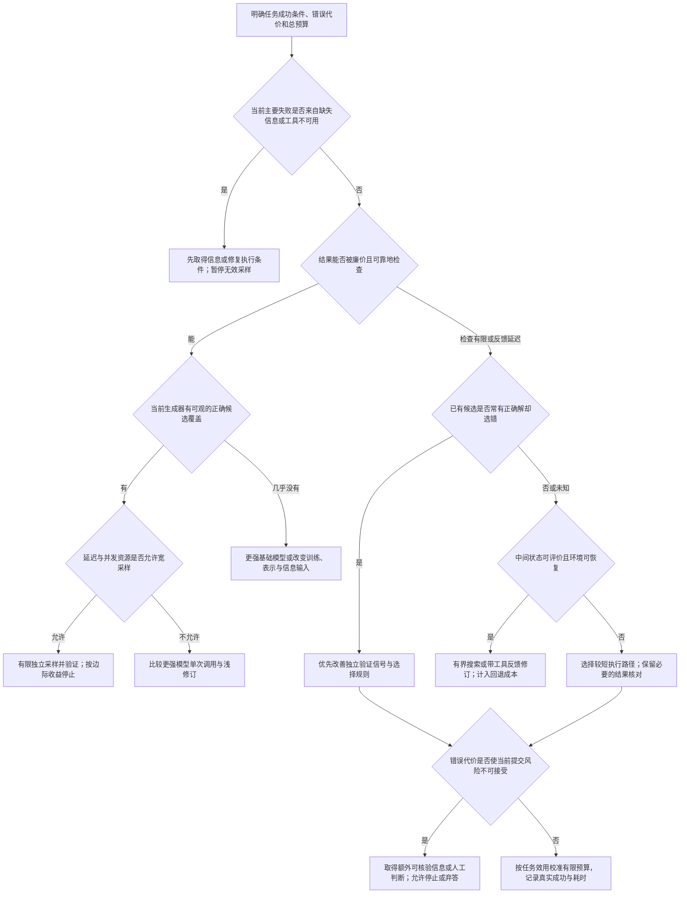

# 推理模型与 Agent 的推理时计算：把预算花在能够改变结果的环节

资料截止：2026 年 11 月 9 日。本文依据指定的 20 份冻结文献原件，使用其中明确的论文、模型与评测版本；不将文献中的结果当作本研究的独立复现。

增加推理计算最有用的条件，是模型已经有机会提出正确解，并且系统有足够可靠的依据识别它，或者能从反馈中改变下一次尝试。数学、程序合成和代码修复都给出了正面结果，但这些结果分属不同环节：有的提高了候选中出现正确解的机会，有的改善了选择，有的依靠专门训练使修订成为有效操作。对多步骤 Agent，还必须把正确决定落实成正确的环境状态。任何一个环节不成立，继续增加 token、候选或工具调用都可能只增加费用。

对设计者最有用的起点，是同时记录三个指标。**候选覆盖率**回答“尝试若干次，是否至少出现一个正确解”；**提交成功率**回答“系统实际选出的答案是否正确”；**执行可靠性**回答“交给用户或环境的整项任务，是否满足结果和过程约束”。Large Language Monkeys 将前两者明确区分；CodeMonkeys 又把代码库上下文、候选生成和最终选择拆开。tau-bench 的终态检查进一步显示，即使数据库结果正确，过程中未取得必要确认仍可能违反任务政策。这使一个高覆盖率系统距离可靠交付仍有实质差距。[Large Language Monkeys，§2、§4](https://arxiv.org/html/2407.21787v2)；[CodeMonkeys，§2](https://arxiv.org/html/2501.14723v1)；[tau-bench，§3](https://arxiv.org/html/2406.12045v1)

若第 x 道题的单次成功概率为 pₓ，在该题上独立重复采样 k 次，候选覆盖率是 1−(1−pₓ)ᵏ，而每次都成功的概率是 pₓᵏ。跨题指标应分别平均这两个量。把所有题的平均成功率代入公式，会掩盖难题集中失败的情况；例如不能把全数据平均准确率直接当作每道题的 pₓ。tau-bench 用 pass^k 表示 k 次都成功，与通常的 pass@k 至少一次成功正好回答不同问题。重复采样可以同时提高发现率、暴露不稳定性，这在逻辑上并不矛盾。

## 一、先固定比较对象，再选择扩展机制

“固定模型”至少要说明生成模型权重、提示和解码分布、验证器及可见信息是否固定。用同一生成器增加样本，只改变推理策略；给生成器补充长推理监督、训练过程验证器，再把新系统与原始模型相比，则同时改变了训练和推理。第三种情况是在测试题到达后更新权重，它发生在推理阶段，却仍包含训练运算。三者均可有价值，但不能用一条“更多思考带来提升”的曲线抹平区别。

自一致性论文使用固定模型与少样本提示，不做微调，适合观察采样和聚合的作用。Snell 等人的预算分配研究先对 PaLM 2-S* 训练修订能力或验证能力，再在相应固定系统内比较推理预算；s1 先在 Qwen2.5-32B-Instruct 上用精选的 1,000 个带推理轨迹样本做监督微调，再干预停止时机。SCoRe 则专门用多轮强化学习训练自纠错。把这些训练前提带入比较，才能知道上线时仅调整预算即可获得什么，以及需要先改变模型才能获得什么。[Self-Consistency，§3.1](https://arxiv.org/html/2203.11171v4)；[Scaling LLM Test-Time Compute Optimally，§4–6](https://arxiv.org/html/2408.03314v1)；[s1，§2–4](https://arxiv.org/html/2501.19393v2)；[SCoRe，§5](https://arxiv.org/html/2409.12917v1)

下表按系统实际执行的动作比较机制。过程验证器不一定等于逐步判定数学真假：它也可能预测“从这个前缀继续生成，最终答对的概率”。两种训练目标不同，分数的解释和聚合方法也会不同。

| 机制 | 谁生成，保留什么 | 筛选、淘汰与评价器可见信息 | 训练前提与容易漏算的成本 |
|---|---|---|---|
| 独立采样 | 同一或多个生成器各自产生完整候选；候选互不看到彼此 | 采样本身不完成选择；oracle pass@N 用标准答案事后判断是否存在正确候选 | 可固定权重；所有候选，包括最终丢弃者都耗费生成和上下文处理 |
| 自一致性 | 固定模型生成不同推理路径，提取可比较的最终答案 | 选择出现最多的答案；只需答案计数，无须知道真值；错误答案若最常见也会获胜 | 不必训练新模型；归一化和解析规则决定哪些答案被视为相同；代码可按测试输入上的输出聚类 |
| best-of-N | 先生成 N 个完整解并保存，结果评价器逐一打分 | 普通形式取最高分；也可把同答案的分数相加后选择；评价器通常见问题与完整候选 | 若使用新训练的 ORM/PRM，要单列训练；每个候选的评分调用、评分输出及最终选择均计费 |
| 顺序修订 | 后一轮看到前一轮或有限历史，可保留多个版本 | 根据批评、运行反馈或自评修改；最终版本不一定最好，需要停止或版本选择 | 需要有效纠错能力或有信息量的外部反馈；串行依赖、增长的输入历史、对正确答案的破坏都不能省略 |
| 中间状态搜索 | 生成器提出下一步；控制器保留 frontier、路径和已完成候选 | beam/BFS 留高分前缀，DFS/best-first 可回退；评价器见当前前缀、任务与已有环境观察 | 前缀评价、被剪枝分支、向前模拟、状态复制或重放均有成本；错误剪枝会移除唯一正确路线 |
| 结果验证与过程反馈 | ORM 评价完整结果；PRM 评价步骤；生成式 critic 还输出解释 | 检查器可见测试及执行结果；模型评价器通常无标准答案；训练时有标准答案不代表部署时仍有 | 有些 PRM 一次前向即可为全部步骤评分，有些 critic 每步生成长文本，调用数和 token 代价差异很大 |
| 自适应分配与停止 | 控制器观察当前共识、置信、进展或题目特征 | 决定是否继续采样、加深、换策略或结束；在线规则只能使用当时已获得的信息 | 估计难度、提取信号和校准控制器也消耗计算；用事后正确率选停止点只给上界 |
| 工具型 Agent 循环 | 模型决定工具参数，环境返回新观察，系统维护任务状态 | 可在局部执行后修订，也可在可恢复环境内搜索；工具成功返回不等于任务成功 | 环境准备、执行、超时、重试、恢复及用户等待共同决定成本和耗时 |

这些机制能够组合，但增加组件应有具体收益。Tree of Thoughts 在 24 点中把状态写成剩余数字和中间算式，生成可选运算后，由模型将状态分为 sure、maybe、impossible，再保留候选。这种表示让早期无解分支可以被淘汰；如果只对一整段答案反复“再想想”，就没有同样的可操作搜索状态。其 GPT-4 实验在选定的 100 道较难 24 点题上，从 CoT 的 4.0% 提升到宽度为 5 的 ToT 的 74%；CoT 的 100 次采样 oracle 覆盖率为 49%。这些数字说明合适的状态分解有价值，但节点数不等于总 token、价值调用或执行时间，不能据此宣称任何任务上搜索都更便宜。[Tree of Thoughts，§3、§4.1](https://arxiv.org/html/2305.10601v2)

评价器能看到什么信息，是贯穿全部方法的边界。能执行隐藏测试的离线评测器、能读取标准答案的诊断模型、只看到题目和候选的部署评价器，解决的不是同一个难度的问题。报告中若只写“使用验证器”，设计者无法判断它能否上线。综述所整理的标量判别、自然语言批评、过程和结果监督，适合做机制分类；实际收益仍需返回各项研究的模型、任务和可见信息。[A Survey of Test-time Compute，§4.1](https://aclanthology.org/2026.cl-3.10.pdf)

## 二、数学推理的收益，受生成分布和选择能力共同约束

独立采样的直接收益来自探索。只要正确路线在生成分布中占有非零概率，多抽几次就可能遇见它。自一致性进一步假设，不同正确推理往往收敛到同一个答案，而错误推理分散到不同答案。因此它可以不依赖标准答案，利用答案频次选出结果。2023 年 v4 的 Self-Consistency 在少样本设置中，每次独立采样 40 个输出、重复 10 次，与同提示的贪心 CoT 比较；论文报告在多个算术任务和模型上均有提升。这是固定模型的有效推理策略证据，但其有效条件并不是“随机多次就一定更可靠”，而是正确答案能够成为聚合规则偏好的答案。[Self-Consistency，§2、§3](https://arxiv.org/html/2203.11171v4)

如果一个模型反复把同一条件理解错，独立随机采样仍可能独立地产生相同的错误答案。这里应区分两种相关性：一是随机过程本身相互依赖，例如多条轨迹共享同一错误前缀；二是独立采样都来自偏向同一错误的分布。后一种情形即使满足统计独立，也不会被多数投票消除。Large Language Monkeys 在 MATH、GSM8K 的子集上，每题生成最多 10,000 个候选，覆盖率继续增长并超过 95%，而多数投票、奖励模型选择、奖励加权投票在约 100 个样本附近趋于饱和。正确答案可能只占不足 1%，继续采样增加了找到它的机会，却没有改变它在投票中的少数地位。[Large Language Monkeys，§4.1](https://arxiv.org/html/2407.21787v2)

2026 年的 Inference Regimes 提供了更清晰的共享候选池比较。其 120 道竞赛数学题、20 个模型配置、每题 80 次采样的分析中，所有选择器重用同一候选池。Qwen3-30B-A3B-Thinking-2507 的单响应准确率为 75.56%，Pass@80 为 91.67%；80 个候选的答案相对多数选择为 78.33%，整段 log probability 选择为 77.50%，而按平均 token log probability 选最高者下降到 65.83%。由于候选没有变化，这个下降直接指向选择分数与正确性的失配，不能归因于“没有采到正确解”。知道标准答案的 CompassVerifier 达到 89.17%，但它仅是 reference-assisted 诊断，不能作为无答案部署时可获得的成绩。该结论在冻结的 v1 与 v2 中均出现；本文引用 v2 对 finite-bank 统计的明确说明。[Inference Regimes v2，§4.2、图5](https://arxiv.org/html/2608.04001v2)

这些结果解释了为什么加强验证器可能比加大候选池更有价值。Let's Verify Step by Step 固定每种规模的生成器，用奖励模型从候选中挑选答案。在其 500 题 MATH 留出集、每题 1,860 个候选设置下，过程监督 PRM 为 78.2%，结果监督 ORM 为 72.4%，多数投票为 69.6%。PRM 的逐步信息帮助定位错误发生在哪，而不只是知道整条答案失败。不过大规模 PRM 与 ORM 的训练数据大小、采集方式不同，不能把 5.8 个百分点全归于“过程标签”这一个变量。作者另做小模型控制实验：生成样本相同，仅改变监督形式，过程监督仍更好。这才是关于监督形式更直接的证据。[Let's Verify Step by Step，§2–4、图3–4](https://arxiv.org/html/2305.20050v1)

过程分数也不能自动免于投机。Snell 等人在 PaLM 2-S* 上发现，直接使用 GPT-4 生成的 PRM800K 数据训练出的过程评价器容易被利用，因而改用该模型的逐步 Monte Carlo rollout 成功率作为监督。这种 PRM 预测的是当前策略下的后续成功价值，论文最后采用末步分数聚合；它与逐步正确概率相乘的 PRM 用法不同。在较小生成预算下，beam search 优于 best-of-N；预算增大后优势缩小，有时反而更差，向前模拟搜索也因额外模拟开销而表现不佳。作者观察到重复、低信息步骤和过短解答等利用 PRM 的行为。更强搜索会把评价器的真实偏好放大，也会把错误偏好放大。[Scaling LLM Test-Time Compute Optimally，§5](https://arxiv.org/html/2408.03314v1)

难度分层使这一取舍更具体。在上述 500 道 MATH 题中，容易题的 beam search 随预算增大出现退化，中等难度题更能从搜索获益，最难一组所有方法都进展有限。经过训练的修订模型则在容易题上更适合顺序修改，在更难题上通常需要混合独立探索与顺序修改。原因是容易题的初稿更可能已走在正确路线上；难题需要先找到不同的高层解法，持续修改同一条失败路线的价值较低。这是该模型、验证器和任务上的解释，不是按人类难度标签自动路由的普遍规则。

该研究用每题 2,048 次样本估计模型特定难度，并在五组难度内用交叉验证选择策略；模型预测难度用验证器平均分替代真值成功率。论文报告的约 2–4 倍生成预算效率提升表明自适应分配的潜力，但主实验没有计入全部前置难度估计成本。部署中需要一个足够便宜的在线难度信号，或复用已经产生的候选，同时把探索成本纳入总账。因此“比 best-of-N 少四倍生成”不能直接换算成“总费用减少四分之三”。[同一研究，§3.2、§5.3、§6.2、§8](https://arxiv.org/html/2408.03314v1)

### 长思考与修订，为什么既有正证也有反证

s1 通过 budget forcing 控制思考结束：到达上限时插入结束思考的分隔符，需要延长时抑制结束并添加“Wait”。在固定 s1-32B 模型上，这种干预在 AIME24 把表现从约 50% 提高到约 57%，之后趋平；更激进的步骤提示还会撞上上下文长度，512 步设置下 30 道题中有 12 道超出窗口。这说明“增加可用推理长度”与“模型实际把它用于有效推理”应分开。其长度拒绝采样还呈现反向趋势：只保留符合长度范围的样本，会改变被观察到的样本分布，较长样本可能本来就对应更多错误和回退。必须把被拒绝样本计入成本，不能用保留下来的 token 数代替整个采样过程。[s1，§3、§5.2、§6.2](https://arxiv.org/html/2501.19393v2)

训练会决定模型能否有效使用这些长度。s1 的训练序列长度消融显示，4,096 token 设置截断了 74% 的训练样本，而 32,768 设置不截断；前者在 AIME24 的输出更长、成绩更低。因果解释在于训练时学没学到“推理之后输出答案”的完整行为，不能把长轨迹天然解释成更强能力。与此同时，1,000 个样本是此次新增监督量，不是该模型所有学习成本；底座预训练、指令微调、教师生成和数据筛选都已在前面发生。[s1，附录C.1](https://arxiv.org/html/2501.19393v2)

“再检查一次”也不是通用纠错器。Large Language Models Cannot Self-Correct Reasoning Yet 在其指定版本的 GPT、Llama-2 和多种提示上，去掉用标准答案控制停止的 oracle 后，内在自纠错使多项任务准确率下降。这一反证限制的是那些模型和流程；它并不证明经过专项训练的模型永远不能修订。SCoRe 用两阶段多轮强化学习抑制只复制第一答案的塌缩，并奖励错改对、惩罚对改错。在其 HumanEval 实验中，训练后的模型由第一轮 52.4% 提升到第二轮 64.6%，净增 12.2 个百分点；基座对应的增幅为 3.0 个百分点。这是训练改变了修订转移的证据，不能归功于只增加一次提示。[Cannot Self-Correct，§3](https://arxiv.org/html/2310.01798v2)；[SCoRe，§5–6、表4](https://arxiv.org/html/2409.12917v1)

停止同样需要可用信号。Termination and Test-Time Compute Pareto Frontier 对六个模型、四组任务逐步截断已有推理轨迹，在每个位置生成 16 次答案探针。它把终止问题转成可观察的比较：同一条轨迹保留不同长度后，答案表现如何变化，继续思考是否带来改善。在这些有限探针构成的测量空间内，动态提前结束的离线 oracle 经验前沿达到全思考端点平均准确率，需要 14.2% 的归一化预算上限。这个数字来自事后最优动作选择，且排除了信号提取成本，不能直接换算为在线节省。跨位置择优也会选中随机高估的位置；原文将探针数由 16 降到 4 时，测得的冗余和准确率下降均增大。因此，经验前沿与现有方法的差距提出了值得检验的停止问题，“能用当时可见、低成本的信号学会更早停止”仍是假设，需要在未参与选择的题目和独立答案探针上验证。[Termination，§3–5、附录B.2](https://arxiv.org/html/2610.13570v1)

When More Thinking Hurts 也报告强制延长后准确率先升后降，但其具体数值应降权使用：表2将翻转数定义为从当前阈值到 16K 的累计事件，却出现阈值提高、负向事件数从 31 增到 83 的情况；同一 7K 显著性检验在附录E正文与表5分别写为 0.038 和 0.014。冻结文本没有足够原始记录解释这些差异。因此本文不采用其“7K 为转折点”或精确 p 值作为停止阈值；过度优化和正确答案被改坏的判断，主要依据前述可清楚定位机制的研究。[When More Thinking Hurts，表2、附录E](https://aclanthology.org/2026.findings-acl.1199.pdf)

| 研究与固定条件 | 报告的扩展行为 | 对预算决策的有效含义 | 不能据此推出 |
|---|---|---|---|
| Self-Consistency v4；固定权重和提示，40 样本、10 次重复 | 多项算术与常识任务优于贪心 CoT | 共识有质量时，宽采样有实际选择收益 | 共识概率等于正确概率 |
| Snell 等 v1；经专门训练的 PaLM 2-S* 系统，MATH 500 | 小预算搜索较强；容易题高预算可退化；中难题收益不同 | 同一个预算应按模型特定难度分配 | 省下的生成预算等于省下的全成本 |
| s1 v2；固定 s1-32B | 延长在部分区间有效，随后趋平，超窗口会损失性能 | 控制停止与长度上限有用 | 任意原始底座只加“Wait”就能获得同样能力 |
| PRM800K 研究 v1；固定生成池 | 1,860 候选时 PRM 78.2%、ORM 72.4% | 选择能力可以限制并释放已有候选价值 | 大规模组差异完全由单一监督变量造成 |
| Large Language Monkeys v2；固定模型重复采样 | 覆盖继续增，部分选择器约百样本饱和 | 先看选择损失，再决定扩宽 | 覆盖率就是实际交付成功率 |
| Inference Regimes v2；共享候选池 | 平均 token log probability 选择随池扩大而退化 | 需要校准的是实际选择规则 | 有标准答案的诊断成绩能直接上线 |
| Termination v1；冻结轨迹与每位置 16 次答案探针 | 有限测量空间内，更细粒度 oracle 停止具有更好经验前沿 | 用于比较在线停止策略，检验低成本信号 | 经验差距已证明可学习，或等于已部署节省 |

最后一个边界是近期的 Test-Time Self-Play。它在共享冻结 Qwen3-8B 底座上更新两个 LoRA adapter，由出题者生成与目标题相关的合成题，执行参考程序生成测试，再以 GRPO 更新求解者和出题者。目标题验证器没有进入训练，不代表系统没有验证信号：合成题执行仍是奖励来源，测试时也实际进行参数更新。其 HardLCBv6 只保留基础模型 mean@512 介于 0 与 0.7 的 28 道题；较困难、基础成功率不超过约 0.1 的组几乎没有改善。报告的 filtered mean@8 是通过当前验证器者中的真正确率，空集合还使用历史 checkpoint 值承接；它不是普通单次提交成功率。该研究为“缺少目标验证时，通过合成任务适应”的可能性提供了证据，但不足以证明固定模型在完全无反馈的开放任务上也能靠更多计算持续提高。[Test-Time Self-Play v1，§4–6、附录A.5](https://arxiv.org/html/2611.07367v1)

## 三、代码和工具任务，把验证收益与执行代价同时放大

代码的优势是能运行。语法错误、异常、输出不符通常可以转成具体反馈，模型下一轮能够据此修改。形式证明的检查器更能严格判定给定形式化命题的证明；一般程序测试只覆盖有限输入，不能等同于程序在所有条件下正确。验证能力是一条连续变化的条件，不能只按“代码可验证、自然语言不可验证”二分。

Large Language Monkeys 在 SWE-bench Lite 中用 DeepSeek-Coder-V2-Instruct 和 Moatless Tools，对每道题独立运行最多 250 条完整工具轨迹，把覆盖率从 15.9% 提高到 56%。这里一个 sample 是整次仓库操作轨迹，费用中不能只计最后一段补丁。论文同时发现 11.3% 的题有不稳定测试套件；部分补丁只在某次幸运运行中通过。对 CodeContests，它在提供 Python3 正确解的 122 题中，发现 35 题的已知正确解仍会被对应测试拒绝，涉及多种合法输出或违反题面约束的测试输入。这些观察说明，增加尝试既可能发现正确实现，也可能发现测试漏洞或偶然通过的实现。[Large Language Monkeys，§2.1、§4.2](https://arxiv.org/html/2407.21787v2)

Inference Scaling Flaws 使用 HumanEval、MBPP 的原测试筛选，再用 HumanEval+、MBPP+ 的扩展测试衡量筛选后的质量。较弱模型更容易产生“通过有限测试却未通过扩展测试”的候选；如果它在通过验证条件下的正确率仍低于强模型单次正确率，继续对同一弱模型和验证器重采样就无法越过这个上界。这个结论限定于固定采样分布和固定不完美检查器，并不排除改进测试、换模型、加入反馈或改变选择规则。扩展测试本身也不是形式化真值，只是比原测试更强的测量。[Inference Scaling Flaws，§3](https://arxiv.org/html/2411.17501v1)

错误后果会进一步改变最优预算。上述研究对正确解赋予收益 1，对错误通过赋予不同负效用，把 200 候选的顺序随机重排 1,000 次。在其若干模型和成本收益比设置中，即便忽略计算费用，较低的采样上限更好；错误成本为收益四倍的图示设置中，最优次数不超过 5。容易题很快找到正确解后，剩下的难题更可能由假阳性结束。这里应迁移的是“把错交成本纳入目标”的原则，具体次数不能照搬到新任务。[Inference Scaling Flaws，§4](https://arxiv.org/html/2411.17501v1)

### CodeMonkeys：覆盖、修订与选择是三笔不同的投入

CodeMonkeys 的主要系统使用 claude-3-5-sonnet-20241022，先由 Qwen2.5-Coder-32B-Instruct 扫描代码文件，再共享筛出的上下文。每题运行 10 对测试和编辑状态机，每个状态机最多 8 次模型完成。初始生成、格式错误修正均占迭代上限。测试状态机先在未修改仓库中复现问题，编辑状态机随后同时调整补丁和测试，在修改前后执行它们。这个安排使顺序计算获得具体反馈，也避免仅靠模型宣称“已经修好”。[CodeMonkeys，§2.1–2.2](https://arxiv.org/html/2501.14723v1)

两类计算的贡献并不相同。前几次顺序迭代改善明显，此后某些同成本的宽度、深度组合具有相近覆盖率；但它们选出最终补丁的难度不同。宽采样带来更多独立起点，也需要更强选择器。单条长轨迹避免多候选选择，却可能提前错误地批准自己的补丁，此时继续提高最大迭代数不会让它自动恢复。增加实际反馈步骤、提高迭代上限和增加独立重启，不能混作同一种“更深”。

最完整配置的候选覆盖率为 69.8%，随机选择的预期成功率为 45.8%。系统把 10 个生成测试与 10 个补丁交叉执行，先保留通过测试最多的三个补丁，再让选择状态机编写区分测试，观察各补丁和原始仓库的运行结果，选择最终补丁，得到 57.4%。选择阶段仅占论文模型费用的 5.8%，却决定了已有候选能否转成提交成功。69.8% 与 57.4% 之间的 12.4 个百分点，是继续改善选择的具体空间；它不保证花钱训练任何评价器都会填平这个空间。[CodeMonkeys，§2.3、表1–2](https://arxiv.org/html/2501.14723v1)

这项系统也揭示了有效验证的上限。生成补丁和生成测试可能共享同一个误解；一个测试“修改前失败、修改后成功”，仍可能只证明模型自己设想的行为改变。CodeMonkeys 报告的主设置未使用仓库原有回归测试作为选择信号，且共享检索上下文有 7.4% 的题未包含官方解修改的全部文件。后一个 recall 指标又不排除其他合法修法。因此，当失败来自缺失上下文时，加候选未必是最有效投入；当候选已正确但挑错时，改善区分测试更直接。[CodeMonkeys，§2.1、§3](https://arxiv.org/html/2501.14723v1)

### 网页搜索可以回退，真实业务动作未必可以

Tree Search for Language Model Agents 将状态定义为到达网页所需的动作序列，在 frontier 中选择高分状态继续探索。GPT-4o 评价器看到任务、轨迹截图、既往动作和当前 URL，估计当前状态是否成功或朝成功前进；它看不到隐藏数据库真值。每次下一动作提案生成 20 个输出，按频率取前 b 个动作，价值函数也采样 20 条判断再平均。默认深度 5、分支 5、搜索预算 20，主任务执行上限为 5 个动作。这样的“5 步 Agent”背后包含许多没有提交到主路径的提案、评价和环境运行。[Tree Search for Language Model Agents，§3–4](https://arxiv.org/html/2407.01476v1)

在相同 GPT-4o、相同 5 动作限制的 WebArena 组内，搜索把成功率从 15.0% 提高到 19.2%；VisualWebArena 表2的 GPT-4o+SoM 为 18.9% 到 26.4%。后者正文另写 18.6%，本文采用表2并保留这个小型报告差异，不把相对增幅当作精确统一指标。Llama-3-70B-Instruct 的 7.6% 到 16.7% 还引入了更强的 GPT-4o 价值函数，因此属于异构系统增强，不是仅增加同一模型计算的纯比较。

这些结果建立在可重置的确定性仿真网页上。回退时系统重置环境并重放动作，普通浏览器后退不能保证还原滚动位置、输入文本和数据库状态；重放本身也产生开销。论文直接指出，购买等不可逆动作难以回退，真实部署必须限制这类搜索扩展。由此可以提出一个有条件的设计策略：在可克隆仓库、沙箱或只读网页中探索候选，将真实状态更改留到选定动作之后；如果没有可信模拟或恢复机制，减少执行路径、提高提交前判断质量，可能比在真实环境中扩展搜索更合适。这是从研究条件推导的设计建议，尚不是文献证明的生产收益。[同一研究，§5.4](https://arxiv.org/html/2407.01476v1)

### 多轮业务可靠性不能靠“至少一次成功”代替

tau-bench v1 的零售和航空任务让 Agent 同时与 API 和模拟用户互动。数据库转换由确定性函数实现，用户回应带随机性，政策中有的规则在 API 中强制检查，有的必须由模型理解后遵守。终态数据库和必要回复信息共同决定奖励，但论文指出奖励为 1 仍可能遗漏过程违规。这比数学最终答案多了至少两个故障源：信息在对话过程中才揭示，动作又会改变之后的可行选择。[tau-bench，§3](https://arxiv.org/html/2406.12045v1)

其 function-calling GPT-4o 在零售、航空的单次成功率分别为 61.2%、35.2%，两领域等权平均 48.2%。零售上八次都成功的 pass^8 低于 25%。这不是说一次部署需要执行八次，而是衡量同一语义任务在不同对话变化下的稳定程度。其错误案例包括遗漏复合请求、参数填错、没有遵守只能一次性提交全部换货商品的规则。最后一种错误已经改变环境可行性，增加后续语言推理未必能够恢复。论文还报告，给 function-calling Agent 增加一个 think 函数没有提升；更多显式思考步骤本身不是充分条件。[tau-bench，§5](https://arxiv.org/html/2406.12045v1)

作为说明性数学关系，若 20 个必须全部正确的动作彼此独立、每步正确率均为 98%，整条不可修复链的成功率只有约 66.8%；每步为 99.5% 时约为 90.5%。真实 Agent 的错误通常不独立，还可能恢复，所以这不是 tau-bench 的拟合。它说明的是，增加动作数量会增加必须同时满足的条件。对含糊结果、延迟反馈或不可逆操作，预算更应支持获得缺失信息、执行前核对约束和可靠的最终结果检查，而非无条件延长行动链。

这些材料对“数学收益能否迁移”给出分层回答：代码执行反馈和可重置网页有直接正证，开放写作也有 ToT 的有限偏好评测；但写作研究只是 100 个约束写作输入，人工比较由部分作者承担，偏好不是客观成功检查。冻结材料没有覆盖真实生产中长期、含糊、多参与方且反馈延迟的 Agent 任务，也没有证明数学的预算扩展曲线在此继续成立。可迁移的是候选、评价、控制和状态管理的设计问题，不能直接迁移收益倍数。[Tree of Thoughts，§4.2](https://arxiv.org/html/2305.10601v2)

## 四、建立能用于部署的预算账本

候选数量是最方便的横轴，也最容易误导。一次数学回答、一次带长隐藏思考的 API 调用、一次仓库修复轨迹都可以被称为“一次尝试”，但它们消耗的资源差异巨大。成本至少应按实际调用分解：

\[
C_{\mathrm{task}}=C_{\mathrm{context}}+\sum_{i\in G}C_{\mathrm{gen},i}+\sum_{j\in V}C_{\mathrm{verify},j}+C_{\mathrm{control}}+\sum_{k\in E}C_{\mathrm{tool},k}+C_{\mathrm{retry}}+C_{\mathrm{restore}}.
\]

G 包含保留和丢弃的完整候选、搜索前缀与 lookahead；V 包含所有过程评分、结果评分和额外批评；E 包含最终主路径之外，为探索、测试、对比而执行的操作。串行修订还要计算前文被再次作为输入的费用；有缓存时，命中、写入和未命中分别用实际价格计算。丢弃某条分支并不会退回已经花掉的计算，终稿长度也不是任务成本。

| 要比较的量 | 建议记录的单位 | 关键边界 |
|---|---|---|
| 总计算 | 分模型的输入/输出/推理 token、前向次数；可取得时用 FLOPs、设备秒或能耗 | token 仅在相同模型和相近配置内近似可比；规模、MoE 活跃参数、上下文、缓存与实现会改变每 token 代价 |
| 货币成本 | 各调用实际账单、环境和工具费，另列训练/适应费用 | 论文历史价格不是当前报价；租用服务器费用和 API token 费用也不能直接混算 |
| 串行延迟 | 单条依赖链的生成、评价、工具与恢复时间 | 深度和反馈轮数决定不可并行部分；加 GPU 不能消除必须等待前一步结果的依赖 |
| 并行资源 | 同时运行轨迹/模型/环境的数量、峰值显存、吞吐 | 更多候选可能降低等待，也可能触发排队和限流；并行不代表没有额外总计算 |
| 端到端耗时 | 从任务开始到可用结果的墙钟时间与分位数 | 包括环境启动、工具等待、重试、选择和提交；平均生成速率不足以预测尾延迟 |

隐藏推理 token 只有在服务明确披露或计费接口提供时才能纳入数字换算；未披露时应标为未知，不能当成零。跨模型研究若仅披露候选数或可见输出 token，就应保留分组结果，而不是硬凑统一“每千 token 能力”。Snell 等人的预训练与推理 FLOPs 对换采用训练约 6ND、推理约 2ND 的近似，并固定训练数据量、改变参数规模。它还依赖整个生命周期中推理 token 与训练 token 的比率：服务量大时，强模型每次推理的额外成本会重复发生；低服务量时，额外预训练的摊销不同。这类分析对模型研发投资有意义，却不是已采购两个 API 时的单题报价比较。[Scaling LLM Test-Time Compute Optimally，§7](https://arxiv.org/html/2408.03314v1)

冻结研究中，能直接复用的成本也有明确范围。CodeMonkeys 表1报告整个 SWE-bench Verified 运行的模型费用 2,291.90 美元，其中生成测试 439.99、生成编辑 1,366.02、选择 131.95 美元，另有检索和排序。它表明测试与选择是实付的一部分，也显示共享上下文和缓存的重要性；这张表不能替代工具容器、重放和端到端耗时的完整核算。s1 图7未包含奖励模型计算，Termination 的 token 指标不包含信号提取，Inference Regimes 的候选数量横轴不包含验证器；这些结果应按各自口径比较。[CodeMonkeys，表1](https://arxiv.org/html/2501.14723v1)；[s1，图7](https://arxiv.org/html/2501.19393v2)；[Termination，§5.1](https://arxiv.org/html/2610.13570v1)；[Inference Regimes v1，图6](https://arxiv.org/html/2608.04001v1)

### 一个实际运行的预算分配算例

以下全部数字是**明确假设**，不对应任何供应商现价或某模型实测。目的在于让“更多采样、改善验证、换强模型、加修订”进入同一预算式。代码已用 Python 实际运行；这是公式计算，不是模型性能实验。

设单题预算为 0.10 美元，最多 8 个独立流水线槽。便宜生成器每次输入 800 token、输出 1,200 token，其中假设 900 为显式推理、300 为答案；输入和输出价格分别为每百万 0.5、2 美元，单候选生成费为 0.0028 美元。验证器每候选输入 2,000 token、输出 200 token，价格分别为每百万 1、3 美元，费用 0.0026 美元。每次工具运行耗时 2 秒、收费 0.0004 美元，10% 会恰好重试一次，所以期望费用为 0.00044 美元、耗时 2.2 秒。p 表示经过这一工具处理后候选的最终正确率；重试只在此算例中改变费用，不能再次当作独立准确率提升。

本例假设环境已经就绪，没有额外启动费用，不进行状态搜索，所以恢复费用为零；一次工具重试直接重放同一调用，不重新生成参数。简单计数控制的费用记为零。若实际任务需要环境启动、难度估计或状态恢复，这些项目须加入预算，表中的候选数应随之减少。

便宜生成器的 p 假设为 0.25。弱验证器对正确解通过率 t=0.95，对错误解误放率 f=0.10。候选及其判断在给定任务条件下相互独立；系统从通过者中均匀选一个，无通过者就弃答。令 a=pt、s=pt+(1−p)f，则

\[
P_{\mathrm{correct}}(N)=\frac{a}{s}[1-(1-s)^N],\quad
P_{\mathrm{wrong}}(N)=\frac{(1-p)f}{s}[1-(1-s)^N],\quad
P_{\mathrm{abstain}}(N)=(1-s)^N.
\]

这是 Sample, Mix, or Verify? 对该选择规则的单生成器公式。它与取评分最高者的 argmax 不同；后者受到高分尾部的正确率支配，可能出现不同的退化形状。此处成功率随 N 上升，却收敛到通过者精度 a/s=76%，而非 100%。这不是所有 best-of-N 的普遍上界，而是明确的生成分布、验证误差和选择规则共同给出的上界。[Sample, Mix, or Verify?，§3](https://arxiv.org/html/2610.23255v1)

比较另外三种分配：更强验证器费用和耗时为原来的两倍、t 不变而 f=0.01；更强生成器的生成费用四倍、p=0.55；两轮修订的第一轮 p 不单独用于最终选择，第二轮得到的最终候选 p=0.40，每条链两次生成和工具运行、最后验证一次，第二轮输入包含前次输出而升至 2,000 token。p=0.40 特别假设系统已经具备有效纠错能力，不能解释成任何模型加一轮提示都会改善。

| 方案 | 最终候选数 | 生成 / 验证 / 工具费用，美元 | 总费用 | 候选覆盖率 | 正确提交 / 错误提交 / 弃答 | 假设墙钟耗时 |
|---|---:|---|---:|---:|---|---:|
| 便宜生成器＋弱验证器 | 17 | 0.04760 / 0.04420 / 0.00748 | 0.09928 | 99.25% | 75.87% / 23.96% / 0.17% | 81.6 秒 |
| 便宜生成器＋更强验证器 | 11 | 0.03080 / 0.05720 / 0.00484 | 0.09284 | 95.78% | 92.53% / 2.92% / 4.54% | 61.4 秒 |
| 更强生成器＋弱验证器 | 7 | 0.07840 / 0.01820 / 0.00308 | 0.09968 | 99.63% | 91.81% / 7.91% / 0.28% | 37.2 秒 |
| 两轮修订＋弱验证器 | 10 | 0.06200 / 0.02600 / 0.00880 | 0.09680 | 99.40% | 86.10% / 13.60% / 0.30% | 104.2 秒 |

这些费用没有漏掉未选中的候选。第一行共生成 20,400 输出 token、读取 13,600 生成输入 token，验证器另读取 34,000、生成 3,400 token，并期望运行工具 18.7 次。即使最后成功选出一个答案，另 16 个完整候选的 19,200 token 仍已发生；若全部被拒绝，所有生成费用都保留。修订行共生成 24,000 输出 token，读取 28,000 生成输入 token，另有 20,000 验证输入和 2,000 验证输出，期望工具调用 22 次。只有最后 10 个版本参与选择，并不使前 10 次生成免费。

耗时采用可复算的简化波次模型。便宜生成耗时假设为 1.5 秒前置处理加 1,200/60 秒生成，验证为 1 秒加 200/80 秒；更强生成器速率假设为 40 token/秒。每槽顺序完成生成、工具和验证，一波全部结束后再开始下一波，不计算排队和跨波重叠。17 个候选需要三波，11 个需要两波，7 个只需一波，所以强生成方案虽然单次更慢，总等待仍较短。修订的两个生成步骤存在依赖，10 条链需要两波，墙钟更长。这里的工具耗时使用平均重试服务量，81.6 秒等数字不是 P95 保证；真实系统应记录实际调度和尾延迟。

算例给出两个可以直接检查的停止信号。第一，弱验证器从 16 扩到 32 个候选，正确提交率只从约 75.81% 增到 76.00%，几乎已经碰到验证精度上限；再增加候选主要支出费用。第二，若正确提交收益为 1、错误提交损失为 4、弃答为 0，第一行的结果效用为 −0.200，强验证方案约为 0.808，强生成方案约为 0.602，两轮修订约为 0.317，尚未扣除计算费用。这一损失比也是假设，但说明错误后果足以改变选择，甚至使停止尝试优于继续。

相关性会改变上表。17 个完全独立、p=0.25 的候选覆盖率约为 99.25%；如果它们其实是同一随机答案的复制，覆盖率仍只有 25%。真实多样性位于何处必须测量，不能用候选计数代替。重复调用验证器同样不能默认独立：一个具有稳定盲点的判断器可能多次放过同一错误。Sample, Mix, or Verify? 用候选级误判倾向建模，并指出重新验证是否提高大样本精度，要看误放率与真通过率的比值是否下降，而不仅是调用数增加；其规划器又依赖代表性的带标签 pilot。研究中部分价格是参数量与 token 的代理，测试执行设为零，延迟按加法处理，均不足以直接替代生产报价和并发调度。[Sample, Mix, or Verify?，§3–4、§7](https://arxiv.org/html/2610.23255v1)

自适应停止可以减少已经没有决策价值的抽样。Adaptive-Consistency 用当前前两名答案计数构造 Beta 近似，在认为众数足够稳定时停止；其数学任务汇总准确率从 73.2% 到 73.1%，平均生成数由 40 降至 13.8。这里的高置信度是“众数稳定”，并非“答案正确”；对于稳定的错误多数，它也会更早停止。代码任务还必须先定义程序输出如何聚合，不能直接比较程序字符串。部署时可把这类规则作为节省共识成本的工具，再用不同的信号处理正确性。[Adaptive-Consistency，§3–4、表1](https://aclanthology.org/2023.emnlp-main.761.pdf)

## 五、从任务条件选择预算，而非先选一种扩展方法

以下决策树是本文根据前述证据提出的设计策略。它不是某篇论文已经验证的完整生产系统；每条分支都对应一个会改变计算用途的条件。

第一步应使用实际失败来决定优先项。若代码候选大多缺少关键文件，改善检索比对同一片段生成更多补丁更直接；若正确补丁已在候选池里而系统常常挑错，先改选择。CodeMonkeys 的上下文漏失、69.8% 覆盖与 57.4% 提交之间的差距提供了这种诊断方法。对于数学，把有限预算分给多条独立路线还是一条修订链，应在固定模型与评价器内比较；Snell 等人的难度分层支持这种选择，却不支持跨模型沿用相同分层阈值。

第二步才考虑更强基础模型。它的价值不只在单次准确率更高，也可能在较少产生能够骗过弱测试的错误、理解更多约束、减少工具参数错误。Inference Scaling Flaws 的代码结果与 tau-bench 的模型差异给出了对应证据。但把更大参数量当作唯一标准也不充分：解码接口、后训练、代码知识和验证器都可能随模型一起变化。设计时应比较“强模型的实际提交结果”与“弱模型加完整选择链的实际结果”，并保留价格、延迟和误交风险，而不是用弱模型 oracle 覆盖率与强模型单次提交作直接优劣判断。

有可靠、便宜、可重复执行的检查器时，宽采样通常是值得先比较的简单基线。它易于并行，而且保留新的高层解法。如果检查器具有已知盲点，扩大样本会更频繁触及那些盲点；此时先扩展测试覆盖、补充独立信息，或选择更少产生假阳性的模型。反复询问同一个模型“你确定吗”只增加判断次数，没有自动增加信息独立性。独立信息可以是另一项约束、一个真正区分候选的输入、可核对的环境终态，而不一定是另一个模型名字。

搜索适用于中间状态具有预测价值的任务。24 点的剩余数字、代码运行结果、可恢复网页观察都能引导后续选择；深搜索的必要性在于早期选择可能导致长期死路，并且评价器能在途中识别这一点。若当前评价器只会奖励某些语言形式，增加搜索深度反而更容易找到高分错误路径。此时改善评价器比增加 beam 更优先。对不可恢复的业务状态，搜索应发生在计划、候选或可信模拟层；实际执行路径尽量短，且每个增加的步骤都应提供后续行动所需的信息。

| 任务条件与观察 | 值得优先比较的方案 | 对应任务证据 | 改变选择的条件 |
|---|---|---|---|
| 答案可归一化，当前正确答案常为众数 | 少量独立采样＋自一致性；众数稳定时停止 | Self-Consistency；Adaptive-Consistency 的数学、常识与符号任务 | 错误答案稳定占多数，或答案无法可靠归并 |
| 生成池已有正确解，但最终选择差 | 更可靠结果/过程评价器或区分测试 | PRM800K 的 MATH；CodeMonkeys 的补丁选择 | 评价成本超过新增成功的价值，或评价器仍缺少所需信息 |
| 初稿接近正确，有具体错误反馈 | 有上限的顺序修订，保留可回退版本 | 经训练的 Snell 修订模型、SCoRe；CodeMonkeys 执行反馈 | 对改错率上升、停止已提前发生，或修订只重复原错误 |
| 早期分支决定后续成败，中间状态可评价 | 小宽度、受预算约束的状态搜索 | ToT 24 点；WebArena 搜索 | 验证分数开始被利用，回退代价高或状态不可恢复 |
| 单次覆盖极低，更多样本仍无法形成可用路线 | 更强模型、不同信息表示，或重新考虑训练 | Snell 最难组；TTSP VeryHardLCBv6；Pythia 在 CodeContests 的零覆盖观察 | 新模型或新表示确实提高可选候选的质量，而非只变长 |
| 用户在线、多步骤写操作、反馈延迟 | 强化关键判断、少走无价值步骤，核对最终状态 | tau-bench 的参数、政策与复合请求失败 | 可以获得可信模拟、可靠中间反馈并有足够等待预算 |
| 增加预算的成功增量小，或错误代价高 | 停止扩展；简单路径或弃答也作为候选方案 | 不完美验证研究的有限最优次数；停止研究的经验前沿 | 新的验证信号、真实任务分布或错误收益比发生变化 |

一个能落地的最小比较，是在目标工作负载的代表性题目上保留同一批候选，用可部署评价器与独立结果标准分别评分，观察“没生成出来”和“生成了却没选中”的比例，再比较两到三个预算档位的真实总费用与耗时。只有当这个诊断指向中间状态价值，才有理由增加搜索复杂度；只有出现工具失败，才增加对应恢复逻辑。校准集上的停止阈值应在不同题目上检查，不能看到最终答案后再为同一道题挑最佳预算。预算档位和阈值取决于实际延迟要求、错交代价与已有测量，冻结材料不足以给所有系统指定一个通用 N 或 token 上限。

## 六、证据能支持到哪里

本文较强的证据是固定生成器内的采样与选择对照、共享候选池的不同选择器比较、明确工具反馈的代码/网页实验，以及明确训练目标的纠错研究。它们共同支持的判断是：推理计算的价值取决于计算是否改变了可达候选、选择信息或执行状态。材料没有建立一个不依赖模型、验证器、任务分布和计费方式的普遍扩展定律。

使用这些结果还有四个具体限制。

* **污染和筛题会改变能力解释。** PRM800K 研究将原 MATH 测试集中的 4,500 题用于训练，单独保留 500 题评价，不能继续把整个原测试集当作完全未见。作者对 MathMix 做字符串去污染，但不能排除预训练中改写题目的重叠。s1 对新增训练集做 8-gram 去重，也不能证明底座和教师完全未见评测题。TTSP 的 28 题按基础模型成功率筛选，因此不能外推到全部 LiveCodeBench v6；较新数据集减少部分记忆风险，不自动消除所有筛选偏差。
* **评价器泄漏与离线 oracle 会放大看似可得的收益。** 知道参考答案的 CompassVerifier、Snell 的 oracle 难度分组、Termination 在有限探针下的最佳停止位置，分别用于诊断或相应测量空间的上界比较。部署时是否拥有同等信息必须单列。不能因为它们也叫“评价器”“自适应”就把结果并入在线策略排名。
* **不确定性单位不同，无法把所有曲线当成同等精确。** Self-Consistency 的重复采样变化、PRM 图中的候选子集变化、Inference Regimes 的题目 bootstrap、TTSP 的 90% 题目 bootstrap，反映的变异来源不同。Termination 的主 bootstrap 固定每位置 16 次探针的标签，只覆盖题目与轨迹重采样，未覆盖答案探针噪声及其对择优结果的影响。对同一有限候选池反复重采样，不能创造新的独立模型运行，也不能覆盖上线分布变化。没有置信区间的细小分差，不足以确定稳定优劣；主文未报告完整费用与尾延迟时，也不能推导成本显著性。
* **文本版本有局部不一致，不能自行补齐。** When More Thinking Hurts 的累计翻转与 p 值冲突已在前文说明；WebArena 搜索论文的 VWA 基线正文与表格有差异。Inference Regimes v2 的表1汇总 1,948,821 个响应，摘要与附录G所列公开重复采样尝试为 1,403,520，二者覆盖口径不同，本文不把前者写成同一种公开 attempt 总数。这些限制影响相应数字，不妨碍使用可定位的机制和组内结果。

实际决策的结束点，是新增计算已不能以可接受的成本改善用户最终收到的结果。对可验证代码，可以把预算投向更多不同实现或更强测试；对数学选择失配，可以把预算从采样移向验证；对交互业务，可能需要更强的单次判断、真实缺失信息或更短的动作链。计算上限是资源约束，是否继续计算则应由可交付收益决定。

## 文献与版本

以下为本报告使用的冻结版本。arXiv 日期按原件页首所载版本日期；期刊/会议论文按冻结文件标识。文中结果均归属于相应来源，未重新运行其模型实验。

| 文献 | 冻结版本或标识 | 主要用途 |
|---|---|---|
| [Scaling LLM Test-Time Compute Optimally can be More Effective than Scaling Model Parameters](https://arxiv.org/html/2408.03314v1) | v1，2024-08-06 | 难度分层、搜索/修订、训练与推理预算 |
| [s1: Simple test-time scaling](https://arxiv.org/html/2501.19393v2) | v2，2025-02-03 | 预算强制、训练数据与长度、饱和 |
| [Test-Time Scaling in Reasoning LLMs: Inference Regimes, Evaluation, and Reproducibility](https://arxiv.org/html/2608.04001v1) | v1，2026-08-04 | 候选池、验证信息与费用口径 |
| [同题 v2](https://arxiv.org/html/2608.04001v2) | v2，2026-08-31 | 共享候选池结果与发布口径澄清 |
| [A Survey of Test-time Compute: From Intuitive Inference to Deliberate Reasoning](https://aclanthology.org/2026.cl-3.10.pdf) | Computational Linguistics 2026，52(3)；冻结第1–55页文本 | 评价和反馈机制分类，非新增实验 |
| [Test-Time Self-Play: Scaling without a Verifier](https://arxiv.org/html/2611.07367v1) | v1，2026-11-05 | 测试时参数适应与合成执行反馈 |
| [When More Thinking Hurts](https://aclanthology.org/2026.findings-acl.1199.pdf) | Findings ACL 2026；冻结第1–11页文本 | 过度思考辅助反证及内部口径问题 |
| [Termination and test-time compute Pareto frontier](https://arxiv.org/html/2610.13570v1) | v1，2026-10-09 | oracle 停止前沿与在线实现边界 |
| [Sample, Mix, or Verify?](https://arxiv.org/html/2610.23255v1) | v1，2026-10-16 | 不完美验证公式、相关性与预算规划 |
| [Self-Consistency Improves Chain of Thought Reasoning in Language Models](https://arxiv.org/html/2203.11171v4) | v4，2023-03-07；初始编号2022 | 固定模型采样与答案聚合 |
| [Large Language Monkeys](https://arxiv.org/html/2407.21787v2) | v2，2024-09-16 | 大规模重采样、覆盖与选择差距、测试缺陷 |
| [Tree of Thoughts](https://arxiv.org/html/2305.10601v2) | v2，2023-12-03 | 状态分解、搜索与含糊结果的局部证据 |
| [Let's Verify Step by Step](https://arxiv.org/html/2305.20050v1) | v1，2023-05-31 | 过程/结果监督、固定生成器选择 |
| [Training Language Models to Self-Correct via Reinforcement Learning](https://arxiv.org/html/2409.12917v1) | v1，2024-09-19 | SCoRe 训练与多轮纠错 |
| [CodeMonkeys: Scaling Test-Time Compute for Software Engineering](https://arxiv.org/html/2501.14723v1) | v1，2025-01-24 | 代码状态机、测试、补丁选择与费用 |
| [tau-bench](https://arxiv.org/html/2406.12045v1) | v1，2024-06-17 | 工具、用户、政策、终态与重复可靠性 |
| [Inference Scaling Flaws: The Limits of LLM Resampling with Imperfect Verifiers](https://arxiv.org/html/2411.17501v1) | v1，2024-11-26 | 假阳性、弱模型上界与错交效用 |
| [Large Language Models Cannot Self-Correct Reasoning Yet](https://arxiv.org/html/2310.01798v2) | v2，2024-03-14 | 无 oracle 内在修订的反证 |
| [Let's Sample Step by Step: Adaptive-Consistency for Efficient Reasoning and Coding with LLMs](https://aclanthology.org/2023.emnlp-main.761.pdf) | EMNLP 2023 | 基于众数稳定性的自适应采样 |
| [Tree Search for Language Model Agents](https://arxiv.org/html/2407.01476v1) | v1，2024-07-01 | 网页状态搜索、价值调用与回退 |
